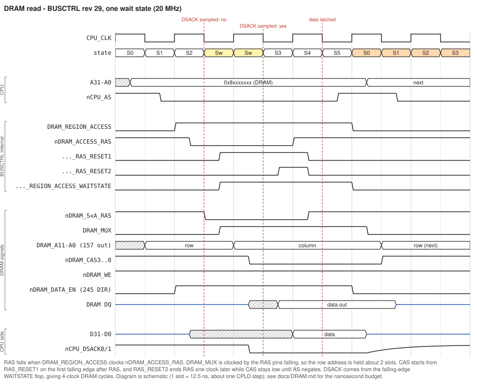
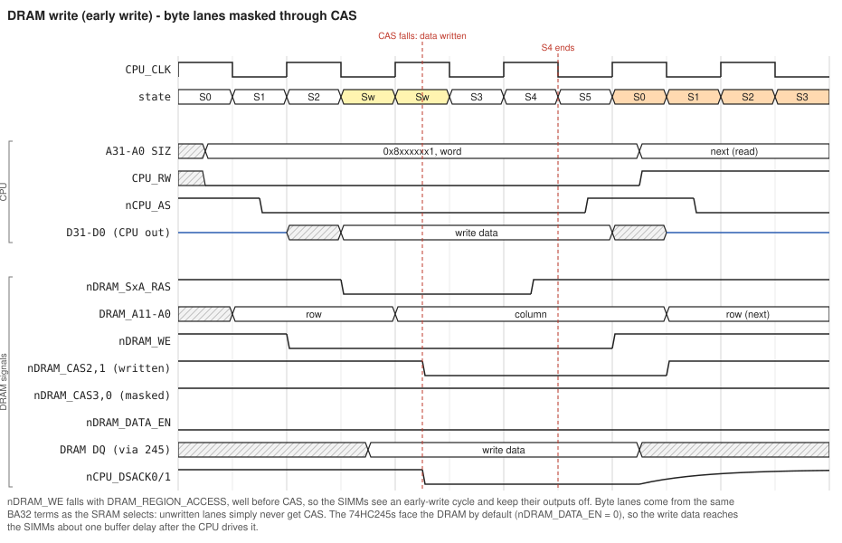
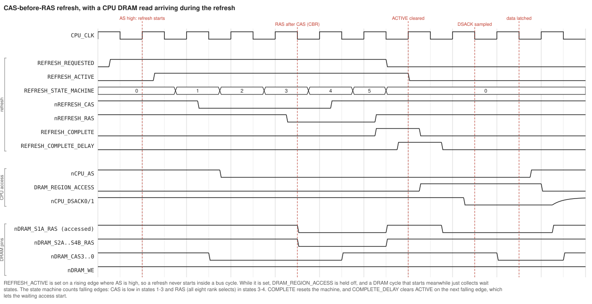

# Roscoe V2 - DRAM interface and refresh

The DRAM controller lives entirely in the bus-controller CPLD, BUSCTRL (U58). This document covers the hardware on schematic sheets 7 and 8, the address mapping, the access cycle, CAS-before-RAS refresh, timing margins and bring-up. It is written against `plds/BUSCTRLV2/BUSCTRL2.PLD` revision 29; see [TheoryOfOperations.md](TheoryOfOperations.md) for the rest of the system. **Status (October 2026):** DRAM works on the current boards. They run four 128 MB 60 ns SIMMs (all eight 64 MB ranks, 512 MB at 0x8000_0000-0x9FFF_FFFF) in the 64/128 MB build with J3 = 1-2 and one wait state, at 12 and 16 MHz. The README's "test DRAM" to-do predates this.

Timing is at a 20 MHz CPU clock unless stated otherwise. At the 12 and 16 MHz clocks the boards actually use, the margins in Section 3.3 are larger. DRAM parameters are taken from the TMS417400A data sheet in `datasheets/`, which is representative of the 4M x 4 parts on 16/32 MB SIMMs; -60 and -70 grades are shown.

## 1 Hardware

### 1.1 SIMM sockets (sheet 7)

There are four 72-pin SIMM sockets, U18-U21, silk-screened "BANK 1" to "BANK 4". Each socket can hold one or two ranks (sides):

| SIMM pin | Signal | Net |
|---|---|---|
| RAS0 (44), RAS2 (34) | rank A, low and high halves | `nDRAM_SnA_RAS` (n = socket) |
| RAS1 (45), RAS3 (33) | rank B | `nDRAM_SnB_RAS` |
| CAS0-CAS3 (40, 43, 41, 42) | byte lanes DQ7-0, 15-8, 23-16, 31-24 | `nDRAM_CAS0..3`, shared by all sockets |
| WE (47) | write enable | `nDRAM_WE`, shared |
| A0-A10, A11 (pin 29) | multiplexed address | `DRAM_A0..11`, shared |
| DQ (D1-D32 on the symbol) | data | `DRAM_D0..31`, shared |
| PD1-PD4 | presence detect | **not connected** |

There is no presence detect and no parity, so software has to size memory by probing (Section 6).

### 1.2 Address multiplexer (sheet 8)

U26, U27 and U28 are 74AHCT157 quad 2:1 multiplexers with OE grounded. Their select input is `DRAM_MUX` from BUSCTRL: 0 passes the row address (A inputs), 1 passes the column address (B inputs).

| DRAM pin | Row (MUX = 0) | Column (MUX = 1) |
|---|---|---|
| DRAM_A0 | **J3 centre pin**: A25 (J3 1-2) or A13 (J3 2-3) | A2 |
| DRAM_A1 | A14 | A3 |
| DRAM_A2 | A15 | A4 |
| DRAM_A3 | A16 | A5 |
| DRAM_A4 | A17 | A6 |
| DRAM_A5 | A18 | A7 |
| DRAM_A6 | A19 | A8 |
| DRAM_A7 | A20 | A9 |
| DRAM_A8 | A21 | A10 |
| DRAM_A9 | A22 | A11 |
| DRAM_A10 | A23 | A12 |
| DRAM_A11 | A24 | A13 |

Jumper J3 selects the row-address LSB. 1-2 (A25) is the setting for 64/128 MB SIMMs with 12-bit rows and columns; 2-3 (A13) is for 16/32 MB SIMMs with 11-bit rows and columns. **The jumper and the BUSCTRL build must agree** (Section 2).

### 1.3 Data transceivers (sheet 8)

U29-U32 are 245-type transceivers: the A side is `DRAM_D`, the B side `CPU_D`, and the mapping is one to one (U29 carries D7-D0, U32 carries D31-D24). Their `/OE` is grounded, so they are always enabled. `DIR` is driven by `nDRAM_DATA_EN`; despite the name, it is a direction control:

```
nDRAM_DATA_EN = DRAM_REGION_ACCESS & CPU_RW;   /* 1 only during DRAM reads: DRAM -> CPU */
```

At all other times the transceivers drive the CPU's data towards the DRAMs, so write data is always present on the SIMMs.

### 1.4 Loading

The address, CAS and WE nets are shared by every socket. With four double-sided SIMMs built from x4 chips, each address line and WE sees around 64 DRAM inputs (several hundred pF), and each CAS line about 16. The address lines are driven by 74AHCT157s, and WE and CAS straight from slow-slew CPLD pins. Expect slow edges with all sockets populated. **Check** RAS-to-address and CAS edges at the far socket with a scope before relying on the margins in Section 3.3.

## 2 Address map

DRAM occupies 0x8000_0000-0xFFFF_FFFF (`DRAM_REGION_ACCESS` = A31 & AS & not CPU space & not refreshing). BUSCTRL turns A31-A26 into one of eight RAS lines. The current build (rev 29, "64/128MB") gives each rank a 64 MB window:

| Rank | RAS net | Socket and side | Window (64/128 MB build, J3 = 1-2) | Window (16/32 MB build, J3 = 2-3) |
|---|---|---|---|---|
| 1A | `nDRAM_S1A_RAS` | BANK 1, side A | 0x8000_0000-0x83FF_FFFF | 0x8000_0000-0x80FF_FFFF |
| 2A | `nDRAM_S2A_RAS` | BANK 2, side A | 0x8400_0000-0x87FF_FFFF | 0x8100_0000-0x81FF_FFFF |
| 3A | `nDRAM_S3A_RAS` | BANK 3, side A | 0x8800_0000-0x8BFF_FFFF | 0x8200_0000-0x82FF_FFFF |
| 4A | `nDRAM_S4A_RAS` | BANK 4, side A | 0x8C00_0000-0x8FFF_FFFF | 0x8300_0000-0x83FF_FFFF |
| 1B | `nDRAM_S1B_RAS` | BANK 1, side B | 0x9000_0000-0x93FF_FFFF | 0x8400_0000-0x84FF_FFFF |
| 2B | `nDRAM_S2B_RAS` | BANK 2, side B | 0x9400_0000-0x97FF_FFFF | 0x8500_0000-0x85FF_FFFF |
| 3B | `nDRAM_S3B_RAS` | BANK 3, side B | 0x9800_0000-0x9BFF_FFFF | 0x8600_0000-0x86FF_FFFF |
| 4B | `nDRAM_S4B_RAS` | BANK 4, side B | 0x9C00_0000-0x9FFF_FFFF | 0x8700_0000-0x87FF_FFFF |

The 16/32 MB decode is the commented-out block in `BUSCTRL2.PLD` (it is active in `REV25_BUSCTRL2-1632.PLD`). A rank's memory is contiguous only when the SIMM's organisation matches the build:

* **64/128 MB build, J3 = 1-2:** row = A25, A24-A14 (12 bits); column = A13-A2 (12 bits); 64 MB per rank. Correct for SIMMs whose ranks are 16M x 32 (12/12 addressing).
* **16/32 MB build, J3 = 2-3:** row = A23-A13 (11 bits); column = A12-A2 (11 bits; DRAM_A11 unused); 16 MB per rank. Correct for 4M x 32 ranks (11/11 addressing).
* **Mismatches:** a 16 MB rank in the 64 MB build ignores A13 and A24. Its 16 MB appears four times inside the 64 MB window, interleaved in 8 KB pieces. Smaller SIMMs with 10-bit addressing (1M x 32 ranks, the 4 and 8 MB modules) never see A12 in either build, so they alias in 4 KB pieces.

Above 0x9FFF_FFFF, `DRAM_REGION_ACCESS` still acknowledges the cycle and asserts CAS, but no RAS falls: reads return floating data and writes vanish. The same happens for an empty rank, or side B of a single-sided SIMM.

## 3 The access cycle

### 3.1 Equations (BUSCTRL)

```
DRAM_REGION_ACCESS = !FC_CPU_SPACE & !nCPU_AS & CPU_A31 & !REFRESH_ACTIVE;

nDRAM_ACCESS_RAS.d  = 0;   .ck = DRAM_REGION_ACCESS;            .ap = DRAM_ACCESS_RAS_RESET2 # !nSYS_RESET;
DRAM_ACCESS_RAS_RESET1.d = 1;                  .ck = !CPU_CLK;  .ar = nDRAM_ACCESS_RAS # !nSYS_RESET;
DRAM_ACCESS_RAS_RESET2.d = ..._RESET1;         .ck = !CPU_CLK;  .ar = nDRAM_ACCESS_RAS # !nSYS_RESET;
nDRAM_ACCESS_CAS.d  = 0;   .ck = DRAM_ACCESS_RAS_RESET1;        .ap = !DRAM_REGION_ACCESS # !nSYS_RESET;
DRAM_ACCESS_MUX.d   = 1;   .ck = (any nDRAM_*_RAS pin low);     .ar = !DRAM_REGION_ACCESS # !nSYS_RESET;
DRAM_REGION_ACCESS_WAITSTATE.d = DRAM_REGION_ACCESS; .ck = !CPU_CLK; .ar = nCPU_AS # !nSYS_RESET;

nDRAM_SnX_RAS = (nDRAM_ACCESS_RAS # !(rank n,X selected by A31-A26)) & nREFRESH_RAS;
nDRAM_CASk    = (nDRAM_ACCESS_CAS # (!CPU_RW & !BA32_lane_k)) & nREFRESH_CAS;
nDRAM_WE      = !(DRAM_REGION_ACCESS & !CPU_RW);
DRAM_MUX      = DRAM_ACCESS_MUX;
```

CAS0 masks D7-D0 (`BA32_UH`), CAS1 D15-D8 (`BA32_UL`), CAS2 D23-D16 (`BA32_LH`) and CAS3 D31-D24 (`BA32_LL`). The `BA32_*` byte-lane terms are described in TheoryOfOperations Section 7.5.

### 3.2 Sequence

1. AS falls in S1, so `DRAM_REGION_ACCESS` rises (for a non-CPU-space, A31 = 1 cycle with no refresh in progress).
2. That edge clocks `nDRAM_ACCESS_RAS` low. The selected rank's RAS falls about one CPLD level later; the row address has been on DRAM_A since the address became valid.
3. The RAS pin falling clocks `DRAM_MUX` high, and the 157s switch to the column address. Clocking from the RAS *pins*, not the internal node, guarantees the row is held after RAS (tRAH).
4. On the first falling CPU_CLK edge after RAS (end of S2), `RAS_RESET1` sets. Its rising edge clocks `nDRAM_ACCESS_CAS` low, and the CAS lines fall: all four on reads, only the written lanes on writes.
5. The same falling edge also sets `DRAM_REGION_ACCESS_WAITSTATE`, which drives both DSACKs. The CPU missed DSACK at the end of S2, sees it one clock later, and latches data one clock after that: a **4-clock cycle with one wait state**.
6. On the second falling edge after RAS, `RAS_RESET2` presets `nDRAM_ACCESS_RAS`, so **RAS rises while CAS is still low**. FPM and EDO DRAMs keep driving data until CAS rises.
7. AS negates, `DRAM_REGION_ACCESS` falls, CAS and MUX return high or low, and the transceivers turn back towards the DRAM.

Writes are early writes: `nDRAM_WE` falls with `DRAM_REGION_ACCESS`, long before CAS, so the SIMM outputs stay off.





### 3.3 Timing budget at 20 MHz

These are worst-case CPU numbers (AS valid 25-45 ns into the cycle, address valid by 25 ns, write data by 75 ns) with a -10 CPLD with slow-slew outputs. They are estimates from the data-sheet maxima, with roughly 9 ns per internal level, 14 ns per pin, 8 ns for array-clocked flops, about 7 ns for the 74AHCT157 and up to about 20 ns for the 245. Board delays are ignored. Times are measured from the rising clock edge that starts S0.

| Event | Time (ns) |
|---|---|
| `DRAM_REGION_ACCESS` (internal) | 37-54 |
| RAS pin falls | 59-76 |
| `DRAM_MUX` pin, then column address out of the 157s | 73-90, then 80-98 |
| `RAS_RESET1` (falling edge at 75) | ~83 |
| CAS pins fall | ~105 |
| DSACK0/1 asserted (sampled at 125) | ~106 |
| RAS pin rises (`RAS_RESET2`, falling edge at 125) | ~147 |
| CPU latches data (falling edge 175, data needed by) | 171 |
| AS negates, CAS rises | 175-195, then 206-226 |

| Parameter | Need (-60 / -70) | Have | Margin |
|---|---|---|---|
| tRAS, RAS low | >= 60 / 70 | 71-88 | OK, tight for -70 |
| tRAH, row hold after RAS | >= 10 | ~20 | OK |
| tASC, column setup to CAS | >= 0 | 7-25 | OK |
| tRCD, RAS to CAS | >= 20 (max 45 / 52 only limits access) | 29-46 | OK |
| tRSH, CAS low to RAS high | >= 15 / 18 | ~42 | OK |
| tCSH, RAS low to CAS high | >= 60 / 70 | > 120 | OK |
| Read data valid at CPU (RAS + tRAC, CAS + tCAC, column + tAA, + 245) | by 171 | ~158 / 168 | about 13 / 3 ns |
| tWCS, WE setup to CAS (early write) | >= 0 | ~50 | OK |
| tDS, write data setup to CAS | >= 0 | ~10-20 | OK |
| tDH, write data hold after CAS falls | >= 10 / 15 | > 60 | OK |
| tRP, RAS precharge between CPU cycles | >= 40 / 50 | > 110 | OK |

At the end of a read, the transceivers turn back towards the DRAM about one CPLD delay after AS negates. The SIMMs keep driving until CAS has been high for tOFF (up to 15/18 ns). That leaves roughly 15-35 ns of overlap on the DRAM-side data lines, harmless but avoidable by holding `DIR` until CAS is high.

### 3.4 Higher clock speeds

RAS width is set by two falling edges, not by nanoseconds, so it shrinks with the clock:

| CPU clock | Approximate RAS low (worst-case AS) | -60 tRAS 60 | Refresh RAS (2 clocks) |
|---|---|---|---|
| 20 MHz | 71-88 ns | OK | 100 ns, OK |
| 25 MHz | ~53-63 ns | marginal | 80 ns, OK |
| 33 MHz | ~40 ns | **fails** | 60 ns, marginal |
| 40 MHz | ~30 ns | **fails** | 50 ns, **fails** |

At 33 MHz the RAS node also barely beats the falling edge at the end of S2. Above about 20-25 MHz, add a RAS-hold stage (a third `RAS_RESETn` flop) and one more wait state, and stretch the refresh RAS by one state.

## 4 Refresh

The SIMM DRAMs need 2048 rows refreshed every 32 ms (4096 / 64 ms for 4K-refresh parts): one row every 15.6 us on average. Roscoe uses **CAS-before-RAS (CBR)** refresh. The DRAMs keep their own row counter, and one CBR cycle refreshes a row in **all eight ranks at once**, because every RAS line falls together.

### 4.1 Refresh timer

```
CPU_CLK -> /2 -> /4 -> /8 (CPU_CLK_div8) -> 5-bit counter REFRESH_TIMER0..4
REFRESH_TIMER_RESET.d = (count == 15), clocked on the falling edge of div8, clears the counter
REFRESH_REQUESTED is set by the rising edge of REFRESH_TIMER_RESET, cleared by REFRESH_COMPLETE
```

The counter runs 0 to 15 and is then held at 0 for one div8 period, so a request is raised every **16 x 8 = 128 CPU clocks**:

| CPU clock | Refresh interval | Versus the 15.6 us requirement |
|---|---|---|
| 12 MHz | 10.7 us | OK |
| 16 MHz | 8.0 us | OK |
| 20 MHz | 6.4 us | OK, about 2.4 times more often than needed |
| 25 MHz | 5.1 us | OK |
| 33 MHz | 3.9 us | OK |
| 40 MHz | 3.2 us | OK |

The table in the source comment ("CPU/16 ... 15 = 15 us at 16 MHz") describes an older div16 version. With div16 the interval would have been 16 us at 16 MHz, just over the limit.

### 4.2 Arbitration

```
REFRESH_ACTIVE.d  = (REFRESH_REQUESTED & nCPU_AS) # REFRESH_ACTIVE;   .ck = CPU_CLK (rising);
REFRESH_ACTIVE.ar = !nSYS_RESET # REFRESH_COMPLETE_DELAY;
```

A pending request becomes active on a **rising** edge where AS is high. In a stream of back-to-back cycles that is the rising edge that starts S0, before the next AS. A refresh therefore never cuts into a DRAM cycle. While `REFRESH_ACTIVE` is set, `DRAM_REGION_ACCESS` is held low, so a DRAM cycle that starts during refresh gets no RAS and no DSACK. The CPU just inserts wait states, and the access starts as soon as refresh finishes. Non-DRAM cycles (SRAM, flash, devices) run normally during a refresh.

### 4.3 CBR sequence

A 3-bit counter, `REFRESH_STATE_MACHINE`, counts falling CPU_CLK edges while `REFRESH_ACTIVE` is set. `nREFRESH_CAS` and `nREFRESH_RAS` are registered on rising edges:

| State | nREFRESH_CAS | nREFRESH_RAS | Notes |
|---|---|---|---|
| 0 | high | high | held while not active |
| 1 | low | high | CAS falls first (CBR) |
| 2 | low | high | |
| 3 | low | low | all eight RAS lines fall |
| 4 | high | low | CAS rises (tCHR satisfied) |
| 5 | high | high | RAS rises; `REFRESH_COMPLETE` sets on the next rising edge |

`REFRESH_COMPLETE` resets the state machine and `REFRESH_REQUESTED`. `REFRESH_COMPLETE_DELAY`, one falling edge later, clears `REFRESH_ACTIVE`, so a waiting access starts at the same phase as a normal one. `nDRAM_WE` stays high throughout. That matters: CBR with WE low enters the DRAM's test mode.

At 20 MHz:

| Parameter | Value | Requirement |
|---|---|---|
| CAS low | 150 ns | |
| RAS low (tRAS) | 100 ns | >= 60 / 70 |
| tCSR (CAS-to-RAS setup) | 100 ns | >= 5 |
| tCHR (CAS hold after RAS) | 50 ns | >= 10 |
| RAS precharge before a held-off access starts | about 60-75 ns | tRP 40 / 50 |

A refresh takes the DRAM for about 6-7 clocks out of every 128, under 5% of DRAM bandwidth, and only when the CPU actually wants DRAM during that window.



### 4.4 Power-up

DRAMs need about 200 us after power is stable, plus at least eight refresh cycles, before the first access. The refresh timer starts as soon as `nSYS_RESET` releases (eight refreshes take about 51 us at 20 MHz), so the boot code only needs to wait **at least 200 us after reset** before touching 0x8000_0000.

## 5 Checklist for a new board or a new SIMM type

1. **Watch refresh first, with no SIMMs fitted.** Logic header U5 carries `nDRAM_S*_RAS`, `nDRAM_CAS0..3`, `nDRAM_WE`, `nDRAM_DATA_EN` and `DRAM_MUX`. J29 carries `REFRESH_REQUESTED`, `REFRESH_ACTIVE` and `REFRESH_COMPLETE` (pins 1-3). Confirm the request interval of 128 clocks and the CAS/RAS order above.
2. **Fit one single-sided SIMM in BANK 1** that matches the build: 16 or 32 MB with J3 = 2-3 and the 1632 JED, or 64 or 128 MB with J3 = 1-2 and rev 29.
3. **Memory tests:**
   * walking ones and zeros on all 32 data bits (catches lane swaps);
   * address-in-address over the rank (catches aliasing and mux mistakes);
   * byte and word writes at every offset (exercises the CAS masking);
   * a long soak with a delay loop that lets refresh do its job.
4. **Probe the far socket** with an analog scope (RAS, CAS, WE, A0) to see the real edge rates once more SIMMs are fitted (Section 1.4).
5. **Size memory in software** (no presence detect): write a distinct value at the start of every rank window and at power-of-two offsets inside it, then read everything back to find each rank's size and spot aliasing.

## 6 Possible improvements

* **Page-mode burst fills.** The 68030 can burst-fill a cache line from any STERM-terminated 32-bit port. A DRAM version keeps RAS low, toggles CAS four times while counting A3:A2, and returns STERM and CBACK, so a 4-clock read could become roughly 4-2-2-2. The A3:A2 counter needed for the SRAM burst ([SRAMBurstProposal.md](SRAMBurstProposal.md)) would feed the column mux instead (DRAM_A0/A1 come from CPU A2/A3).
* **Clock-independent RAS timing** (Section 3.4), if the board is to run above about 20-25 MHz.
* **Hold the transceiver direction until CAS rises,** to remove the end-of-read overlap.
* **Refresh interval:** comparing against 31 instead of 15 at 20 MHz would halve the refresh overhead and still give 12.8 us. Keep a margin, and remember the interval scales with the clock.
* **Bus error above 0x9FFF_FFFF and for empty ranks** (instead of returning garbage), which helps memory-sizing code.
