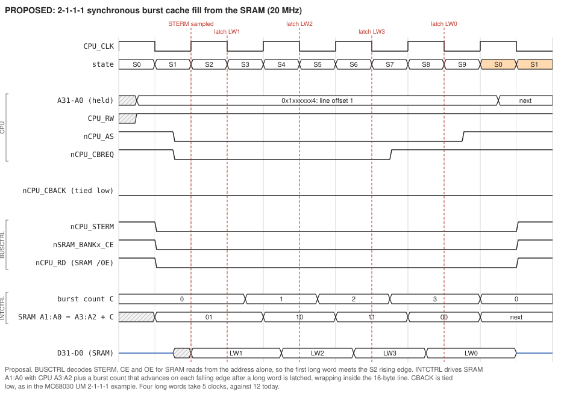
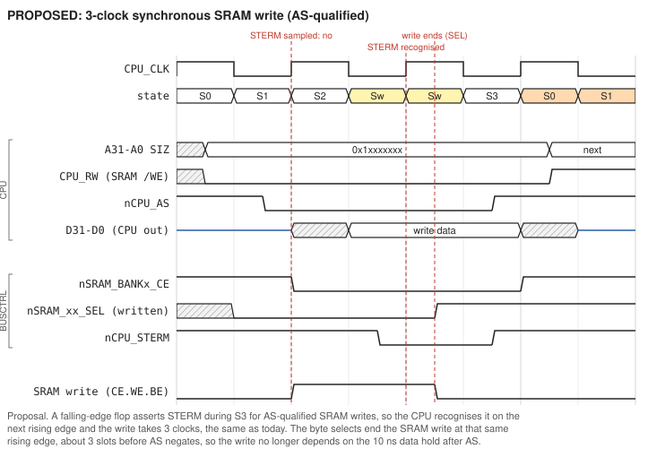

# Proposal: synchronous and burst SRAM cycles

**Status: proposal only, nothing here is implemented or tested.** This document works out what it would take to run Roscoe's 4 MB SRAM (eight IS61C25616AL-12 on the riser) with the MC68030's synchronous bus cycles and 2-1-1-1 burst cache fills, instead of today's asynchronous DSACK cycles. Background is in [TheoryOfOperations.md](TheoryOfOperations.md), Sections 4 and 7.

## Summary

| | Today | Proposed |
|---|---|---|
| Single long-word read | 3 clocks (async, DSACK) | **2 clocks** (STERM) |
| Cache line fill (4 long words) | 4 x 3 = 12 clocks | **5 clocks** (2-1-1-1 burst) |
| Write | 3 clocks, ended by CE rising after AS | 3 clocks, ended by a registered strobe before AS negates |

The 12 ns SRAM is not the limit; the CPLD paths are. On paper, 2-1-1-1 works at 20 MHz with the current -10 parts and at 25 MHz with -7 parts and fast slew on the critical outputs. At 33 MHz it is marginal, so 3-1-1-1 or 2-2-2-2 is the safer target there.

The work splits into two steps:

1. **2-clock synchronous reads and 3-clock synchronous writes.** BUSCTRL equations only, no rework.
2. **Burst fills.** CBACK must be asserted, and the SRAM's two lowest address inputs must come from a counter instead of straight from CPU A3:A2. That takes two wires and one jumper on the board.

## 1 How the 68030 does it

From the MC68030 User's Manual, sections 7.3.4 (synchronous read), 7.3.7 (burst) and 12.5.2-12.5.3 (Motorola's own 2-1-1-1 and 3-1-1-1 SRAM designs), and the data sheet's AC tables:

* **STERM** terminates a cycle synchronously. The CPU samples it on **rising** clock edges while AS is asserted, with setup #60 and hold #61 (4/12 ns at 20 MHz, 2/8 ns at 25 MHz). If STERM is seen at the start of S2, data is latched on the **falling** edge at the end of S2 (setup #27, hold #30 = 12 ns at 20 MHz). The cycle is then 2 clocks long. Each extra clock without STERM adds a wait state. Only 32-bit ports may use STERM, and STERM must never be asserted together with DSACK.
* **Burst.** When a cache miss can fill a whole line (instruction or data cache enabled, `IBE`/`DBE` set in CACR, all four entries of the line invalid), the CPU asserts **CBREQ** in S1. If **CBACK** is asserted when STERM is recognised, the CPU keeps AS, the address, SIZ and FC unchanged and takes another long word on every clock that STERM is asserted, up to four.
* **The CPU does not increment the address during a burst.** A3:A2 stay at the first long word, and the memory must step through the line itself, wrapping modulo 4. A fill that starts at offset 1 reads 1, 2, 3, 0.
* CBREQ negates after STERM is recognised for the third long word. CIIN or BERR abort the burst. CBACK is ignored during DSACK cycles. If the only memory that uses STERM can burst, **CBACK may simply be grounded** (UM 12.5.2).
* CACR bits: EI 0, FI 1, CEI 2, CI 3, **IBE 4**, ED 8, FD 9, CED 10, CD 11, **DBE 12**, WA 13.

## 2 What the board has today

| Requirement | Today | Change needed |
|---|---|---|
| `nCPU_STERM` to the CPU | BUSCTRL pin 45, driven constantly high | equations only |
| SRAM `/CE` early enough for a 2-clock read | `nSRAM_BANKn_CE` includes AS, ready about AS + 14 ns | decode reads from the address alone |
| SRAM `/OE` early enough | `nCPU_RD`, registered, asserts at S3 | assert immediately for SRAM reads |
| `/CBACK` | **not connected (floating)** | tie low for burst (high until then) |
| `/CBREQ` | not connected | not needed: the burst simply ends when AS negates |
| SRAM A1:A0 = burst address | hard-wired to CPU A3:A2 through riser pins A18/B18 | drive from a counter (two wires) |
| Free CPLD pins | BUSCTRL: 80/80 I/O used, but TESTP0-3 on J29 are free to reuse. INTCTRL: 46/80 used, TESTP0-2 on J27. Spare inter-CPLD nets `EXTRA_BC_INT1/2` and `EXTRA_BC_DM1/2`. | see Section 4 |

BUSCTRL does **not** have CPU A2/A3 as inputs; it only sees A31-A16 and A1-A0. INTCTRL does: it has A3-A0, CPU_CLK and a spare net from BUSCTRL. That is why Section 4 puts the burst counter in INTCTRL.

## 3 Timing budget

Assumptions: worst-case 68030 timing (address valid #6 = 25/20/14 ns at 20/25/33 MHz), CPLD maximum delays, no board delay, IS61C25616AL-12 (tAA = tACE = 12, tDOE = 6, tOHA = 3). Delays per CPLD level are -10 with slow slew: 14 ns to a pin, about 8 ns for a flop to its internal node; -7 with fast slew: 9.5 ns and about 6 ns. All times are measured from the rising edge that starts S0.

**First long word** (STERM sampled at the rising edge of S2; data latched at the following falling edge):

| | 20 MHz, -10 slow | 25 MHz, -10 slow | 25 MHz, -7 fast | 33 MHz, -7 fast |
|---|---|---|---|---|
| Address valid (#6) | 25 | 20 | 20 | 14 |
| STERM, CE, OE and SRAM address out of the CPLD | 39 | 34 | 29.5 | 23.5 |
| STERM deadline (rising edge - #60) | 46 | 38 | 38 | 28 |
| STERM margin | 7 | 4 | 8.5 | 4.5 |
| SRAM data valid (+12) | 51 | 46 | 41.5 | 35.5 |
| Data deadline (falling edge - #27) | 71 | 58 | 58 | 44 |
| Data margin | 20 | 12 | 16.5 | 8.5 |

**Later long words** (counter steps on the falling edge that latched the previous word):

| | 20 MHz, -10 slow | 25 MHz, -10 slow | 25 MHz, -7 fast | 33 MHz, -7 fast |
|---|---|---|---|---|
| Latch edge of previous word | 75 | 60 | 60 | 45 |
| Counter, then new SRAM address at the pin | 83, 97 | 68, 82 | 66, 75.5 | 51, 60.5 |
| New data valid (+12) | 109 | 94 | 87.5 | 72.5 |
| Deadline (next falling edge - #27) | 121 | 98 | 98 | 74 |
| Margin | 12 | 4 | 10.5 | 1.5 |

**Hold of the previous word.** The 68030 wants data held #30 after the latch edge: 12 ns at 20 MHz, 8 at 25, 6 at 33. The address changes no sooner than the counter's clock-to-output plus the output delay, and the SRAM then holds old data another tOHA = 3 ns. The ATF1508 data sheet specifies no minimum delays, so this cannot be proven on paper. It is exactly how Motorola's own 2-1-1-1 example (74F191 counters) works. Measure it, and if it is short, add a few ns with fast-slew off on those two outputs (they are not otherwise critical).

**Writes** (3 clocks): a falling-edge flop at the end of S2 (75 ns) asserts STERM at about 84 ns, and the CPU recognises it at the 100 ns rising edge. A rising-edge flop on that same edge ends the SRAM write through the byte selects at about 109 ns. Write data has been valid since 75 ns (#23), so tSD is about 34 ns against 6 needed. The write pulse is about 50 ns against 9, and the data is still held by the CPU until AS negates (125 ns or later).

## 4 Proposed implementation

### 4.1 Board changes

1. **SRAM address A1:A0 (two wires).** On the riser, cut the traces from connector pins **A18** (CPU_A2) and **B18** (CPU_A3) to the SRAMs' A0 (pin 44) and A1 (pin 43). Feed those nets from **J27 pins 3 and 2** on the main board: INTCTRL `TESTP0` (pin 40) and `TESTP1` (pin 41). Using the riser and the existing test header avoids touching 0.5 mm CPLD pins.
2. **CBACK.** Tie CPU `/CBACK` (PGA pin J1) to GND; pin J3, two positions away, is a GND pin. For step 1 (no burst counter yet) tie it **high** instead, or keep `IBE` and `DBE` clear (Section 5).
3. `/CDIS` (H12) and `/MMUDIS` (F13) are already pulled up on the current boards, through the spare pull-up at J23 (TheoryOfOperations Section 4.6). `/CBACK` is the one still floating, which step 2 fixes.
4. For V3: route BA2/BA3 from a CPLD directly, route CBREQ and CBACK to the bus controller, and enable fast slew on the strobe outputs.

### 4.2 BUSCTRL changes (sketch, not compiled)

```
/* SRAM decode without AS, for reads (4 MB fitted: A27-A22 = 0) */
SRAM_FITTED = !FC_CPU_SPACE & !CPU_A31 & !CPU_A30 & !CPU_A29 & CPU_A28
            & !CPU_A27 & !CPU_A26 & !CPU_A25 & !CPU_A24 & !CPU_A23 & !CPU_A22;
SRAM_RD     = SRAM_FITTED & CPU_RW;                 /* no AS: lets the first word start early */
SRAM_WR     = SRAM_FITTED & !CPU_RW & !nCPU_AS;     /* writes stay AS-qualified */

/* Writes: STERM one clock late, write ended on the rising edge where STERM is seen */
PINNODE = STERM_WR, WR_DONE;
STERM_WR.d  = SRAM_WR;    STERM_WR.ck = !CPU_CLK;  STERM_WR.ar = nCPU_AS # !nSYS_RESET;
WR_DONE.d   = STERM_WR;   WR_DONE.ck  = CPU_CLK;   WR_DONE.ar  = nCPU_AS # !nSYS_RESET;

nCPU_STERM  = !(SRAM_RD # STERM_WR);          /* the CPU only looks at STERM while AS is asserted */

/* Chip enables: reads from the address alone, writes still qualified by AS */
nSRAM_BANK1_CE = !( (SRAM_RD # SRAM_WR) & !CPU_A21 & !CPU_A20 );
/* ... banks 2-4 likewise ... */

/* Byte selects: reads all lanes, writes end at WR_DONE */
nSRAM_LL_SEL = !( CPU_RW # (BA32_LL & !WR_DONE) );     /* and LH, UL, UH */

/* Output enable: immediate for SRAM reads, still delayed to S3 for everything else */
PINNODE = RD_LATE;   RD_LATE.d = CPU_RW; RD_LATE.ck = !CPU_CLK; RD_LATE.ar = nCPU_AS # !nSYS_RESET;
nCPU_RD = !( SRAM_RD # RD_LATE );

/* DSACK: drop SRAM_REGION_ACCESS from both terms, but keep acknowledging the unfitted part
   of the SRAM region (0x1040_0000-0x1FFF_FFFF) so those addresses do not hang:  */
SRAM_EMPTY = SRAM_REGION_ACCESS & !SRAM_FITTED;     /* use in place of SRAM_REGION_ACCESS */

/* Burst enable to INTCTRL over a spare net (BUSCTRL pin 30 = EXTRA_BC_INT1) */
EXTRA_BC_INT1 = SRAM_RD & !nCPU_AS;
```

The burst-enable line is an output in BUSCTRL and an input in INTCTRL. Today both ends treat it as an input, so this is equations only.

### 4.3 INTCTRL: burst address counter (sketch)

```
PINNODE = [BC0..1];
[BC0..1].ck = !CPU_CLK;
[BC0..1].ar = !EXTRA_BC_INT1 # !nSYS_RESET;    /* held at 0 until an SRAM read cycle starts */
BC0.d = !BC0;
BC1.d = BC1 $ BC0;

/* SRAM A1:A0 = CPU A3:A2 + count (mod 4); out on TESTP0/TESTP1 (pins 40/41 -> J27) */
BA2 = CPU_A2 $ BC0;
BA3 = CPU_A3 $ BC1 $ (CPU_A2 & BC0);
```

The counter is held clear until the burst enable arrives. That happens one CPU level plus one inter-CPLD hop after AS, well before the first counting edge at the end of S2. It then steps on every falling edge (end of S2, S4, S6) while AS stays low. On a non-burst read the CPU negates AS right after the first word, so the one extra count is harmless. On writes the counter never runs, so BA3:BA2 = A3:A2.

INTCTRL needs CPU A2 and A3 as **inputs** only. It already has them on pins 72 and 71, and its TESTP0/1 drive the riser. The FPU, interrupt and register logic is unaffected.





## 5 Bring-up order

1. **Step 1, no rework.** Program the BUSCTRL changes with the burst-enable line unused. **Keep `IBE` and `DBE` clear** in CACR, or tie `/CBACK` high. A floating or grounded CBACK with burst enabled but no address counter would fill every cache line with four copies of the same long word. Verify with logic header U70 (`nCPU_AS`, `nCPU_STERM`, `nSRAM_*`): SRAM reads should show AS low for one clock, and writes two.
2. **Step 2, burst.** Do the riser rework and CBACK, program INTCTRL with the counter and BUSCTRL with the enable, then set `IBE`/`DBE`. Probe `CBREQ` directly at the CPU pin (it is not routed) together with J27 pins 2/3, STERM and the data bus. Check that the four words come out as A, A+1, A+2, A+3 (mod 4) and that each is held long enough after its latch edge (Section 3).
3. **Soak test:** run code from SRAM with the caches on, and checksum large blocks repeatedly, at the highest clock you intend to use.

## 6 Risks and notes

* **Margins.** STERM has 4-7 ns of setup at 20-25 MHz with -10 parts. Fast slew on `nCPU_STERM`, the SRAM CEs, `nCPU_RD` and BA2/BA3 buys roughly 4 ns on each.
* **STERM is decoded without AS.** That is safe because the CPU ignores STERM unless AS is asserted, and the address cannot change while AS is asserted. Writes and every other region keep their AS-qualified logic.
* **Never assert DSACK and STERM together.** SRAM must leave both DSACK equations, with only the unfitted part of the region still acknowledged by DSACK.
* **Read-modify-write (TAS, CAS).** The read uses STERM_RD and the write uses STERM_WR, so it works. The CPU never bursts in RMW cycles.
* The open-collector DSACK problem (TheoryOfOperations Section 4.5) does not affect STERM, which BUSCTRL drives push-pull.
* The same counter could later drive the DRAM column LSBs for page-mode bursts ([DRAM.md](DRAM.md), Section 6).
