# Roscoe V2 - Theory of Operation

This document explains how the Roscoe V2 main board works, with the emphasis on the CPLDs that implement all of its glue logic. It was written against these sources:

| Item | Version used |
|---|---|
| Main board schematic | `RoscoeMainboardV2Final.pdf` (17 sheets) |
| Main board netlist | `schematic/RoscoeMainboardV2Final.net` (DipTrace 5.3.5.1 export), checked 2026-10-18 |
| SRAM riser schematic | `RoscoeSRAMboardV2.pdf` (2 sheets) |
| Bus controller CPLD, U58 | `plds/BUSCTRLV2/BUSCTRL2.PLD`, revision 29 ("nCPU_RD delayed"), fitted 2026-07-04 |
| Device decoder CPLD, U59 | `plds/DEVMAPV2/DEVMAP2.PLD`, revision 20 (newest JED in the folder: `REV21-DEVMAP2-2WS.jed`) |
| Interrupt controller CPLD, U60 | `plds/INTCTRLV2/INTCTRL2.PLD`, revision 16 |
| Programmable timer CPLD, U11 | `plds/PTC/PTC.PLD`, revision 4/5 |
| CPU | `datasheets/MC68030_Data_Sheet_1991.pdf`, `datasheets/MC68030UM.pdf` |
| CPLDs | `datasheets/ATF1508.pdf` |

Companion documents:

* [DRAM.md](DRAM.md) - the DRAM controller: SIMM wiring, address multiplexing, access cycles and refresh.
* [SRAMBurstProposal.md](SRAMBurstProposal.md) - what it would take to run the SRAM with synchronous (STERM) cycles and 2-1-1-1 burst cache fills.
* [changes.md](changes.md) - the agreed and proposed changes (rework, CPLD edits, expansion-bus definition), grouped into change sets.
* [timing/](timing/) - every timing diagram in these documents, as WaveDrom source plus rendered SVG.

**Conventions.** Signal names are the schematic and CUPL names; a leading `n` means active low. BUSCTRL, DEVMAP and INTCTRL are the three ATF1508AS parts, and PTC is the ATF1504AS. Addresses are physical. Timing is quoted for a 20 MHz CPU clock (50 ns period), the schematic value, unless stated otherwise. The boards currently run at 12 or 16 MHz with a different Y1 oscillator. At those clocks each CPLD delay takes a smaller share of the clock, so most margins are larger; anything decided at a clock edge, such as DSACK sampling, behaves the same. Everything here comes from the schematic PDFs and the CUPL sources, cross-checked against the netlist: every CPLD pin assignment in the four CUPL sources matches the net it is wired to. Where a statement is an inference (a timing margin, for example) the text says so. Items that still need a scope, the logic analyser or a look at the fitted parts are marked **Check**.

## Contents

1. [System overview](#1-system-overview)
2. [Clocks](#2-clocks)
3. [Reset and power control](#3-reset-and-power-control)
4. [The 68030 bus as Roscoe uses it](#4-the-68030-bus-as-roscoe-uses-it)
5. [Memory map and decoding](#5-memory-map-and-decoding)
6. [Data-bus lanes by device](#6-data-bus-lanes-by-device)
7. [CPLD 1 - BUSCTRL (U58)](#7-cpld-1---busctrl-u58)
8. [CPLD 2 - DEVMAP (U59)](#8-cpld-2---devmap-u59)
9. [CPLD 3 - INTCTRL (U60)](#9-cpld-3---intctrl-u60)
10. [PTC - programmable timer (U11)](#10-ptc---programmable-timer-u11)
11. [Other on-board devices](#11-other-on-board-devices)
12. [IDE interface in depth](#12-ide-interface-in-depth)
13. [Expansion interface - notes for card designers](#13-expansion-interface---notes-for-card-designers)
14. [Findings and open issues](#14-findings-and-open-issues)
15. [Next PCB revision checklist](#15-next-pcb-revision-checklist)
16. [Appendices](#16-appendices)

---

## 1 System overview

Everything hangs off one 32-bit bus. The MC68030's address bus, data bus and control signals run unbuffered to the devices near the CPU: the FPU, boot flash, SRAM riser, UART, the CPLDs, the PTC and the RTC and IDE buffers. They reach the DRAM SIMMs and the three expansion connectors through buffers. The CPLDs do all decoding and cycle termination, plus every strobe that needs timing.

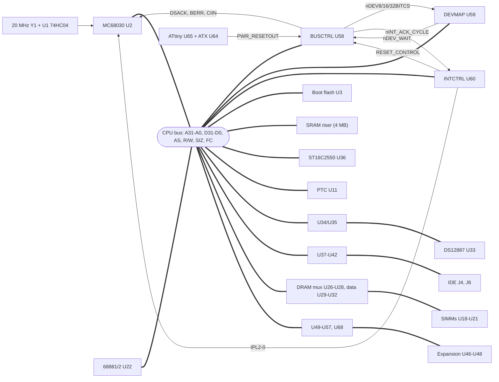

### 1.1 Who does what

| Block | Role |
|---|---|
| **BUSCTRL** (U58, ATF1508AS) | Owns the CPU bus. Decodes A31-A27, A19-A16 and FC into regions and terminates every cycle (DSACK0/1, BERR). Drives cache inhibit, boot flash and SRAM strobes, the shared read strobe `nCPU_RD`, and the region chip selects for DEVMAP. Contains the whole DRAM controller including refresh, plus reset synchronisation and the clock dividers. |
| **DEVMAP** (U59, ATF1508AS) | Splits the 8-, 16- and 32-bit device regions into individual chip selects using A27-A8. Shapes device strobes (RTC address/data multiplexing, IDE write strobe, interrupt-controller write pulse) and asks BUSCTRL for wait states. |
| **INTCTRL** (U60, ATF1508AS) | Sixteen interrupt inputs, masks, priority encoding to IPL2-0, and vector generation during interrupt acknowledge. Also holds the software power-off and reset bits. |
| **PTC** (U11, ATF1504AS) | Two 12-bit periodic interrupt timers, one clocked from 32.768 kHz and one from CPU_CLK/16. |
| **ATtiny** (U65) | ATX power sequencing, power and reset buttons, and the master reset input to BUSCTRL. Its firmware is not in this repository. |

### 1.2 Parts by schematic sheet

| Sheet | Contents |
|---|---|
| 1 | Clock oscillator Y1 (20 MHz) and U1 hex inverter, RESET/HALT LEDs, CPLD JTAG header J1, debug button U901 (NMI), decoupling |
| 2 | Two 7-segment digits and 8 status LEDs, latched by U9/U10/U7 (74HC273) |
| 3 | MC68030 (U2), MC68881/68882 FPU (U22), CPU pull-ups |
| 4 | Boot flash U3, SST39SF040 (512K x 8) |
| 5 | SRAM riser connector U6 |
| 6 | PTC CPLD U11 (ATF1504), its JTAG header J11, 32.768 kHz oscillator U12 |
| 7 | Four 72-pin SIMM sockets U18-U21 ("BANK 1-4") |
| 8 | DRAM address multiplexers U26-U28 (SN74AHC157), jumper J3, DRAM data transceivers U29-U32 (74HCT245) |
| 9 | RTC U33 (DS12887; the symbol says DS12877) with address buffer U34 and data transceiver U35 |
| 10 | Dual UART U36 (ST16C2550, 44-PLCC), 18.432 MHz oscillator U13, serial headers J301 (A) and J20 (B) |
| 11 | Two IDE ports: J4 (IDE1) with U37/U38/U39, J6 (IDE2) with U40/U41/U42 |
| 12 | ATX connector U64, ATtiny power controller U65, power and reset buttons, PWR jumpers |
| 13 | Expansion connectors U46-U48 |
| 14 | Expansion buffers: address/control U49-U53 and U68 (74AHC244), data U54-U57 (SN74AHC245), pull-ups |
| 15 | Seven 20-pin logic-analyser headers (U4, U5, U23, U24, U25, U69, U70) |
| 16 | BUSCTRL U58 |
| 17 | DEVMAP U59 and INTCTRL U60, JTAG chain jumpers J8/J9, test headers J27/J28 |

---

## 2 Clocks

| Clock | Source | Destinations |
|---|---|---|
| `CPU_CLK` | Y1 20 MHz oscillator -> U1 (one 74HC04 inverter section; four sections share the oscillator input) | CPU, FPU, all three ATF1508s (global clock pin 87), logic header U70, test point U8 |
| `EBUS_CPU_CLK` | separate U1 section | expansion connectors, pin B27 |
| `CPU_CLK_2`, `CPU_CLK_3` | separate U1 sections | none: the netlist shows nothing else on either net (U1 pins 6 and 2), so they are spare outputs |
| `CPU_CLK_DIV16` | BUSCTRL ripple divider (div2 -> div4 -> div8 -> div16), pin 47 | PTC timer B clock (`PTCB_CLOCK`) |
| `CPU_CLK_div8` | BUSCTRL internal | DRAM refresh timer |
| 32.768 kHz | U12 | PTC timer A clock (`PTCA_CLOCK`) |
| 18.432 MHz | U13 | UART XTAL1 (divisor 10 gives 115200 baud) |

Two U1 sections are not clocks. `nSYS_RESET` and `nCPU_HALT` go through them to drive the RESET (D1) and HALT (D2) LEDs.

Several CPLD constants depend on the CPU clock: the refresh interval (Section 7.8 and [DRAM.md](DRAM.md)), PTC timer B rates (Section 10), and every wait-state count. The MC68030 also has a **minimum** clock frequency: 12.5 MHz for the 20 and 25 MHz grades, 20 MHz for the 33 MHz grade, and 25 MHz for the 40 MHz grade (data sheet, clock input specification).

**Current boards:** Y1 is fitted with either a 12 MHz or a 16 MHz oscillator. The board boots and runs the operating system at both. 12 MHz is slightly below the 12.5 MHz data-sheet minimum; it works, but keep it in mind if something misbehaves only at 12 MHz. The logic-analyser captures `ide1.JPG` and `ide2.JPG` show an 83 ns clock period, which is the 12 MHz oscillator.

---

## 3 Reset and power control

### 3.1 Hardware reset path

1. The ATtiny U65 runs from +5VSB. It drives `/PS_ON`, watches `PWR_OK`, reads the power and reset buttons (and the front-panel headers J17/J18), and pulls its `RESET_SINK` output (`PWR_RESETOUT`) low to reset the system. Jumper J25 can hold `PWR_RESETOUT` low.
2. `PWR_RESETOUT` enters BUSCTRL as `nSYS_RESET_IN` on dedicated input pin 89.
3. BUSCTRL makes `nSYS_RESET` with one flop: `nSYS_RESET.ar = !nSYS_RESET_IN # RESET_CONTROL_IN`, `.d = 1`, `.ck = !CPU_CLK`. Reset therefore asserts immediately (asynchronously) and releases on a **falling** edge of CPU_CLK, so the first CPU clock edge after reset is a rising edge.
4. `nSYS_RESET` (BUSCTRL pin 49, push-pull, with R47 10K pull-up) goes to the CPU `/RESET`, the FPU, the INTCTRL, DEVMAP and PTC reset inputs, RTC `/RESET`, the IDE `/RESET` pins (through U39/U42), the 74HC273 LED latches' `/MR` (which turns on every segment and LED: a free lamp test), and through U53 to the expansion connectors as `nEXP_SYS_RESET`. DEVMAP inverts it to `SYS_RESET_POS` for the UART's active-high RESET.

The MC68030 needs RESET held for at least 520 clocks after Vcc is in tolerance. For later resets the manual says 10 clocks resets the processor logic and 520 is recommended (MC68030 UM, reset operation in Section 7). The power-on reset width is set by the ATtiny firmware, which is not in this repository.

`RESET_CONTROL_IN` has a 10K pull-up (R7). While INTCTRL is unprogrammed, or being reprogrammed over JTAG, its pins float, so the pull-up holds the system in reset. That looks deliberate, and it is useful.

### 3.2 Software power-off and reset (INTCTRL register 0x3000_0202)

| Bit | Name | Effect |
|---|---|---|
| 0 | `POWER_CONTROL_STATE` | 1 = INTCTRL actively drives `POWER_CONTROL_OUT` high. That net goes to the ATtiny's `PWR_REQGR` pin (U65 pin 5), which reads it as a power-off request. When the bit is 0 the pin is tri-stated, and R9 and R46 (10K each) pull the net low. |
| 1 | `RESET_CONTROL_OUT` | 1 = reset the system, but see the problem below. |

The same net is also INTCTRL input `vINT1B` (pin 30), intended as the "power button pressed" interrupt from the ATtiny. J24 can strap it high or low.

**Problem: the software reset is about one clock long** (see [timing/11-software-reset.svg](timing/11-software-reset.svg)). `RESET_CONTROL_OUT` asynchronously resets `nSYS_RESET` in BUSCTRL. INTCTRL then clears `RESET_CONTROL_OUT` with `.ar = !nSYS_RESET`, so BUSCTRL's asynchronous reset input goes away and `nSYS_RESET` returns high on the next falling clock edge. The pulse is far shorter than the 10 clocks the CPU needs (520 recommended) and the 25 us ATA devices need. The source comment ("set to zero to disable the function") and the file `INTCTRL2-RSTFIX.jed` suggest this was already noticed. To fix it, stretch the pulse with a counter (for example clear the bit only after `CPU_CLK_DIV16` has counted several hundred clocks), or hand the request to the ATtiny instead.

**Problem: the 68030 `RESET` instruction will fight BUSCTRL.** The CPU drives `/RESET` low, open-drain, for 512 clocks when it executes `RESET`, but BUSCTRL drives `nSYS_RESET` push-pull high. Software must not use the `RESET` instruction unless `nSYS_RESET` is changed to an open-collector output.

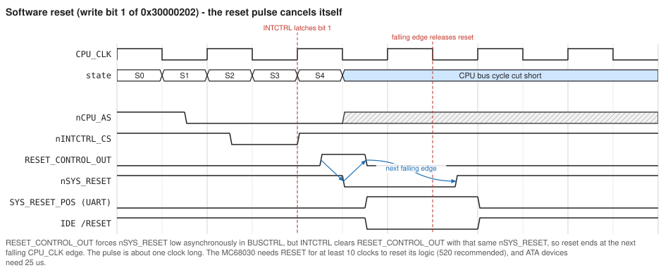

---

## 4 The 68030 bus as Roscoe uses it

### 4.1 Asynchronous cycles and dynamic bus sizing

Every Roscoe bus cycle today is an asynchronous cycle terminated by DSACK1/DSACK0:

* **S0** (CLK high): address, FC, SIZ1-0 and R/W become valid.
* **S1** (falling edge): AS asserts (and DS for reads).
* The CPU samples DSACK1/0 on the **falling edge at the end of S2**. If either is asserted, the cycle continues with no wait states. Otherwise it inserts whole-clock wait states and samples again at each falling edge.
* Data is latched one clock after DSACK is recognised, on the falling edge at the end of S4. AS and DS negate in S5.
* A zero-wait-state cycle is 3 clocks (150 ns at 20 MHz).

The DSACK pair also tells the CPU the port size:

| DSACK1 | DSACK0 | Port | Used for |
|---|---|---|---|
| H | L | 8-bit, on D31-D24 | boot flash, 8-bit device region, interrupt acknowledge |
| L | H | 16-bit, on D31-D16 | 16-bit device region, "big flash" region |
| L | L | 32-bit | SRAM, DRAM, 32-bit device region |

The CPU automatically splits wider operands into several cycles for narrower ports. A word write to the 8-bit interrupt controller, for example, becomes two byte cycles at consecutive addresses.

Synchronous (STERM-terminated) 2-clock cycles and 2-1-1-1 burst cache fills (CBREQ/CBACK) are not used yet: BUSCTRL drives `nCPU_STERM` permanently high. [SRAMBurstProposal.md](SRAMBurstProposal.md) covers adding them.

### 4.2 CPU-space cycles (FC = 7)

| A19-A16 | Cycle | Roscoe behaviour |
|---|---|---|
| 1111 | Interrupt acknowledge | BUSCTRL asserts `nINT_ACK_CYCLE` and an 8-bit DSACK0; INTCTRL drives the vector on D31-D24 (Section 9) |
| 0010 | Coprocessor (FPU) | BUSCTRL asserts `nFPU_CS`; the FPU terminates the cycle with its own DSACKs |
| 0000 | Breakpoint acknowledge (`BKPT`) | nothing responds, so the bus hangs (there is no bus timeout) |
| 0001 | Access level control | not used by the 68030 |

The 68030's own MMU instructions (CpID 0) run internally and generate no bus cycles.

### 4.3 Key MC68030 timing (data sheet, AC electrical specifications)

| # | Parameter | 20 MHz | 25 MHz | 33 MHz | 40 MHz |
|---|---|---|---|---|---|
| 6 | CLK high to address, FC, SIZ valid (max) | 25 | 20 | 14 | 14 |
| 9 | CLK low to AS, DS asserted (min-max) | 3-20 | 3-18 | 2-10 | 2-10 |
| 12 | CLK low to AS, DS negated (max) | 20 | 18 | 10 | 10 |
| 23 | CLK high to data-out valid (max) | 25 | 20 | 14 | 14 |
| 25 | AS, DS negated to data-out invalid (write data hold, min) | 10 | 7 | 5 | 3 |
| 27 | Data-in valid to CLK low (setup, min) | 4 | 2 | 1 | 1 |
| 28 | AS, DS negated to DSACKx, BERR, HALT negated (max) | 50 | 40 | 30 | 20 |
| 29A | AS, DS negated to data-in high impedance (max) | 50 | 40 | 30 | 25 |
| 30 | CLK low to data-in invalid (synchronous hold, min) | 12 | 8 | 6 | 6 |
| 31 | DSACKx asserted to data-in valid (max) | 43 | 28 | 20 | 14 |
| 31A | DSACK1 to DSACK0 skew (max) | 10 | 7 | 5 | 3 |
| 47A / 47B | Asynchronous input setup / hold around CLK low | 4 / 12 | 2 / 8 | 2 / 6 | 2 / 6 |
| 60 / 61 | Synchronous input (STERM, CIIN, CBACK) setup / hold around CLK high | 4 / 12 | 2 / 8 | 2 / 6 | 2 / 6 |
| - | Legal clock range for the part grade (MHz) | 12.5-20 | 12.5-25 | 20-33.3 | 25-40 |

All values are in ns.

### 4.4 ATF1508AS timing used in this document

| Parameter | -7 | -10 |
|---|---|---|
| tPD1, input or feedback to non-registered output | 7.5 | 10 |
| tPD2, to internal feedback | 7 | 9 |
| tCOP, global clock to output | 4.5 | 5 |
| tACOP, product-term (array) clock to output | 7.5 | 10 |
| Slow-slew output adder (tOD3 - tOD1) | +3 | +4 |
| tSEXP, foldback term | 4 | 5 |

All values are in ns. All four Roscoe fits use slow slew everywhere (`Output_fast = OFF`) and enable the pin keepers (`Pin_keep_mode = ON`). The CPLD speed grade fitted on the boards is not recorded in the repository. In the diagrams one slot (a quarter clock, 12.5 ns at 20 MHz) stands for one CPLD level.

### 4.5 DSACK is open-collector

BUSCTRL drives `nCPU_DSACK0/1` as open-collector outputs (`PROPERTY ATMEL {open_collector=...}`), because the FPU drives the same lines. R51 and R52 pull them up. The CPLD therefore only ever pulls DSACK low; returning it high at the end of a cycle is left to the resistors, against the capacitance of the CPU, FPU and CPLD pins, the traces, the U70 logic header, and the BUSCTRL pin keeper, which holds the last level.

**R51/R52 are 1K on the boards.** The schematic says 10K; the fitted value was lowered for exactly this rise-time problem, and the schematic should be corrected on the next PCB (Section 15.2). With 1K and an estimated 25-50 pF, the time constant is 25-50 ns, so DSACK reaches 2.0 V (about 0.5 RC) some 15-25 ns after the CPLD lets go. Spec #28 asks for DSACK negated within 50 ns of AS negating at 20 MHz (20 ns at 40 MHz). In practice the hard limit is that DSACK must read high again before the next cycle samples it, about 2 clocks after AS negates, and 1K meets that easily at every clock the board can run. Each pull-up draws about 5 mA while DSACK is held low, by the CPLD or by the FPU. With the schematic's 10K the rise would take 120-250 ns, longer than the gap between cycles at 20 MHz.

A fast pull-up does not make "retracting" a DSACK a way to add wait states: the CPU may already have sampled it (Section 12.5).

### 4.6 How the CPU pins are terminated (sheet 3)

| CPU pin | Net | Connected to | Notes |
|---|---|---|---|
| FC2-0 | CPU_FC2..0 | BUSCTRL 78/77/76 | CPU-space detection |
| SIZ1-0 | CPU_SIZ1..0 | BUSCTRL 80/79; U68 -> expansion | byte-enable logic |
| R/W | CPU_RW | many | also SRAM /WE, UART /IOW, RTC/IDE transceiver direction |
| /AS | nCPU_AS | BUSCTRL 41, FPU; U53 -> expansion | **DEVMAP and INTCTRL never see AS** |
| /DS | nCPU_DS | FPU only | |
| /DSACK1-0 | nCPU_DSACK1..0 | BUSCTRL 48/50 (open collector), FPU, R52/R51 (1K fitted; the schematic says 10K) | Section 4.5 |
| /STERM | nCPU_STERM | BUSCTRL 45 | driven high (unused) |
| /BERR | nCPU_BERR | BUSCTRL 46 | asserted only for 0x2xxx_xxxx |
| /HALT | nCPU_HALT | BUSCTRL 42 (driven high), R2 10K, U1 -> HALT LED | input-only on the 68030 |
| /RESET | nSYS_RESET | BUSCTRL 49 (push-pull), R47 10K | Section 3 |
| /CIIN | nCPU_CIIN | BUSCTRL 44 | caches inhibited for device regions |
| /IPL2-0 | nCPU_IPL2..0 | INTCTRL 52/53/54 | |
| /AVEC | nCPU_AVEC | R49 10K only | autovectors never used |
| /BR, /BGACK | nCPU_BR, nCPU_BGACK | R50, R11 10K only | no other bus masters |
| /RMC | nCPU_RMC | BUSCTRL 7 | input, not used in any equation |
| /OCS, /ECS | nCPU_OCS, nCPU_ECS | labelled nets, nothing else connected (netlist) | outputs, fine |
| /BG, /DBEN, /CIOUT, /CBREQ, /IPEND, /STATUS, /REFILL | - | not connected | outputs, fine |
| **/CDIS, /MMUDIS, /CBACK** | - | **not connected** | **floating inputs**, see below |

**Floating CPU inputs.** `/CDIS` (cache disable), `/MMUDIS` (MMU disable) and `/CBACK` (burst acknowledge) are unconnected on the V2 PCB; sheet 3 shows them with DipTrace no-connect markers. The 68030 has no internal pull-ups. The MC68030 User's Manual (12.1, adapting the 68030 to MC68020 sockets) lists STERM, CBACK, CIIN and MMUDIS among the pins that must be pulled up when unused, and CDIS is likewise an active-low input that is unused here. A floating `/CDIS` or `/MMUDIS` can randomly disable the caches or address translation. A floating `/CBACK` is harmless only as long as no STERM cycles exist (Section 6 of the burst proposal).

**Status:** the current boards are reworked with wires from these three pins to a pull-up resistor. The fix belongs on the next PCB (Section 15).

---

## 5 Memory map and decoding

### 5.1 Regions as implemented by BUSCTRL

BUSCTRL decodes A31-A27 and FC. All region terms include `!nCPU_AS` and exclude CPU space (FC = 7).

| Address range | BUSCTRL term | Port (DSACK) | Wait states | Cache | Contents and notes |
|---|---|---|---|---|---|
| 0x0000_0000-0x07FF_FFFF | BOOTFLASH | 8-bit | 0 | cacheable | 512 KB boot flash, repeated every 512 KB. The CPU's reset vectors live at 0. |
| 0x0800_0000-0x0FFF_FFFF | BIGFLASH | 16-bit | 0 | cacheable | Nothing fitted. Acknowledged, so reads return whatever is floating on the bus. |
| 0x1000_0000-0x1FFF_FFFF | SRAM | 32-bit | 0 | cacheable | 4 x 1 MB banks at 0x1000_0000-0x103F_FFFF. The rest of the region is acknowledged but selects nothing. |
| 0x2000_0000-0x2FFF_FFFF | UNUSED | none | - | - | **BERR** (the only region that bus-errors) |
| 0x3000_0000-0x3FFF_FFFF | DEV8BIT | 8-bit | 0 unless `nDEV_WAIT` | inhibited | DEVMAP sub-decode (5.2) |
| 0x4000_0000-0x4FFF_FFFF | DEV16BIT | 16-bit | 0 unless `nDEV_WAIT` | inhibited | IDE, PTC (5.2) |
| 0x5000_0000-0x5FFF_FFFF | DEV32BIT | 32-bit | 0 unless `nDEV_WAIT` | inhibited | expansion (5.2) |
| 0x6000_0000-0x7FFF_FFFF | VIDEO (decoded but unused) | none | - | - | **no DSACK and no BERR: the CPU hangs** |
| 0x8000_0000-0xFFFF_FFFF | DRAM | 32-bit | 1, plus refresh stalls | cacheable | 8 ranks x 64 MB at 0x8000_0000-0x9FFF_FFFF in the 64/128 MB build. Above 0x9FFF_FFFF cycles are acknowledged and get CAS but no RAS (reads float). See [DRAM.md](DRAM.md). |

There is no bus timeout anywhere. A cycle that nobody acknowledges hangs the machine forever: the 0x6/0x7 region, a `BKPT`, or FPU instructions with no FPU fitted (which would normally bus-error and trap to an F-line emulator). That is worth fixing before Linux bring-up, for example with a counter in BUSCTRL that asserts BERR after a few microseconds of AS.

### 5.2 Device sub-decode (DEVMAP)

DEVMAP sees only A27-A8 and the three region selects, so its smallest unit is a 256-byte window. Windows that are not decoded are still acknowledged by BUSCTRL; reads return floating data.

**8-bit region (0x3000_0000 + offset), all on D31-D24:**

| Offset | Select | Device | Registers inside the window |
|---|---|---|---|
| 0x000 | `nUART_CSA` | UART channel A | A2-A0, eight registers repeated through the window |
| 0x100 | `nUART_CSB` | UART channel B | as above |
| 0x200 | `nINTCTRL_CS` | interrupt controller | 0x200/0x201 mask (write-only), 0x202 power/reset (write-only) |
| 0x300 | `nRTC_CS` | DS12887 RTC | RTC register n at 0x3000_0300 + n (A7-A0 go to the RTC as its address) |
| 0x500 | `nEXP_VIO_CS` | expansion "video I/O" window | card-defined |
| 0x600 | `nSEVENSEGA_WR` | left 7-segment digit (latch) | write-only |
| 0x700 | `nSEVENSEGB_WR` | right 7-segment digit (latch) | write-only |
| 0x800 | `nSTATUSLED_WR` | 8 status LEDs (latch) | write-only |

**16-bit region (0x4000_0000 + offset), on D31-D16:**

| Offset | Select | Device |
|---|---|---|
| 0x000 | `nIDE1_CSA` | IDE1 (J4) /CS0, command block |
| 0x100 | `nIDE1_CSB` | IDE1 /CS1, control block |
| 0x200 | `nIDE2_CSA` | IDE2 (J6) /CS0 |
| 0x300 | `nIDE2_CSB` | IDE2 /CS1 |
| 0x400 | `nPTC_CS` | PTC timers. The comment in DEVMAP says 0x3000_0400 and the memory-map PDF says 512 bytes; the decode is 0x4000_0400-0x4000_04FF. |

**32-bit region (0x5000_0000 + offset):**

| Range | Select |
|---|---|
| 0x5000_0000-0x500F_FFFF | `nEXP_VMEM_CS` (1 MB video memory window) |
| whole region | `nEXP_DEV32BITCS` |

DEVMAP also passes the three region selects straight through to the expansion connectors as `nEXP_DEV8BITCS`, `nEXP_DEV16BITCS` and `nEXP_DEV32BITCS`. They cover the **whole** region, on-board devices included, so a card must sub-decode (Section 13.4).

---

## 6 Data-bus lanes by device

The 68030 is big-endian: in a 32-bit port, D31-D24 holds the byte at offset 0. An 8-bit port must sit on D31-D24 and a 16-bit port on D31-D16.

| Device | Port | CPU data lines | Address lines used | Notes |
|---|---|---|---|---|
| Boot flash | 8 | D31-D24 | A18-A0 | `/OE` = `nCPU_RD`, `/WE` = `nBFLASH_WE` |
| SRAM | 32 | D31-D0 | A19-A2 (SRAM A17-A0) | per-lane `/UB`, `/LB` from `nSRAM_xx_SEL` (Section 7.5) |
| DRAM | 32 | D31-D0 via U29-U32 | muxed A25-A2 | per-lane CAS |
| UART | 8 | D31-D24 | A2-A0 | `/IOW` = `CPU_RW`, `/IOR` = `nCPU_RD` |
| RTC | 8 | D31-D24 via U35 | A7-A0 via U34 | multiplexed AD bus, Section 8.4 |
| INTCTRL | 8 | D31-D24 | A3-A0 | write registers, and the vector on acknowledge |
| LEDs, 7-segment | 8 | D31-D24 | - | 74HC273 latches clocked by the rising edge of the select. Segments and LEDs are tied to +5V, so a 0 bit lights. |
| PTC | 16 | D31-D16 (PTC D15-D0) | A1 selects the timer | Section 10 |
| IDE | 16 | IDE DD15-DD8 on D31-D24, DD7-DD0 on D23-D16 | A7-A5 -> IDE A2-A0 | Section 12.3 |
| FPU | 32 | D31-D0 | A4-A0 | SIZE pin tied high |
| Expansion | 8/16/32 by region | D31-D0 via U54-U57 | A31-A0 via U49-U52 | Section 13 |

On byte writes the 68030 copies the byte to every lane it might need, so byte writes reach 8- and 16-bit ports correctly at any address.

---

## 7 CPLD 1 - BUSCTRL (U58)

Source: `plds/BUSCTRLV2/BUSCTRL2.PLD` (rev 29). Fit: 77/128 macrocells, 28 flip-flops, 80/80 I/O pins and 4/4 dedicated inputs. The I/O pins are all used, so new outputs have to reuse test or spare pins (7.9).

### 7.1 Pins

| Group | Pins |
|---|---|
| CPU inputs | A31-A16 (52-58, 60, 61, 63-65, 67-70), `CPU_AA1/AA0` = A1/A0 (71/72), FC0-2 (76-78), SIZ0/1 (79/80), `CPU_RW` (88, dedicated input), `nCPU_AS` (41), `nCPU_RMC` (7, unused), `CPU_CLK` (87, global clock) |
| CPU outputs | `nCPU_DSACK0/1` (50/48, open collector), `nCPU_BERR` (46), `nCPU_CIIN` (44), `nCPU_STERM` (45, constant 1), `nCPU_HALT` (42, constant 1), `nSYS_RESET` (49) |
| Reset | `nSYS_RESET_IN` (89, dedicated input, from the ATtiny), `RESET_CONTROL_IN` (83, from INTCTRL) |
| Memory strobes | `nBFLASH_CE` (37), `nBFLASH_WE` (40), `nSRAM_BANK1..4_CE` (92/93/94/96), `nSRAM_LL/LH/UL/UH_SEL` (97/98/99/100), `nCPU_RD` (8, shared read strobe and output enable) |
| To DEVMAP and INTCTRL | `nDEV8BITCS` (1), `nDEV16BITCS` (2), `nDEV32BITCS` (5), `nINT_ACK_CYCLE` (6); input `nDEV_WAIT` (90, dedicated input) |
| FPU | `nFPU_CS` (84) |
| DRAM | `nDRAM_S1A..S4A_RAS` (19-22), `nDRAM_S1B..S4B_RAS` (23-25, 27), `nDRAM_CAS0..3` (17/16/14/13), `DRAM_MUX` (12), `nDRAM_DATA_EN` (10), `nDRAM_WE` (9) |
| Clock | `CPU_CLK_div16` (47) |
| Test and spare | `TESTP0..3` (32/33/35/36 -> J29), `EXP_BC_CPLD1/2` (28/29 -> expansion, driven 0), `EXTRA_BC_INT1/2` (30/31 <-> INTCTRL), `EXTRA_BC_DM1/2` (81/85 <-> DEVMAP), `UNUSED2` (75) |

### 7.2 Clock dividers and reset

`CPU_CLK_div2/4/8/16` form a ripple chain of toggle flops, each clocked by the previous stage. `div8` drives the refresh timer and `div16` leaves on pin 47 for the PTC. Reset synchronisation is described in Section 3.1.

### 7.3 Region decode

The `*_REGION_ACCESS` terms in the source decode A31-A27 as listed in Section 5.1. Two more decodes do not use `!FC_CPU_SPACE`:

* `INTERRUPT_ACK_ACCESS` = AS & FC = 7 & A19-A16 = 1111, which drives `nINT_ACK_CYCLE`.
* `nFPU_CS` = FC = 7 & A19-A16 = 0010. It is not qualified by AS (earlier variants with AS/CLK qualification are commented out in the source) and ignores the coprocessor ID in A15-A13. A select without AS or DS does nothing in the 68881/2, so this is benign.

`DRAM_REGION_ACCESS` also includes `!REFRESH_ACTIVE`, which is how refresh holds off DRAM cycles.

### 7.4 Cycle termination: DSACK, BERR, CIIN

```
nCPU_DSACK0 = !( DRAM_REGION_ACCESS_WAITSTATE # SRAM_REGION_ACCESS # BOOTFLASH_REGION_ACCESS
               # INTERRUPT_ACK_ACCESS # (DEV8BIT_REGION_ACCESS  & nDEV_WAIT)
                                      # (DEV32BIT_REGION_ACCESS & nDEV_WAIT) );
nCPU_DSACK1 = !( DRAM_REGION_ACCESS_WAITSTATE # SRAM_REGION_ACCESS # BIGFLASH_REGION_ACCESS
               # (DEV16BIT_REGION_ACCESS & nDEV_WAIT) # (DEV32BIT_REGION_ACCESS & nDEV_WAIT) );
nCPU_BERR   = !UNUSED_REGION_ACCESS;
nCPU_CIIN   = !(DEV8BIT_REGION_ACCESS # DEV16BIT_REGION_ACCESS # DEV32BIT_REGION_ACCESS);
```

* Every non-DRAM region is acknowledged combinationally, so DSACK appears about two CPLD levels after AS. The fitter split both DSACK equations through `XXL_23x` foldback nodes, which is why it takes two levels. That beats the S2 sample point, so these regions run at 0 wait states (3-clock cycles).
* DRAM is acknowledged from `DRAM_REGION_ACCESS_WAITSTATE`, a flop clocked on the falling edge. It misses the S2 sample by design and adds one wait state.
* The device regions are acknowledged unless `nDEV_WAIT` is low. **This wait-state mechanism does not work as intended:** DSACK is already asserted before `nDEV_WAIT` can arrive (Section 12.5).

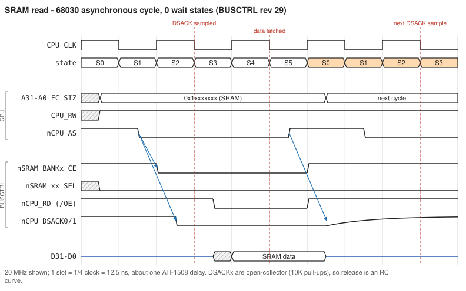

### 7.5 Byte-lane logic

During writes the CPU's SIZ1-0, A1 and A0 select which bytes of a 32-bit port change. BUSCTRL implements the MC68030 data-bus-requirements table as four terms (`docs/030MemorySelect.pdf`):

| Term | Lane | Equation | Lane is written for |
|---|---|---|---|
| `BA32_LL` | D31-D24 (offset 0) | `!A0 & !A1` | any size at offset 0 |
| `BA32_LH` | D23-D16 (offset 1) | `!A1 & (A0 # !SIZ0 # SIZ1)` | |
| `BA32_UL` | D15-D8 (offset 2) | `!((!A1 & SIZ0 & !SIZ1) # (A1 & A0) # (!A0 & !A1 & !SIZ0 & SIZ1))` | |
| `BA32_UH` | D7-D0 (offset 3) | `(A1 & SIZ1) # (!SIZ1 & !SIZ0) # (A0 & SIZ1 & SIZ0) # (A0 & A1)` | |

I checked all 16 SIZ/A1/A0 combinations against the MC68030 table and they match. (The `UL` line in `030MemorySelect.pdf` has a typo, `A2&A1`; the CUPL is correct.) The names follow the SRAM riser's chip naming, where "LL" is the lowest address byte, D31-D24. Reads always enable all four lanes, as the cache requires. The same terms mask the DRAM CAS lines.

### 7.6 Boot flash, SRAM and the shared read strobe

* `nBFLASH_CE` = BOOTFLASH region. `nBFLASH_WE` = BOOTFLASH region & write, so the flash can be programmed in circuit with the SST39SF command sequences.
* `nSRAM_BANKn_CE`: SRAM region, with A27-A22 = 0 and A21-A20 selecting the bank. The `nSRAM_xx_SEL` byte selects are `!(CPU_RW # BA32_xx)`. They do **not** include AS: during reads all four are asserted, during writes only the written lanes. SRAM `/WE` is `CPU_RW` itself, so every SRAM write is CE-controlled. It starts when the bank CE falls and ends when CE rises, one CPLD delay after AS negates. The 68030 guarantees write data for only 10 ns after AS negates (#25), so the end of the write depends on the data bus holding its value. That works in practice, but it is unspecified ([timing/02](timing/02-sram-write-async.svg)).
* `nCPU_RD` is the system read strobe. It is the SRAM, flash and UART `/OE` or `/IOR`, and IDE `/IOR` through U39/U42. Since rev 29 it is registered: `.d = !CPU_RW`, `.ck = !CPU_CLK`, `.ap = nCPU_AS # !nSYS_RESET`. It asserts on the first falling edge after AS (start of S3) and releases as soon as AS negates. Before rev 29 it was simply `!CPU_RW` and asserted during S0, ahead of AS and every chip select, which mattered for IDE setup time (Section 12).

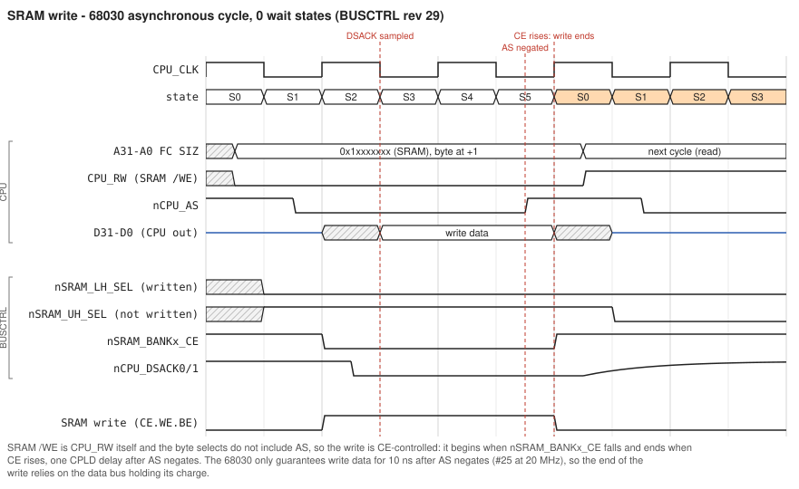

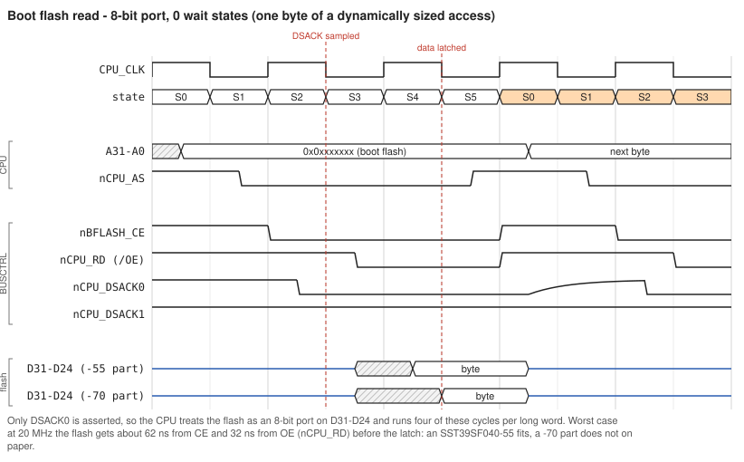

**Boot flash access-time budget at 20 MHz, worst case** (AS at +45 ns, slow-slew -10 CPLD): CE asserts at about 59 ns and `nCPU_RD` at about 89 ns, and data must be valid by about 121 ns. That leaves about 62 ns from CE and 32 ns from OE. An SST39SF040-55 (tCE 55, tOE 30) fits; a -70 part (70/35) does not on paper. **Check** which speed grade is fitted.

### 7.7 Device region selects and DEVMAP handshake

`nDEV8BITCS`, `nDEV16BITCS` and `nDEV32BITCS` are the region terms (with AS) sent to DEVMAP. `nDEV_WAIT` comes back on a dedicated input, and Section 12.5 explains why it cannot do its job today.

### 7.8 DRAM controller (summary)

The DRAM logic is in BUSCTRL and is documented in [DRAM.md](DRAM.md). In brief:

* RAS for the selected rank falls when `DRAM_REGION_ACCESS` clocks `nDRAM_ACCESS_RAS`.
* `DRAM_MUX` switches the 157s to the column address when any RAS pin falls.
* CAS (masked per byte lane on writes) starts on the first falling edge after RAS.
* RAS ends on the second falling edge.
* DSACK comes from a one-wait-state flop, so DRAM cycles take 4 clocks.
* A CAS-before-RAS refresh of all eight ranks runs every 128 CPU clocks (6.4 us at 20 MHz), whenever AS is high on a rising edge.

### 7.9 Test points and spare pins

| Pin | Signal today | Header |
|---|---|---|
| 32 | `TESTP0` = `REFRESH_REQUESTED` | J29-1 |
| 33 | `TESTP1` = `REFRESH_ACTIVE` | J29-2 |
| 35 | `TESTP2` = `REFRESH_COMPLETE` | J29-3 |
| 36 | `TESTP3` = dummy AND that keeps input pins allocated | J29-4 |
| 28, 29 | `EXP_BC_CPLD1/2` driven 0 | expansion B26/B30 |
| 30, 31 | `EXTRA_BC_INT1/2` (inputs here and in INTCTRL) | spare BUSCTRL-INTCTRL nets |
| 81, 85 | `EXTRA_BC_DM1/2` (inputs here and in DEVMAP) | spare BUSCTRL-DEVMAP nets |

The `EXTRA_*` nets are real board traces between the CPLDs that neither end drives today, so they can carry new signals without any rework. The IDE fix in Section 12.7 uses one.

### 7.10 Revision history (from comments and JED names)

| Rev | Change |
|---|---|
| 24/25 | first 128 MB support, DRAM aliasing removed (separate 16/32 MB and 64/128 MB builds, `REV25_BUSCTRL2-1632.PLD` and `-64128.PLD`) |
| 26 | cache enabled (`nCPU_CIIN` only for devices; rev 25 inhibited everything) |
| 27 | bus error for 0x2xxx_xxxx |
| 28 | `nDEV_WAIT` used for wait states |
| 29 | `nCPU_RD` registered and delayed to S3 |

---

## 8 CPLD 2 - DEVMAP (U59)

Source: `plds/DEVMAPV2/DEVMAP2.PLD` (rev 20). There is no `.fit` file and no `DEVMAP2.jed` in the folder, only `REV17-...IDEWAIT`, `REV20-...` and `REV21-...-2WS.jed`. The `.chn` files expect `DEVMAP2.jed`. Fit summary from the source comments: 34/128 macrocells, so there is plenty of room.

DEVMAP has **no AS input**. Everything is derived from BUSCTRL's region selects, which include AS. That costs one extra CPLD level on every device select, and DEVMAP cannot see the end of a cycle until BUSCTRL's select goes away.

### 8.1 Pins

| Group | Pins |
|---|---|
| Inputs | A27-A8 (52-58, 60, 61, 63-65, 67-72, 75, 76), `CPU_RW` (100), `nDEV8/16/32BITCS` (1/2/5), `CPU_CLK` (87), `nSYS_RESET` (88), `nEXP_DEV_WAIT` (32), `nEXP_CACHE_CTRL` (33, unused) |
| Device selects | `nUART_CSA/CSB` (25/24), `nINTCTRL_CS` (13), `nRTC_CS` (14), `nPTC_CS` (28), `nIDE1_CSA/CSB` (50/49), `nIDE2_CSA/CSB` (48/47), `nSEVENSEGA_WR` (96), `nSEVENSEGB_WR` (97), `nSTATUSLED_WR` (98) |
| Strobes and control | `nIDE_WR` (46), `nIDE_BUFFER_EN1/2` (45/44), `RTC_A_SEL` (17), `RTC_D_SEL` (16), `SYS_RESET_POS` (93), `nDEV_WAIT` (6) |
| Expansion | `nEXP_DEV8/16/32BITCS` (29/30/31), `nEXP_VMEM_CS` (23), `nEXP_VIO_CS` (22), `EXP_DM_CPLD1/2` (7/8, driven 0) |
| Test and spare | `TESTP0..2` (35/36/37 -> J28) = `nDEV_WAIT`, `nIDE_WAITSTATE_DELAY`, `nIDE_WAITSTATE_DELAY_RESETw2`; `EXTRA_DM_INT1/2` (21/27), `EXTRA_BC_DM1/2` (83/84), unused I/O on 9, 10, 12, 40-42, 77-81, 94 |

### 8.2 Decode

Every select is `region select OR NOT(A27-A8 matches the window)`, as tabulated in Section 5.2. `SYS_RESET_POS = !nSYS_RESET` for the UART.

### 8.3 Interrupt-controller write pulse

```
nINTCTRL_CS_delay.d = 1;  .ck = !CPU_CLK;  .ar = nINTCTRL_CS_pre # CPU_RW;
nINTCTRL_CS = nINTCTRL_CS_pre # nINTCTRL_CS_delay;
```

INTCTRL clocks its registers on the rising edge of (`nINTCTRL_CS` OR R/W OR address). On a write, the delay flop ends the select at the first falling clock edge (start of S3), so that edge falls mid-cycle while the CPU is solidly driving data. On a read the select stays the full length. This is the right way to clock a register from a bus cycle. The PTC and the LED latches do not do it, and they clock at the very end of the cycle instead.

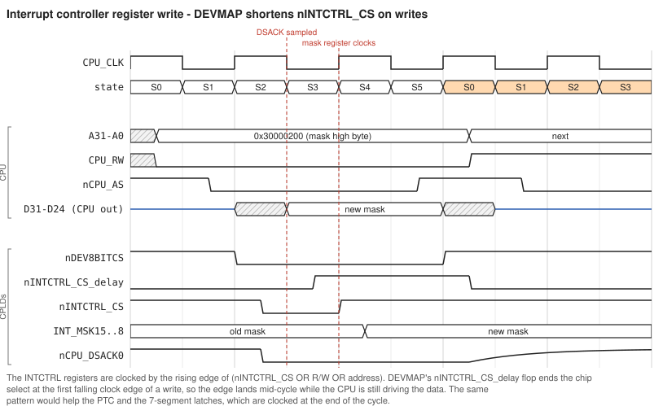

### 8.4 RTC address/data multiplexing

The DS12887 has a multiplexed AD7-AD0 bus and runs in Motorola mode (MOT tied high). DEVMAP and two buffers turn it into a directly addressed device:

* U34 (74AHC244, both halves enabled by `RTC_A_SEL` low) drives CPU A7-A0 onto AD7-AD0 whenever no RTC data phase is in progress.
* U35 (SN74AHC245, `/OE` = `RTC_D_SEL`, DIR = `CPU_RW`) connects AD7-AD0 to D31-D24 during the data phase.
* RTC AS and /CS are both `nRTC_CS`. Its falling edge latches the address that U34 is driving.
* `RTC_A_SEL` is a flop: `.d = 1`, `.ck = !CPU_CLK`, `.ar = nRTC_CS`. It sets on the first falling edge after the select, which turns U34 off, raises the RTC's DS (data strobe) and enables U35 through `RTC_D_SEL = !RTC_A_SEL`. When the cycle ends, `nRTC_CS` clears it.

So RTC register n is simply address 0x3000_0300 + n. The cycle has no wait states, which leaves DS high for only about one clock (50 ns at 20 MHz). At the end of a write, /CS rises one CPLD delay before DS falls, but Motorola-mode writes latch on the falling edge of DS. **Check** both against the DS12887 bus-timing table; the data sheet is not in `datasheets/`. If RTC accesses are flaky, give the RTC window wait states and end DS before /CS.

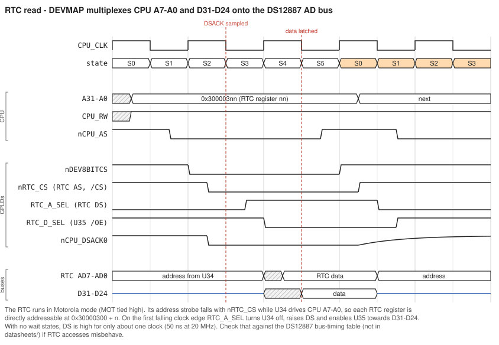

### 8.5 IDE logic

`nIDE_BUFFER_EN1/2` enable the IDE data transceivers whenever either select of a port is active. `nIDE_WR` and the wait-state generator are covered in Section 12.

### 8.6 LED and 7-segment latches

`nSEVENSEGA_WR`, `nSEVENSEGB_WR` and `nSTATUSLED_WR` are plain window selects that clock 74HC273s on their **rising** edge. That is the end of the cycle, one or two CPLD delays after AS negates, which leans on the bus holding write data past the 10 ns minimum (#25). A **read** of these addresses also clocks the latch, with whatever is floating on D31-D24.

### 8.7 Expansion pass-through and `nDEV_WAIT`

```
nEXP_DEV8BITCS = nDEV8BITCS;  nEXP_DEV16BITCS = nDEV16BITCS;  nEXP_DEV32BITCS = nDEV32BITCS;
nDEV_WAIT = (!nIDE_WAITSTATE_DELAY) & nEXP_DEV_WAIT;
```

`nEXP_DEV_WAIT` (connector A26, 10K pull-up R10) passes straight through DEVMAP into BUSCTRL's wait input. `nEXP_CACHE_CTRL` (A28, pull-up R12) reaches DEVMAP pin 33 but only feeds a dummy term. It was presumably meant to let a card inhibit caching, but device regions are already non-cacheable.

---

## 9 CPLD 3 - INTCTRL (U60)

Source: `plds/INTCTRLV2/INTCTRL2.PLD` (rev 16). Fit: 65/128 macrocells, 30 flip-flops, 46/80 I/O. JEDs in the folder: `INTCTRL2.jed`, `INTCTRL2_ORIG.jed`, `INTCTRL2-RSTFIX.jed`.

### 9.1 Pins

| Group | Pins |
|---|---|
| Bus | A3-A0 (71/72/75/76), `CPU_RW` (70), D7-D0 = CPU D31-D24 (57/58/60/61/63/64/65/67, bidirectional), `CPU_CLK` (87), `nSYS_RESET` (88), `nINTCTRL_CS` (89), `nINT_ACK_CYCLE` (90) |
| Interrupt inputs | `vINT7A` (8), `vINT6A/6B` (9/10), `vINT5A-D` (12/13/14/16), `vINT4A-C` (19/20/21), `vINT3A` (7), `vINT3B` (24), `vINT2A/2B` (25/27), `vINT1A/1B` (29/30) |
| Outputs | `CPU_IPL2..0` (52/53/54), `POWER_CONTROL_OUT` (45, tri-state), `RESET_CONTROL_OUT` (46), `EXP_INT_CPLD1/2` (31/32, driven 0), `TESTP0..2` (40/41/42 -> J27) = `vINT7A`, `INT7A_REQUEST_LATCHED`, `nINT_ACK_CYCLE` |

### 9.2 Registers (write-only, 8-bit port, byte or word writes)

| Address | Bit 7 | 6 | 5 | 4 | 3 | 2 | 1 | 0 |
|---|---|---|---|---|---|---|---|---|
| 0x3000_0200 | 7A | 6A | 6B | 5A | 5B | 5C | 5D | 4A |
| 0x3000_0201 | 4B | 4C | 3A | 3B | 2A | 2B | 1A | 1B |
| 0x3000_0202 | - | - | - | - | - | - | reset | power off |

A mask bit of 1 enables the source. Reset clears everything. Because the port is 8-bit, a word write to 0x3000_0200 becomes two byte cycles and sets both mask bytes. **In rev 16 only 7A, 6A, 6B, 4A, 4B and 1A can actually be enabled**; the other mask flops have `.d = 'b'0` hard-coded. Nothing can be read back. Reads of the window return floating data, and pending requests are not visible to software.

### 9.3 Interrupt sources

| Level | Input | Source and wiring | Treated as | Vector | Mask |
|---|---|---|---|---|---|
| 7 | vINT7A | Debug button U901 (R16/C27 RC, R17 and R8 pull-ups) | falling edge | 0xF0 | 200.7 |
| 6 | vINT6A | PTC timer A `nINTA_OUT` | falling edge | 0xE1 | 200.6 |
| 6 | vINT6B | PTC timer B `nINTB_OUT` | falling edge | 0xE2 | 200.5 |
| 5 | vINT5A | expansion A29 via U68 (NIC in `InterruptVectors.pdf`) | low level | 0xD1 | 200.4, fixed 0 |
| 5 | vINT5B | IDE1 INTRQ (J4 pin 31) | **low level** | 0xD2 | 200.3, fixed 0 |
| 5 | vINT5C | IDE2 INTRQ (J6 pin 31) | **low level** | 0xD4 | 200.2, fixed 0 |
| 5 | vINT5D | expansion A22 via U53 | low level | 0xD8 | 200.1, fixed 0 |
| 4 | vINT4A | UART A INTA | high level | 0xC1 | 200.0 |
| 4 | vINT4B | UART B INTB | high level | 0xC2 | 201.7 |
| 4 | vINT4C | expansion B22 via U53 | low level | 0xC4 | 201.6, fixed 0 |
| 3 | vINT3A | expansion B21 via U68 (USB in the PDF) | low level | 0xB1 | 201.5, fixed 0 |
| 3 | vINT3B | expansion A23 via U53 | low level | 0xB2 | 201.4, fixed 0 |
| 2 | vINT2A | expansion A24 via U53 (video) | low level | 0xA1, **delivered as 0xA0** | 201.3, fixed 0 |
| 2 | vINT2B | expansion B23 via U53 | low level | 0xA2 | 201.2, fixed 0 |
| 1 | vINT1A | RTC /IRQ | low level | 0x91 | 201.1 |
| 1 | vINT1B | `PWR_REQGR` (power controller) | falling edge | 0x92 | 201.0, fixed 0 |

Vectors are `1 LLL SSSS` (L = level, S = one-hot source within the level). Any other vector from 0x80-0xFF should go to a spurious-interrupt handler. This happens when a level-triggered source goes away before the acknowledge (for example 0xC0).

### 9.4 Request pipeline and priority

1. `INTxx_REQUEST`: for level-triggered sources, `input & mask`, combinational. For edge-triggered sources, a flop clocked by the input's falling edge with `.d = mask`.
2. `INTxx_REQUEST_LATCHED`: registered on the rising CPU_CLK edge, so everything downstream is synchronous.
3. `INTLn_REQUEST_PE`: registered on the falling edge. One flag per level, with a priority chain so only the highest pending level is set.
4. `CPU_IPL2..0`: registered on the rising edge, so the CPU, which samples IPL on falling edges, always sees a stable code.

IPL therefore follows a source by about two clocks. Within a level, the `INTxx_REQUEST_PE` terms pick A over B over C over D.

### 9.5 Acknowledge and vector

When BUSCTRL asserts `nINT_ACK_CYCLE`, INTCTRL latches A3-A1 (the level being acknowledged) into `INT_ACK_LEVEL2..0` on that falling edge and enables its D7-D0 outputs (CPU D31-D24). It then drives `1, level, source bits`. BUSCTRL acknowledges with DSACK0 (8-bit, 0 wait states). After the cycle, `INT_ACK_RESET_PRE` is set by the rising edge of `nINT_ACK_CYCLE`, and `INT_ACK_RESET` turns that into a pulse of about one clock. That pulse clears whichever **edge-triggered** request of the acknowledged level won the priority. Level-triggered sources stay pending until the device is serviced.

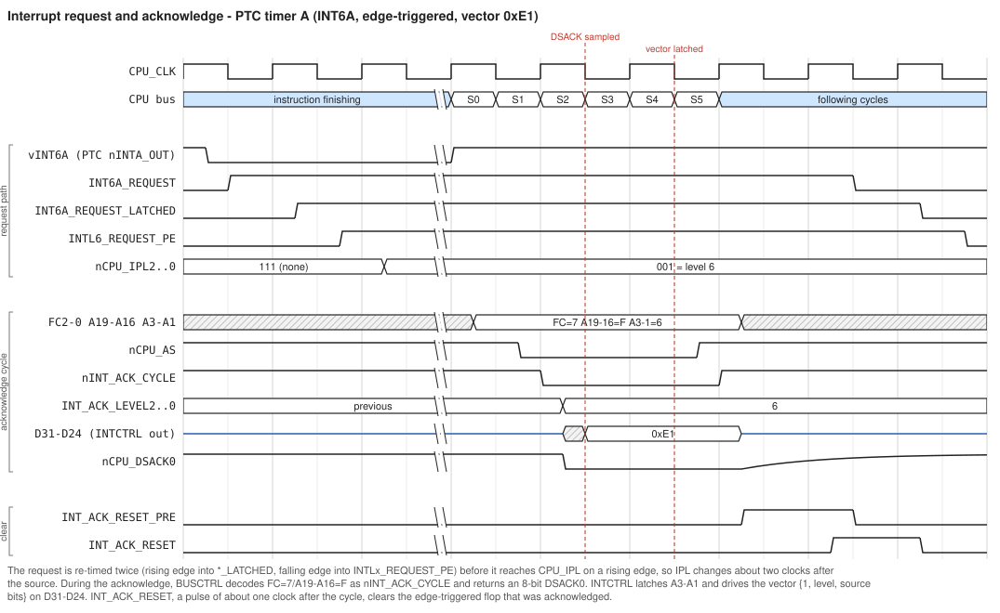

### 9.6 Problems found in the source

* **INT2A vector bug:** `INT2A_REQUEST_PE = INT3A_REQUEST_LATCHED;` should be `INT2A_REQUEST_LATCHED`. A level-2 acknowledge of INT2A returns 0xA0 (spurious), and INT2B can win even when INT2A is pending. It is latent today because the mask is forced to 0.
* **IDE interrupt polarity:** ATA INTRQ is active **high** (and tri-stated when the device is deselected or nIEN = 1), but INT5B/5C are decoded as `!vINT5x`. If those masks are ever enabled, an idle drive will look like a pending interrupt.
* **Missing pull-ups:** the RTC `/IRQ` is open-drain, and the schematic has no pull-up on `vINT1A`. INTCTRL's pin keepers are on, so after the first RTC interrupt the line can stay latched low once the RTC releases it. The current boards have a pull-up added by rework (Section 15). The IDE INTRQ lines still float whenever the drive tri-states them; add pull-downs if the polarity is corrected and IDE interrupts are enabled.
* **INT1B comments disagree:** the comments say "rising edge" and "positive level", while the code triggers on the falling edge. It is masked off anyway.
* **Software reset** pulse width: Section 3.2.

---

## 10 PTC - programmable timer (U11)

ATF1504AS (TQFP-44), source `plds/PTC/PTC.PLD`. It sits in the 16-bit region at 0x4000_0400. Its JTAG is separate, on J11.

### 10.1 Wiring

| PTC pin | Net |
|---|---|
| D15-D0 | CPU D31-D16 |
| `nPTC_CS` (27) | DEVMAP `nPTC_CS` |
| `nPTC_RW` (15) | `CPU_RW` |
| `nPTC_A2` (14) | **CPU A1** (the name is historical) |
| `nSYS_RESET` (39) | `nSYS_RESET` |
| `PTCA_CLOCK` (40) | U12, 32.768 kHz |
| `PTCB_CLOCK` (37) | BUSCTRL `CPU_CLK_DIV16` |
| `nINTA_OUT` (43) / `nINTB_OUT` (42) | `vINT6A` / `vINT6B` |

### 10.2 Programming model

* **Write** (byte or word, any address in the window). The value is taken from PTC D7-D0 = CPU D23-D16, which is the low byte of a word written to 0x4000_0400, or a byte written to 0x4000_0401:

  | Bits | Meaning |
  |---|---|
  | 2-0 | timer A rate |
  | 3 | timer A run (1 = run, 0 = counter and interrupt held in reset) |
  | 6-4 | timer B rate |
  | 7 | timer B run |

  The register clocks on the rising edge of `nPTC_CS # nPTC_RW`, which is the end of the cycle. Like the LED latches, it relies on data still being on the bus after AS.
* **Read** a word at 0x4000_0400 for timer A's 12-bit count, or at 0x4000_0402 for timer B's. Bits 15-12 read as 0. A long-word read returns A in the high word and B in the low word. The count can change during a read.

### 10.3 Interrupt rates

The interrupt fires when counter bit N = rate + 4 sets; the counter then restarts.

| Rate | Bit | Timer A (32.768 kHz) | Timer B at 12 MHz | Timer B at 16 MHz | Timer B at 20 MHz | Timer B at 25 MHz |
|---|---|---|---|---|---|---|
| 0 | 4 | 488 us | 21.3 us | 16 us | 12.8 us | 10.2 us |
| 1 | 5 | 977 us | 42.7 us | 32 us | 25.6 us | 20.5 us |
| 2 | 6 | 1.95 ms | 85.3 us | 64 us | 51.2 us | 41 us |
| 3 | 7 | 3.91 ms | 171 us | 128 us | 102 us | 82 us |
| 4 | 8 | 7.81 ms | 341 us | 256 us | 205 us | 164 us |
| 5 | 9 | 15.6 ms | 683 us | 512 us | 410 us | 328 us |
| 6 | 10 | 31.3 ms | 1.37 ms | 1.02 ms | 819 us | 655 us |
| 7 | 11 | 62.5 ms | 2.73 ms | 2.05 ms | 1.64 ms | 1.31 ms |

Timer B periods are one or two ticks longer than shown because of the reset handshake. The comment in the source that says "000 = no interrupt" is stale: a stopped timer is "run = 0".

### 10.4 How the pulse is made

The selected bit pulls `nINTx_OUT` low. On the next falling `PTCB_CLOCK` edge, `nINTx_OUT_DELAYED` goes low and asynchronously clears the counter (and the mid-counter clock), which ends the pulse. The following falling edge releases the counter. INTCTRL captures the falling edge. The 12-bit counter is built as two 6-bit halves with a registered carry (`PTCx_MIDCLOCK`) to fit; the fitter reports 67 of 64 "nodes + feedback", so the device is full.

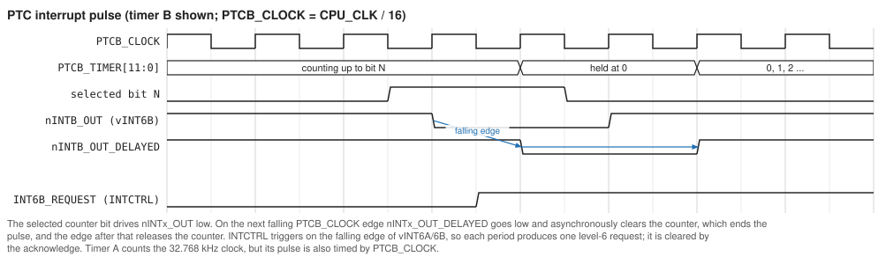

---

## 11 Other on-board devices

* **FPU (U22, 68881/68882, PLCC).**

  | Pin | Connection |
  |---|---|
  | CLK | CPU_CLK |
  | /CS | `nFPU_CS` |
  | /AS, /DS, R/W, A4-A0, D31-D0 | CPU |
  | DSACK1/0 | shared with BUSCTRL (wired-OR) |
  | /RESET | `nSYS_RESET` |
  | SIZE | +5 V (32-bit) |
  | /SENSE | not connected |

  FPU operation is still untested (README). Without an FPU, FPU instructions hang the bus rather than taking a bus error and F-line trap (Section 5.1).
* **Boot flash (U3, SST39SF040).**

  | Pin | Connection |
  |---|---|
  | A18-A0 | CPU A18-A0 |
  | D7-D0 | CPU D31-D24 |
  | /CE | `nBFLASH_CE` |
  | /OE | `nCPU_RD` |
  | /WE | `nBFLASH_WE` |

  Reprogramming works with the standard SST command sequences at 0x5555/0x2AAA (byte addresses within the 512 KB device).
* **SRAM riser** (sheet 5 connector U6; `RoscoeSRAMboardV2.pdf`). Eight IS61C25616AL; the schematic says -10, but the fitted parts are 12 ns. Bank n uses an "upper" chip (D15-D0) and a "lower" chip (D31-D16):

  | Chip | Pin | Byte select |
  |---|---|---|
  | Upper (D15-D0) | /LB | `nSRAM_UH_SEL` (D7-D0) |
  | Upper (D15-D0) | /UB | `nSRAM_UL_SEL` (D15-D8) |
  | Lower (D31-D16) | /LB | `nSRAM_LH_SEL` (D23-D16) |
  | Lower (D31-D16) | /UB | `nSRAM_LL_SEL` (D31-D24) |

  The other signals are common to every chip:

  | Pin | Connection |
  |---|---|
  | A17-A0 | CPU A19-A2 |
  | /CE | `nSRAM_BANKn_CE` |
  | /OE | `nCPU_RD` |
  | /WE | `CPU_RW` |

  The connector carries exactly these 64 signals plus power, with no spare pins.
* **UART (U36, ST16C2550).** The memory-map PDF calls it a TL16C2552.

  | Pin | Connection |
  |---|---|
  | D7-D0 | CPU D31-D24 |
  | A2-A0 | CPU A2-A0 |
  | /CSA, /CSB | `nUART_CSA`, `nUART_CSB` |
  | /IOR | `nCPU_RD` |
  | /IOW | `CPU_RW` |
  | RESET | `SYS_RESET_POS` |
  | INTA, INTB | `vINT4A`, `vINT4B` |
  | XTAL1 | 18.432 MHz from U13 |

  Because /IOW is R/W, the write is ended by /CS rising at the end of the cycle, with the same data-hold caveat as the SRAM. Modem-control lines go to J301 (A) and J20 (B) with R301 pull-ups.
* **RTC (U33, DS12887):** Section 8.4. RCLR goes to jumper J2 (RAM clear) and SQW is unused.

---

## 12 IDE interface in depth

### 12.1 Hardware

There are two identical 40-pin ports, IDE1 on J4 and IDE2 on J6.

| Function | IDE1 (J4) | IDE2 (J6) |
|---|---|---|
| Data DD7-DD0 <-> CPU D23-D16 | U38 (SN74AHC245) | U41 |
| Data DD15-DD8 <-> CPU D31-D24 | U37 (SN74AHC245) | U40 |
| Transceiver /OE | `nIDE_BUFFER_EN1` | `nIDE_BUFFER_EN2` |
| Transceiver DIR | `CPU_RW` (read = drive -> CPU) | same |
| Address/control buffer, always enabled | U39 (74AHC244) | U42 |
| A2, A1, A0 | CPU A7, A6, A5 | same |
| /CS0, /CS1 | `nIDE1_CSA`, `nIDE1_CSB` | `nIDE2_CSA`, `nIDE2_CSB` |
| /IOR | `nCPU_RD` | same |
| /IOW | `nIDE_WR` | same |
| /RESET | `nSYS_RESET` | same |
| INTRQ (pin 31) | `vINT5B` | `vINT5C` |
| Pin 20 power (for DOMs/CF adapters) | J5 jumper to +5 V | J7 |
| IORDY, /IOCS16, DASP, PDIAG, CSEL | not connected | not connected |

`nCPU_RD` and `nIDE_WR` reach **both** ports. A drive only acts when its own /CS is asserted, so that is fine, but /IOR pulses on every read cycle in the system.

**Input thresholds.** The netlist gives the data transceivers as SN74AHC245, and AHC inputs have CMOS thresholds: at 5 V a valid high is at least about 3.5 V (0.7 VCC). ATA only promises VOH of 2.4 V from a drive, and many later drives and some CF cards drive 3.3 V levels. In the read direction (drive to CPU) such a high sits in the transceiver's undefined band. It usually still reads correctly, because AHC actually switches near 2.5 V, but with little noise margin. SN74AHCT245 is a drop-in replacement with TTL thresholds (VIH 2.0 V); see [changes.md](changes.md) P7. **Check** which parts are actually fitted.

### 12.2 Register map

Register n of the command block sits at the CS0 base plus 0x20 x n; the control block uses the CS1 base the same way. The 8-bit registers are on DD7-DD0, which is CPU D23-D16, the **odd** byte of the 16-bit port. Use byte accesses at base + 0x20 x n + 1, or word accesses with the value in the low byte. This is what the software in the captures does: a word write of 0x00A0 to 0x400000C0.

| Register | IDE1 | IDE2 |
|---|---|---|
| Data (16-bit) | 0x4000_0000 | 0x4000_0200 |
| Error / Features | 0x4000_0021 | 0x4000_0221 |
| Sector count | 0x4000_0041 | 0x4000_0241 |
| LBA low / mid / high | 0x4000_0061 / 81 / A1 | 0x4000_0261 / 81 / A1 |
| Device/Head | 0x4000_00C1 | 0x4000_02C1 |
| Status / Command | 0x4000_00E1 | 0x4000_02E1 |
| Alt status / Device control | 0x4000_01C1 | 0x4000_03C1 |

### 12.3 Byte order

DD15-DD8 lands on D31-D24, the even address. A 16-bit read therefore returns the ATA word with its high byte at the even address. Word-valued IDENTIFY fields read correctly as 16-bit numbers, and IDENTIFY strings (stored high byte first) read in the right order. Raw sector data, however, comes out byte-swapped relative to how a PC stores it, so swap each word when exchanging disks with PCs (FAT, MBR and so on).

### 12.4 What ATA PIO timing requires

These are the standard ATA PIO limits (ATA/ATAPI-4 and later), in ns:

| Parameter | Mode 0 | Mode 1 | Mode 2 | Mode 3 | Mode 4 |
|---|---|---|---|---|---|
| t0 cycle time (min) | 600 | 383 | 240 | 180 | 120 |
| t1 address/CS valid to /IOR or /IOW (min) | 70 | 50 | 30 | 30 | 25 |
| t2 /IOR or /IOW pulse width, 16-bit (min) | 165 | 125 | 100 | 80 | 70 |
| t2 pulse width, 8-bit register access (min) | 290 | 290 | 290 | 80 | 70 |
| t3 write data setup to /IOW rising (min) | 60 | 45 | 30 | 30 | 20 |
| t4 write data hold after /IOW rising (min) | 30 | 20 | 15 | 10 | 10 |
| t5 read data setup to /IOR rising (min) | 50 | 35 | 20 | 20 | 20 |
| t9 address/CS hold after /IOR or /IOW (min) | 20 | 15 | 10 | 10 | 10 |

Devices power up in mode 0. Many CF cards and newer drives tolerate faster strobes, but the hold times (t4, t9) matter to all of them.

### 12.5 What the current logic actually does

The intent (DEVMAP comments) is two wait states for IDE: `nIDE_WAITSTATE_DELAY` is clocked by the IDE select going active and pulls `nDEV_WAIT` low, BUSCTRL then withholds DSACK1, and a two-flop chain (`RESETw1`, `RESETw2`) releases it. A delayed write strobe goes with it. The timing does not work:

1. **The wait request loses the race.** BUSCTRL asserts DSACK1 for the whole 16-bit region about two CPLD levels after AS. DEVMAP's request takes BUSCTRL's select, DEVMAP's decode, a product-term-clocked flop and an output, and then BUSCTRL needs two more levels to drop DSACK. Worst-case figures, measured from the start of the cycle:

   | CPU clock | DSACK1 asserted | CPU samples DSACK | BUSCTRL starts releasing DSACK1 |
   |---|---|---|---|
   | 20 MHz | 50-70 ns | 75 ns | 90-105 ns |
   | 16 MHz | 57-74 ns | 94 ns | 95-112 ns |
   | 12 MHz | 68-85 ns | 125 ns | 106-123 ns |

   At 12 MHz the release only just beats the sample edge, and then the 1K pull-up would need roughly 15-25 ns to raise the open-collector line above 2.0 V (Section 4.5). It has a few nanoseconds. **Every IDE cycle therefore runs with zero wait states, at all three clock speeds.**
2. **The captures confirm it.** In `ide1.JPG` and `ide2.JPG` (writes of 0xA0 to Device/Head and 0xEC, IDENTIFY, to Command, at 12 MHz), `DSACK1` goes low at the instant `nIDE1_CSA` falls and stays low, and AS is low for only two clocks: a 3-clock cycle. Those captures also show `nIDE_WR` falling before AS and CS, plus a short glitch after the cycle. That behaviour comes from an older DEVMAP revision; the current one is different, but no better (point 4).
3. **/IOR is too short for slow devices.** Since BUSCTRL rev 29, /IOR (`nCPU_RD`) starts at S3 and ends when AS negates: about one clock (50 ns at 20 MHz, 62 ns at 16 MHz, 83 ns at 12 MHz). After allowing for the CPLD, U39 and the data transceiver, a drive gets roughly 15 ns (20 MHz), 25 ns (16 MHz) or 45 ns (12 MHz) from /IOR falling at the connector to valid data. Mode 0 allows a drive 115 ns (t2 - t5), and even mode 4 allows 50 ns. Fast CF cards cope; older drives will return stale data. Before rev 29 the opposite problem existed: /IOR asserted in S0, ahead of /CS (violating t1).
4. **/IOW ends after CS and data are gone.** `nIDE_WR = CPU_RW # !IDE_WR_SIG`. `IDE_WR_SIG_A` arms on the first falling edge after the select and `IDE_WR_SIG` sets on the next rising edge, so /IOW falls in S4. With no wait states, `IDE_WR_SIG_RESET` is held off by `nDEV_WAIT` for the whole cycle. /IOW therefore only rises when R/W changes in the next cycle or the select disappears: at or after the moment /CS0 rises and the 245s turn off. ATA latches the write on the rising edge of /IOW and needs CS and data held afterwards (t9, t4), so writes can be lost or written to the wrong register.
5. **IDE2 is half-implemented.** `IDE_WR_SIG_A.ar` and the clock of `nIDE_WAITSTATE_DELAY` use only `nIDE1_CSA`/`CSB`. An IDE2 cycle never generates /IOW at all, and never even requests a wait state.
6. **The wait request leaks into the next cycle.** `nIDE_WAITSTATE_DELAY` is only cleared by `RESETw2`, one or two clocks after the IDE cycle has already ended, so `nDEV_WAIT` can still be low when the next device cycle starts. Back-to-back data-register transfers then see inconsistent timing.
7. **Interrupts:** INTRQ polarity and the hard-coded masks (Section 9.6) mean IDE has to be polled for now.

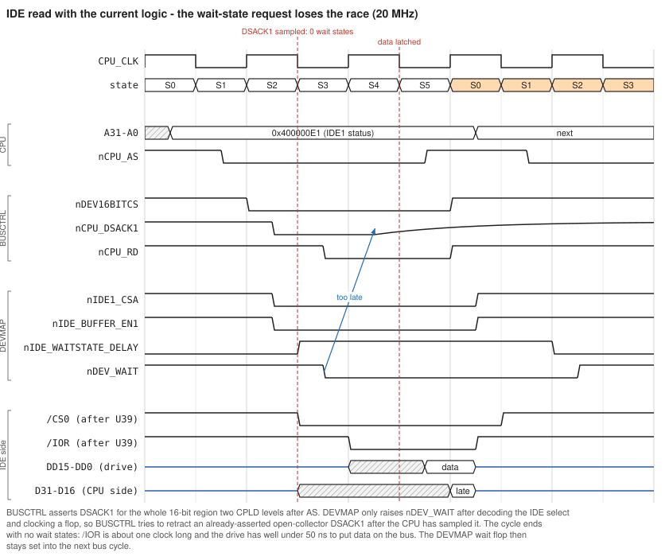

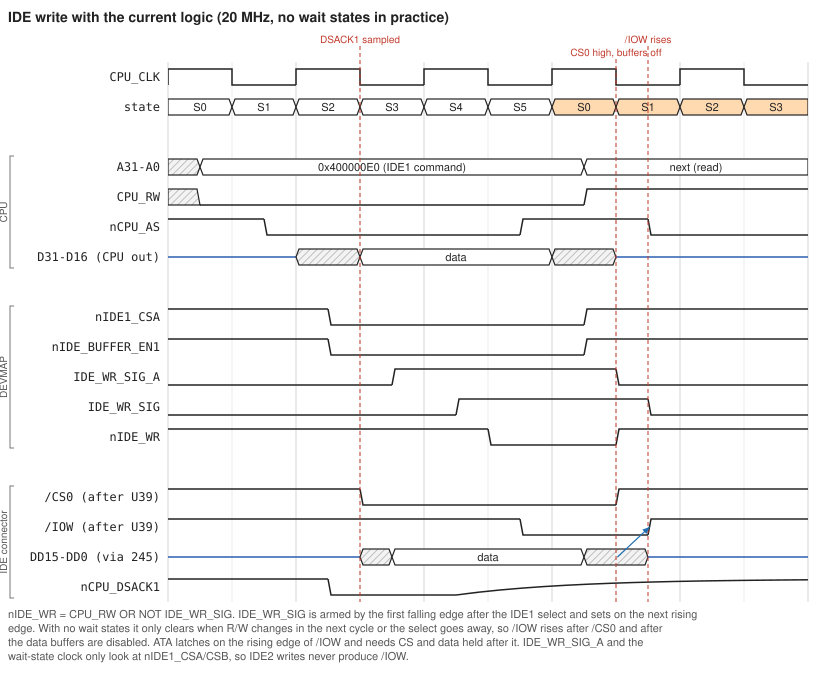

### 12.6 Measuring it

| What | Where |
|---|---|
| `nIDE1_CSA`, `nIDE1_BUFFER_EN`, `nIDE_WR`, `nPTC_CS` | logic header U4 (D4, D3, D2, D1) |
| `nCPU_AS`, `CPU_RW`, `nCPU_DSACK0/1`, `CPU_CLK` | logic header U70 (D15, D14, D11, D10, CLK1) |
| `nDEV_WAIT`, `nIDE_WAITSTATE_DELAY`, `RESETw2` | DEVMAP test header J28 (pins 3, 2, 1). After CS1: `nCPU_AS` (rework wire), `nDEV_ACK`, `T1`. |
| `nIDE_RD_INH` (after CS2) | logic header U5 (D15, pin 4), net `EXTRA_BC_DM1` |
| /IOR, /IOW, /CS0 at the drive | J4 pins 25, 23, 37 |

Useful checks:

* Count the clocks AS stays low on IDE cycles: 2 means zero wait states, 4 means two.
* Compare the time from `nDEV_WAIT` falling to the DSACK1 sample edge.
* With an analog scope, measure how fast DSACK1 rises at the end of a cycle.
* At the IDE connector, check /IOW rising against /CS0 and against the data lines.

### 12.7 Proposed fix (not implemented)

> **Superseded.** The fix is now change sets CS1 and CS2 in [changes.md](changes.md). CS1 keeps the idea below (never assert and then retract DSACK), but adds a direct AS wire to DEVMAP and makes the device acknowledge combinational, so fast devices keep 0 wait states. CS2 sets the IDE timing to PIO mode 0, with a mode 2 alias for the Data register. It shapes /IOR through BUSCTRL, holds /CS after the strobes, and fixes the interrupts, the missing pull-downs and the reset length. This section is kept for the reasoning.

The robust approach is never to assert DSACK for a device region and then try to retract it. Make the acknowledge registered, and let DEVMAP decide when each device is ready:

* **BUSCTRL:** replace the combinational device-region DSACK terms with a registered acknowledge:

  ```
  PINNODE = DEV_SEEN, DEV_ACK;
  DEV_ANY = DEV8BIT_REGION_ACCESS # DEV16BIT_REGION_ACCESS # DEV32BIT_REGION_ACCESS;
  DEV_SEEN.d = DEV_ANY;            DEV_SEEN.ck = !CPU_CLK;  DEV_SEEN.ar = nCPU_AS # !nSYS_RESET;
  DEV_ACK.d  = DEV_SEEN & nDEV_WAIT; DEV_ACK.ck  = !CPU_CLK;  DEV_ACK.ar  = nCPU_AS # !nSYS_RESET;
  /* DSACK0/1 for the device regions then use DEV_ACK & DEVxBIT_REGION_ACCESS instead of
     DEVxBIT_REGION_ACCESS & nDEV_WAIT. */
  ```

  `DEV_SEEN` gives DEVMAP a full clock to raise `nDEV_WAIT` before it is first sampled. Device cycles become at least 5 clocks, which costs very little for UARTs, RTC and IDE.
* **DEVMAP:** replace the IDE wait and strobe logic with a small sequencer that covers both ports:

  ```
  IDE_CYCLE = !(nIDE1_CSA & nIDE1_CSB & nIDE2_CSA & nIDE2_CSB);
  /* IDE_T[2:0]: counts falling CPU_CLK edges while IDE_CYCLE, async-cleared when !IDE_CYCLE,
     saturating at 4 */
  nIDE_WR   = !(IDE_CYCLE & !CPU_RW & (IDE_T >= 1) & (IDE_T <= 3));
  nDEV_WAIT = !(IDE_CYCLE & (IDE_T < 4)) & nEXP_DEV_WAIT;
  ```

  /IOW then sits inside the cycle, with CS and data held for several clocks after it rises. /IOR stays on `nCPU_RD` and covers S3 to the end of the cycle. The compare values set the PIO timing, so make them depend on the CPU clock. Shown below for 20 MHz: /IOW 150 ns, an 8-clock cycle and /IOR about 300 ns, which meets PIO mode 1-2 strobe and cycle times. Raise the counts for mode 0.
* An even cleaner option is a dedicated "device ready" line. The spare `EXTRA_BC_DM1/2` nets already connect DEVMAP and BUSCTRL, so `nDEV_WAIT` (and its pass-through of `nEXP_DEV_WAIT`) can stay as it is while the new handshake is tried.

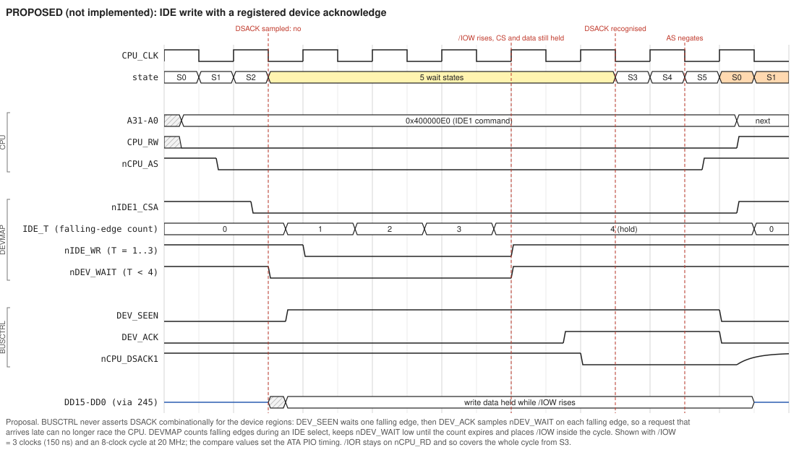

Changing the handshake means reprogramming **both** CPLDs together. Keep the current JEDs to hand.

---

## 13 Expansion interface - notes for card designers

### 13.1 Connector (U46-U48, sheet 13; 2 x 31 + 2 x 18 edge connector)

| Pin | Signal | Dir (from the board) | Source and notes |
|---|---|---|---|
| A1-A9, A11-A15, A17, A18 / B1-B9, B11-B15, B17, B18 | `EXP_A0`-`EXP_A31` (even on A, odd on B) | out | U49-U52 (74AHC244), always enabled |
| C1-C4, C6-C13, C15-C18 / D1-D4, D6-D13, D15-D18 | `EXP_D0`-`EXP_D31` (even on C, odd on D) | bidir | U54-U57 (SN74AHC245), always enabled. CMOS input thresholds: a card must drive reads with 5 V CMOS levels (13.2). |
| A10, B10, C14, D14 | +5 V | | no 3.3 V or 12 V |
| A16, B16, C5, D5 | GND | | |
| A19 | `EXP_RW` | out | U53 |
| A25 | `nEXP_CPU_AS` | out | U53 |
| B24, B25 | `nEXP_CPU_SIZ0`, `nEXP_CPU_SIZ1` | out | U68. **Not inverted** despite the `n` names: these are SIZ0/SIZ1. |
| B27 | `EBUS_CPU_CLK` | out | its own U1 inverter section |
| B28 | `nEXP_SYS_RESET` | out | U53 |
| B19, A20, B20 | `nEXP_8BDEV`, `nEXP_16BDEV`, `nEXP_32BDEV` | out | DEVMAP: whole-region selects |
| A30 | `nEXP_VIO_CS` | out | DEVMAP: 0x3000_0500-0x3000_05FF |
| A21 | `nEXP_VMEM_CS` | out | DEVMAP: 0x5000_0000-0x500F_FFFF. CS1 widens it to 2 MB, with a 0-wait-state motherboard acknowledge ([changes.md](changes.md) 1.4). |
| A27 | `nEXP_DATA_EN` | in (card drives) | 10K pull-up R48. Sets the U54-U57 direction: 0 = card drives the CPU. |
| A26 | `nEXP_DEV_WAIT` | in | 10K pull-up R10, into DEVMAP pin 32 (13.6). CS1 renames it `nEXP_ACK`: the card's "cycle may end" ([changes.md](changes.md) 1.6). |
| A28 | `nEXP_CACHE_CTRL` | in | 10K pull-up R12, into DEVMAP pin 33 (unused) |
| A29, A22 | `nEXP_INT5A`, `nEXP_INT5D` | in | level 5 |
| B22 | `nEXP_INT4C` | in | level 4 |
| B21, A23 | `nEXP_INT3A`, `nEXP_INT3B` | in | level 3 |
| A24, B23 | `nEXP_INT2A`, `nEXP_INT2B` | in | level 2. A24's symbol pin is named `EXP_nVIDRFSH_INT`. |
| B26, B30 | `EXP_BC_CPLD1/2` | BUSCTRL 28/29 | currently **driven low**. CS1 makes them the VMEM hold-off pair, `nEXP_VMEM_BUSY` (in, needs a pull-up) and `nEXP_VMEM_GNT` (out) ([changes.md](changes.md) 1.4). |
| A31, B31 | `EXP_DM_CPLD1/2` | DEVMAP 7/8 | currently **driven low** |
| B29 | `EXP_INT_CPLD2` | INTCTRL 32 | currently **driven low**. `EXP_INT_CPLD1` (INTCTRL 31) is not on the connector; the netlist shows it going only to logic header U24 (CLK1). |

All interrupt inputs have 10K pull-ups (R18-R22, R58, R59) and pass through U53/U68 to INTCTRL. They are active-low and level-sensitive, so a card should pull the line low (open-drain is fine) until software services it.

### 13.2 Buffering

Address and control are one-way 244s, so cards cannot master the bus. The data 245s are **always enabled**; `nEXP_DATA_EN` only selects their direction. As a result:

* During every CPU write, and every read from an on-board device, the 245s drive the CPU's data onto `EXP_D`. Cards must keep `EXP_D` tri-stated unless they are being read.
* To answer a read, a card drives `EXP_D` and pulls `nEXP_DATA_EN` low. It must release both as soon as its select goes away. **Drive `nEXP_DATA_EN` high actively** (a tri-state driver that drives high, then lets go), or use a much stronger pull-up. With only R48 (10K) and the capacitance of the connectors and four DIR inputs, the 245s stay pointed at the CPU bus for hundreds of nanoseconds and fight the next cycle ([timing/10](timing/10-expansion-read.svg)).
* The 245s are SN74AHC245, with CMOS input thresholds: a high must reach about 3.5 V. Drive `EXP_D` and `nEXP_DATA_EN` from 5 V CMOS outputs (HC, HCT, AC, ACT, or a 5 V CPLD), not from LS or F parts or 3.3 V logic. Fitting SN74AHCT245 in U54-U57 would remove the restriction.

### 13.3 Port size

Port size follows the region, not the card: anything selected by `nEXP_8BDEV` is an 8-bit port on D31-D24, `nEXP_16BDEV` is 16-bit on D31-D16, and `nEXP_32BDEV` is 32-bit. Byte selects for 32-bit cards have to come from SIZ0/SIZ1 and A1/A0, using the same table as Section 7.5.

### 13.4 Address decoding on a card

The `nEXP_xxBDEV` selects cover entire 256 MB regions **including on-board devices**, so a card must decode further address bits itself. The DEVMAP comments propose 16 MB windows: 0x3100_0000 for 8-bit, 0x4100_0000 for 16-bit and 0x5100_0000 for 32-bit. Those avoid all on-board windows (0x3000_0000-0x3000_08FF, 0x4000_0000-0x4000_04FF), and on the 32-bit side the 0x5000_0000-0x500F_FFFF VMEM window is available as a ready-made select.

### 13.5 Timing budget for a card today

With the current BUSCTRL, every expansion cycle is a zero-wait-state cycle:

* At 20 MHz `nEXP_xxBDEV` is valid about 2 CPLD levels plus a buffer after AS (roughly 60-70 ns into the cycle).
* Read data must be valid at the connector about 115 ns into the cycle (the CPU latches at 125 ns, minus the 245 delay and 4 ns setup).
* A card therefore has about 50 ns from its select to valid read data, including its own decode.
* For writes, data is valid at the connector from about S2 plus 30 ns until AS negates. A card should latch on its select or on `nEXP_CPU_AS` rising, and it gets only #25 (10 ns) of guaranteed hold.

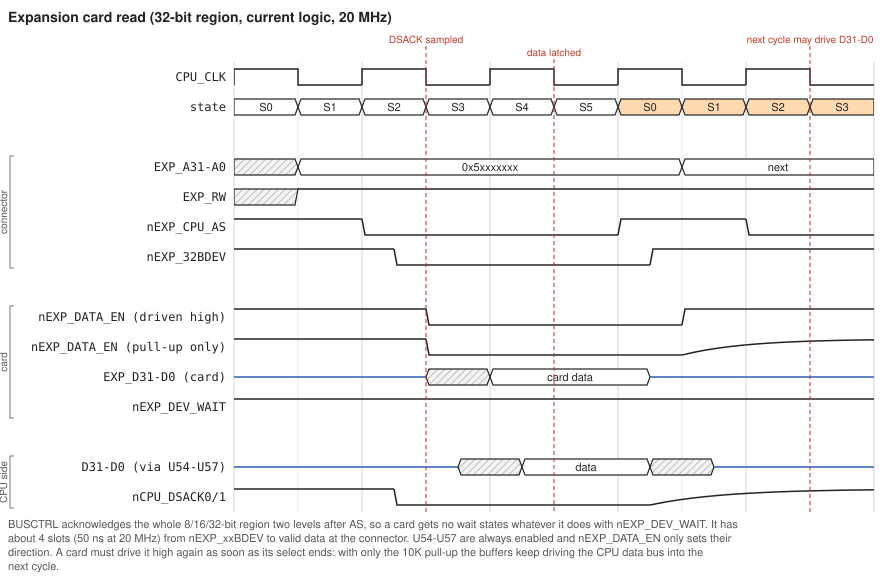

### 13.6 Wait states

`nEXP_DEV_WAIT` cannot stretch a cycle today, for the same race as IDE (Section 12.5). The request would have to arrive before BUSCTRL sees the select. [changes.md](changes.md) CS1 replaces it with an acknowledge on the same pin (A26): `nEXP_ACK`, which a card pulls low when its cycle may end. The VMEM window instead gets a 0-wait-state motherboard acknowledge, which a video card can hold off with the busy/grant pair on B26/B30. Until CS1 is programmed, design cards for zero wait states, or use them for slow devices that can be written through latches and polled.

### 13.7 Checklist for a new card

* Decode A27-A24 (at least) as well as the region select. Do not respond to on-board windows.
* Use the region that matches the card's data width, and connect data to the matching lanes (D31-D24 for 8-bit).
* Keep `EXP_D` tri-stated except during your own read cycles. Drive `nEXP_DATA_EN` low only while selected and reading, and drive it high again promptly.
* Assume zero wait states for now: about 50 ns from select to data at 20 MHz.
* Interrupts: open-drain, active-low on one of the 7 lines. The INTCTRL masks for every expansion line are currently forced to 0, so INTCTRL needs a source change before any card interrupt can reach the CPU.
* Leave the `EXP_*_CPLD*` pins alone until the CPLD equations are changed; they are driven low today. CS1 assigns B26 and B30 to the VMEM hold-off.
* Only +5 V is available on the connector.

---

## 14 Findings and open issues

Confidence: **high** means read directly from the source or schematic, **medium** means inferred from timing analysis and worth measuring, **low** means it depends on a part not documented here.

| # | Area | Finding | Impact | Confidence | Suggested action |
|---|---|---|---|---|---|
| 1 | IDE | Wait states are never actually inserted: DSACK1 is asserted before `nDEV_WAIT` arrives (12.5) | IDE cycles run at 3 clocks, too short for many devices | high (logic plus captures) | device acknowledge, [changes.md](changes.md) CS1 |
| 2 | IDE | /IOW rises after /CS0 and the data buffers are released (12.5 point 4) | lost or misdirected writes | high | /IOW inside the cycle, CS1 and CS2 |
| 3 | IDE | IDE2 never gets /IOW or wait states | IDE2 writes do not work | high | all four selects, CS1 |
| 4 | IDE | INTRQ treated as active low; masks forced off | no IDE interrupts | high | polarity, masks and pull-downs, CS2 |
| 5 | Bus | The schematic gives the open-collector DSACK lines 10K pull-ups, far slower than #28 (4.5) | none on the current boards, which have 1K fitted | confirmed | fix the R51/R52 value on the schematic (15.1) |
| 6 | CPU | `/CDIS`, `/MMUDIS`, `/CBACK` unconnected on the PCB (4.6) | random cache or MMU disable | confirmed | reworked with pull-ups on current boards; fix on the next PCB (15) |
| 7 | Reset | Software reset pulse about 1 clock (3.2) | unreliable CPU/peripheral reset; IDE drives need 25 us | high | stretch the pulse, [changes.md](changes.md) CS2 B10 |
| 8 | Reset | `nSYS_RESET` push-pull vs the `RESET` instruction (3.2) | contention if software uses `RESET` | high | avoid `RESET`, or make the output open-collector |
| 9 | Bus | No bus timeout; 0x6/0x7 region, `BKPT` and a missing FPU hang (5.1) | hard hangs during OS bring-up | high | BERR timeout counter in BUSCTRL |
| 10 | INTCTRL | `INT2A_REQUEST_PE` uses INT3A (9.6) | wrong vector for video interrupt | high | one-line fix |
| 11 | INTCTRL | Most mask bits hard-coded 0; no readable status | expansion, IDE and power interrupts unusable | high | enable as the hardware matures |
| 12 | RTC | RTC `/IRQ` (open-drain) has no pull-up on the PCB (9.6) | RTC interrupt sticks | confirmed | reworked with a pull-up on current boards; fix on the next PCB (15) |
| 13 | Writes | PTC, LED latches, UART and SRAM end writes at or after AS negation; #25 guarantees only 10 ns | marginal writes | medium | clock registers mid-cycle (as for INTCTRL) |
| 14 | Flash | -70 flash does not meet 0-wait-state timing at 20 MHz worst case (7.6) | boot reads at higher clocks | medium | -55 part or a wait state |
| 15 | RTC | DS pulse about 50 ns with no wait states; /CS rises before DS falls (8.4) | possible RTC read/write errors | low | compare with the DS12887 data sheet |
| 16 | Clock | The boards run at 12 or 16 MHz; 12 MHz is just under the data sheet's 12.5 MHz minimum for the 20 and 25 MHz grades | none seen | informational | prefer 16 MHz when chasing marginal behaviour |
| 17 | Docs | Small mismatches: PTC address comment; memory-map PDF (PTC 512 B, TL16C2552, DS12887 vs DS12877); refresh comment says 15 us (the actual interval is 128 CPU clocks); the hardware manual is a stub; `.chn` paths point to the old tree | confusion | high | tidy as you go |
| 18 | Buffers | Per the netlist, the receivers that take data from outside are SN74AHC245 with CMOS thresholds (about 3.5 V for a high at 5 V): IDE data U37/U38/U40/U41, expansion data U54-U57, RTC data U35 (12.1, 13.2) | IDE drives with TTL-level or 3.3 V outputs read with little or no noise margin; cards must drive 5 V CMOS levels | medium (check the fitted parts) | SN74AHCT245, pin-compatible, at least in the IDE data path ([changes.md](changes.md) P7) |

---

## 15 Next PCB revision checklist

### 15.1 Reworked on the current V2 boards (must be fixed on the next PCB)

| # | Problem | Current boards | Next PCB |
|---|---|---|---|
| 1 | MC68030 `/CDIS` (PGA H12), `/MMUDIS` (F13) and `/CBACK` (J1) are unconnected, so they float (4.6) | wires from the three pins to a pull-up resistor | add pull-ups (10K to Vcc) on `/CDIS` and `/MMUDIS`. For `/CBACK`, decide first whether burst cache fills are wanted: if so, connect it to a CPLD output, or to GND through a jumper, instead of a fixed pull-up ([SRAMBurstProposal.md](SRAMBurstProposal.md) Section 4.1) |
| 2 | DS12887 RTC `/IRQ` (U33 pin 19, net `vINT1A`) is open-drain with no pull-up (9.6) | pull-up added. **Confirm on the board** that the rework is on `/IRQ`. | add a pull-up (10K to Vcc) on `vINT1A` |
| 3 | DSACK0/1 pull-ups R51/R52 are 10K on the schematic, too slow for the open-collector release (4.5) | 1K fitted | change the schematic value to 1K |

### 15.2 Candidates from this review (not yet decided)

These are board-level changes suggested by the analysis. None is needed for the board to run today.

| Change | Why | Reference |
|---|---|---|
| CS1 items: route `nCPU_AS` to a DEVMAP dedicated input; name connector A26 `nEXP_ACK` (1K pull-up), B26 `nEXP_VMEM_BUSY` (4.7K pull-up) and B30 `nEXP_VMEM_GNT` | removes the CS1 rework wires and pull-ups | [changes.md](changes.md) 1.13 |
| 10K pull-downs on IDE INTRQ (J4/J6 pin 31) and DD7 (pin 3) | INTRQ floats when the drive tri-states it; DD7 must read low with no drive fitted. Reworked by CS2 P5/P6 on the current boards. | 9.6, [changes.md](changes.md) 2.3 |
| Series resistors (22-33 ohm) on IDE /IOR, /IOW, /CS0, /CS1 and A2-A0 | damp ringing on the cable, which can double-clock a strobe | [changes.md](changes.md) 2.10 |
| SN74AHCT245 (TTL thresholds) instead of SN74AHC245 for the IDE data (U37/U38/U40/U41) and expansion data (U54-U57) transceivers | drives and cards only guarantee TTL output levels | 12.1, 13.2, finding 18 |
| Bring CPU A2/A3 into the bus controller, and route two CPLD outputs to the SRAM's A0/A1 (riser pins A18/B18), plus `/CBREQ` and `/CBACK` | allows 2-1-1-1 burst fills without rework | [SRAMBurstProposal.md](SRAMBurstProposal.md) |
| Drive IDE `/IOR` (U39/U42 pin 8) from a DEVMAP pin instead of `nCPU_RD` | gives the IDE sequencer full control of address setup (ATA t1) and strobe width | 12.5, 12.7 |
| Route IDE IORDY (pin 27) to a DEVMAP input | lets slow devices stretch cycles | 12.1 |
| Correct schematic labels: SRAM part number (12 ns parts are fitted), RTC symbol "DS12877", "common cathode" note on sheet 2 (the displays' common pins go to +5V) | documentation | 6, 11 |

---

## 16 Appendices

### A. JTAG chain

The main chain runs from J1 (Atmel 10-pin: 1 TCK, 2 GND, 3 TDO via J26, 4 VCC, 5 TMS, 9 TDI via J10, 10 GND):

```
J1 TDI -> J10 -> U58 BUSCTRL -> J8 -> U59 DEVMAP -> J9 -> U60 INTCTRL -> J26 -> J1 TDO
```

R1 and R3 (10K) pull up TDI and TMS, and the TDI/TMS pull-ups inside the CPLDs are enabled. `plds/ThreeProgram.chn` programs INTCTRL (device 3) and `ThreeProgramB.chn` programs DEVMAP (device 2), with the other devices bypassed. The PTC has its own header, J11, programmed with `plds/PTC/PTCProgram.chn`.

### B. Logic-analyser headers (sheet 15)

Every header is 20 pins: pin 20 GND, pin 1 5 V (not connected), pins 2/3 = CLK2/CLK1, pins 4-19 = D15-D0. `docs/DebugPinouts.xlsx` uses different reference designators in two places: its "U7" is U70 and its second "U5" is U4.

| Header | CLK1 / CLK2 | D15 ... D0 |
|---|---|---|
| U70 | CPU_CLK / - | nCPU_AS, CPU_RW, CPU_SIZ0, CPU_SIZ1, nCPU_DSACK0, nCPU_DSACK1, nCPU_IPL0, nCPU_IPL1, nCPU_IPL2, nSYS_RESET, nCPU_STERM, nSRAM_BANK1_CE, nSRAM_LH_SEL, nSRAM_LL_SEL, nSRAM_UH_SEL, nSRAM_UL_SEL |
| U4 | - | nCPU_BERR, nCPU_HALT, nCPU_CIIN, CPU_FC0, CPU_FC1, CPU_FC2, nSRAM_BANK2_CE, nSRAM_BANK3_CE, nSRAM_BANK4_CE, nSTATUSLED_WR, nFPU_CS, nIDE1_CSA, nIDE1_BUFFER_EN, nIDE_WR, nPTC_CS, (nc) |
| U5 | - | EXTRA_BC_DM1, nDRAM_S4B_RAS, S4A, S3B, S3A, S2B, S2A, S1B, S1A, nDRAM_CAS3, CAS2, CAS1, CAS0, nDRAM_WE, nDRAM_DATA_EN, DRAM_MUX |
| U25 | - | EXP_A1, A0, A3, A2, A5, A4, A7, A6, A9, A8, A11, A10, A13, A12, A15, A14 |
| U24 | EXP_INT_CPLD1 / EXP_INT_CPLD2 | EXP_A17, A16, A19, A18, A21, A20, A23, A22, A25, A24, A27, A26, A29, A28, A31, A30 |
| U23 | EXP_DM_CPLD1 / EXP_DM_CPLD2 | EXP_D1, D0, D3, D2, D5, D4, D7, D6, D9, D8, D11, D10, D13, D12, D15, D14 |
| U69 | EXP_BC_CPLD1 / EXP_BC_CPLD2 | EXP_D17, D16, D19, D18, D21, D20, D23, D22, D25, D24, D27, D26, D29, D28, D31, D30 |

The address and data headers tap the **buffered** expansion side. `EXP_D` mirrors the CPU data bus except while a card drives it.

### C. Timing diagrams

All diagrams are in `docs/timing/`. The `src/*.json` files are WaveDrom WaveJSON, so they can be pasted into <https://wavedrom.com/editor.html>. One extension, `markers`, draws the labelled vertical lines. After editing a source, regenerate the SVGs with:

```bash
powershell -ExecutionPolicy Bypass -File docs\timing\render-timing.ps1
```

The script needs no external tools. Diagrams use a quarter-clock grid at 20 MHz (one slot = 12.5 ns), and each CPLD level is drawn as one slot. They show ordering and approximate margins; the text gives nanosecond budgets where they matter.

| File | Shows |
|---|---|
| 01-sram-read-async | SRAM read, current logic |
| 02-sram-write-async | SRAM write, current logic |
| 03-bootflash-read | 8-bit flash cycle and access-time budget |
| 04-rtc-read | RTC address/data multiplexing |
| 05-intctrl-write | shortened INTCTRL write select |
| 06-interrupt-ack | request pipeline, IACK, vector, edge-request clear |
| 07-ide-read-current | IDE read and the wait-state race |
| 08-ide-write-current | IDE write strobe hazards |
| 09-ide-write-proposed | proposed registered acknowledge and IDE sequencer |
| 10-expansion-read | expansion card read budget and `nEXP_DATA_EN` |
| 11-software-reset | self-cancelling software reset |
| 12-ptc-interrupt | PTC interrupt pulse |
| 20-22 | DRAM read, write and refresh ([DRAM.md](DRAM.md)) |
| 30-31 | proposed synchronous SRAM ([SRAMBurstProposal.md](SRAMBurstProposal.md)) |
| 40-cs1-device-ack | proposed device acknowledge, CS1 ([changes.md](changes.md)) |
| 41-cs1-vmem-holdoff | proposed VMEM window grant and card hold-off, CS1 ([changes.md](changes.md) 1.4) |
| 42-cs2-ide-read, 43-cs2-ide-write | proposed IDE register read and write, base window, CS2 ([changes.md](changes.md) 2.2) |
| 44-cs2-ide-read-fast | proposed Data-register read through the fast window, CS2 |
