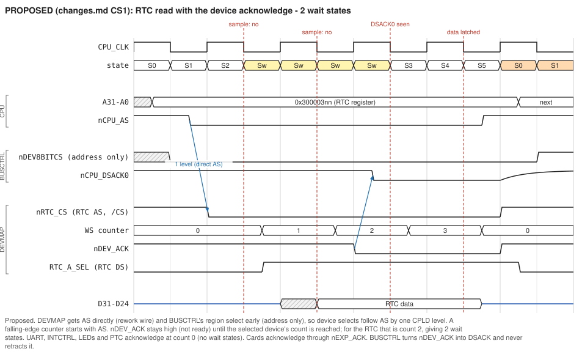
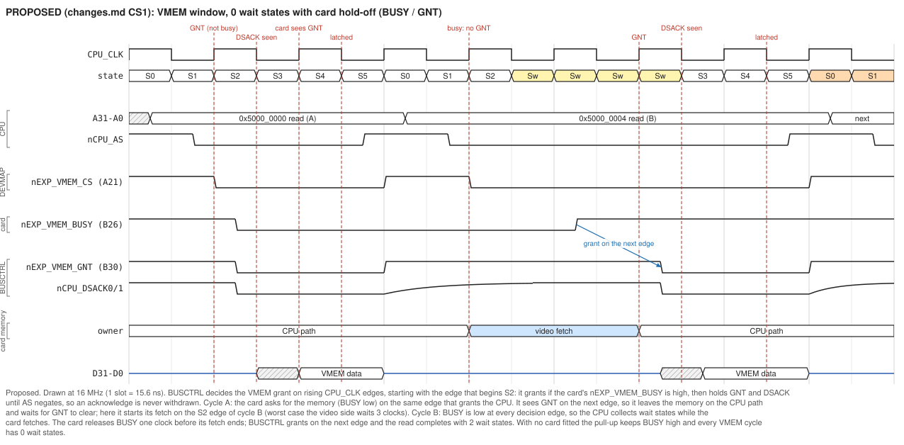
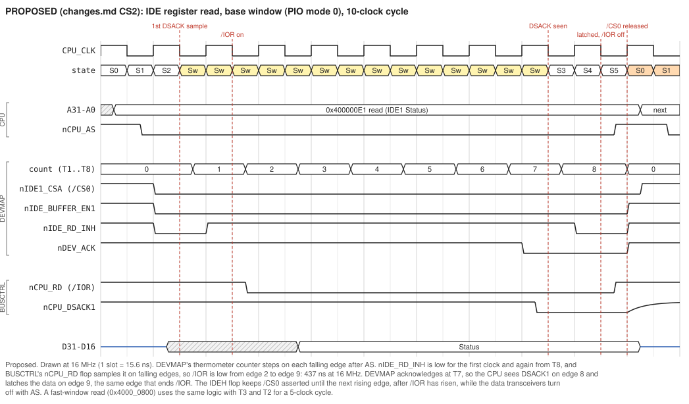
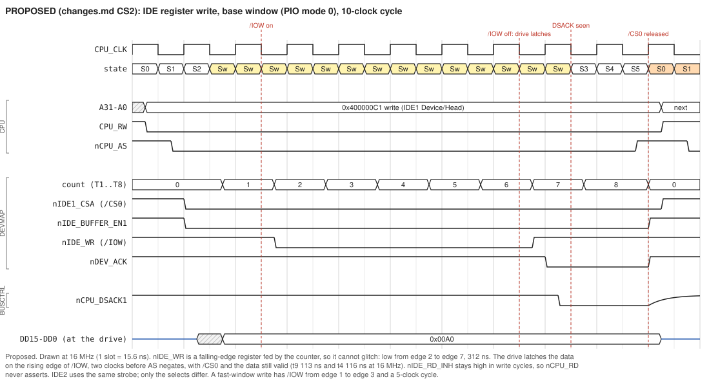
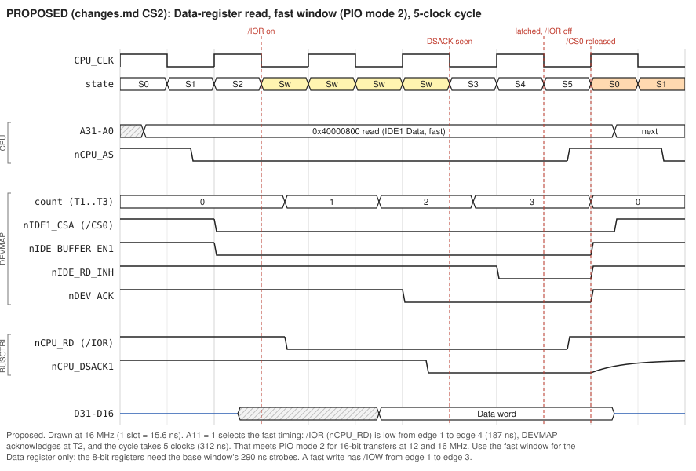

# Roscoe V2 - Change plan

This is the working list of every change we decide to make: physical rework on the current boards, CPLD source changes, expansion-bus definitions, and items for the next PCB. Changes are grouped into change sets (CS). Each set says what to wire, what to edit in which CPLD file, how to program and test it, and how to roll it back. Background and analysis are in [TheoryOfOperations.md](TheoryOfOperations.md).

Nothing in this file has been compiled or programmed yet. CS1's CUPL is written against the current sources (BUSCTRL rev 29, DEVMAP rev 20/21), and CS2's against CS1's revisions plus INTCTRL rev 16. They still need a WinCUPL compile, and the fit report has to be checked for logic levels as noted in each step.

**Status values:** Proposed -> Agreed -> Implemented (source edited) -> Programmed -> Verified.

| Set | Title | Status |
|---|---|---|
| CS0 | Pull-up rework already on the boards | Done on current boards; fix on next PCB |
| CS1 | Device-cycle acknowledge (replaces `nDEV_WAIT`), fast VMEM window with card hold-off, bus timeout, refresh during long cycles | **Agreed in principle; details under discussion (1.14)** |
| CS2 | IDE timing on both ports, /IOR window, interrupts, pull-downs, reset length | **Agreed (2.11)**; implement after CS1 is verified. P7 (buffer swap) proposed. |

---

## CS0 - Rework already on the boards

| # | Change | Current boards | Next PCB |
|---|---|---|---|
| 0.1 | Pull-ups on 68030 `/CDIS` (H12), `/MMUDIS` (F13), `/CBACK` (J1) | wires to a pull-up resistor | 10K pull-ups; route `/CBACK` to a CPLD or a GND jumper if burst fills are wanted |
| 0.2 | Pull-up on RTC `/IRQ` (U33 pin 19, `vINT1A`) | pull-up added (confirm it is on `/IRQ`) | 10K pull-up |

Details: [TheoryOfOperations.md, Section 15](TheoryOfOperations.md#15-next-pcb-revision-checklist).

---

## CS1 - Device-cycle acknowledge

### 1.1 Problem

Today BUSCTRL acknowledges the 8-, 16- and 32-bit device regions combinationally, about two CPLD levels after AS. DEVMAP's `nDEV_WAIT` can only arrive later: it waits for BUSCTRL's AS-qualified region select, does its own decode, clocks a flop, and drives an output. By then the CPU has already sampled DSACK. Pulling DSACK back up after that cannot add a wait state, however fast the pull-up is (the boards have 1K on R51/R52). The result is that no device can ever get a wait state, IDE included, and expansion cards would have no way to stretch a cycle.

### 1.2 Design

Turn "wait" into **acknowledge**: a device cycle ends only when the device side says so.

1. **BUSCTRL** asserts DSACK for a device region only while DEVMAP drives `nDEV_ACK` low. It uses the existing `nDEV_WAIT` trace (DEVMAP pin 6 to BUSCTRL dedicated input 90) with the meaning inverted. Once acknowledged, the acknowledge is held until AS negates, so DSACK is never retracted.
2. **DEVMAP** decides when each device is ready:
   * fast devices (UARTs, INTCTRL, displays, LEDs, PTC, empty on-board windows) acknowledge immediately: 0 wait states;
   * the RTC and IDE acknowledge after a fixed number of clocks, from a falling-edge counter that starts with AS;
   * expansion cards acknowledge themselves through the connector line `nEXP_ACK` (today's `nEXP_DEV_WAIT`).
3. **DEVMAP gets AS directly** (one rework wire), and BUSCTRL sends it the region decodes **without** AS. Those are valid well before AS, so DEVMAP's selects and acknowledges follow AS by a single CPLD level instead of two. This is what makes 0 wait states reachable at 16 MHz.
4. **The VMEM window is acknowledged by BUSCTRL itself**, at 0 wait states, like the SRAM. A VGA card can hold the CPU off while its display fetch is using the memory, through a busy/grant pair of connector lines. This is the 0-wait-state path for a VGA card (1.4).
5. **Bus timeout:** with "wait" now the default, a cycle that nobody acknowledges must not hang the machine. BUSCTRL asserts BERR after about 15 periods of CPU_CLK/16. This also fixes today's hangs: the 0x6/0x7 region, `BKPT`, and FPU instructions with no FPU fitted. VMEM cycles are excluded, because a hold-off may legitimately run longer.
6. **Refresh during long cycles:** today a DRAM refresh can only start between bus cycles, so a long hold-off or a slow card cycle would block it. BUSCTRL now also starts a refresh during any cycle that cannot be a DRAM cycle (1.4, B8).

Who ends each cycle after CS1:

| Address space | Ended by | Wait states |
|---|---|---|
| SRAM, boot flash, big-flash region, interrupt acknowledge | BUSCTRL decode | 0 (unchanged) |
| DRAM | BUSCTRL wait-state flop | 1 (unchanged) |
| VMEM fast window 0x5000_0000-0x501F_FFFF | BUSCTRL grant; the card may hold it off | 0, plus 1 per clock of hold-off |
| UART A/B, INTCTRL, 7-segment, LEDs, PTC, empty on-board windows | DEVMAP, immediately | 0 (worst case 1 at 16 MHz, see 1.3) |
| RTC 0x3000_03xx | DEVMAP, after count 2 | 2 |
| IDE1/IDE2 0x4000_00xx-0x4000_03xx | DEVMAP, after count 3 | 3 (interim, CS2 tunes it) |
| Card space (1.6) and the VIO window 0x3000_05xx | card via `nEXP_ACK` | card-defined, at least 1 |
| Anything nobody acknowledges (0x6/0x7, empty card space, `BKPT`, missing FPU), except VMEM | BUSCTRL timeout | BERR after 224-240 clocks |
| 0x2xxx_xxxx | BUSCTRL | BERR at once (unchanged) |

The "on-board area" of the 8- and 16-bit regions is A27-A24 = 0 (0x3000_0000-0x30FF_FFFF and 0x4000_0000-0x40FF_FFFF). This matches the windows DEVMAP already decodes, and the DEVMAP comments' plan to put cards at 0x31.., 0x41.. and 0x51...



### 1.3 Timing: what can run at 0 wait states

For 0 wait states, DSACK must be asserted by the falling edge that ends S2, less the 4 ns setup (#47A). AS can arrive as late as 20 ns into S1 (#9). The time available from AS to DSACK is therefore **T - 24 ns**: 59 ns at 12 MHz, 38.5 ns at 16 MHz, 26 ns at 20 MHz. Each missed sample costs exactly one wait state; nothing breaks.

Worst-case paths, with a -10 CPLD with slow-slew outputs (14 ns per level to a pin, 23 ns for a 2-level DSACK):

| Path from AS to DSACK | Delay | 12 MHz | 16 MHz | 20 MHz |
|---|---|---|---|---|
| BUSCTRL only: SRAM, flash | 14-23 ns | 0 WS | 0 WS | 0 WS |
| VMEM grant: AS must meet the 7 ns setup at the S2 rising edge, then about 20 ns from that edge to DSACK | (registered) | 0 WS | 0 WS (4 ns margin on AS) | 0-1 WS |
| On-board device, today's wiring (AS-qualified region, then DEVMAP, then BUSCTRL) | 42-51 ns | 0 WS | 1 WS | 1 WS |
| On-board device with the AS wire (CS1) | 28-37 ns | 0 WS | 0 WS (1.5-10 ns margin) | 1 WS |
| Card handshake (U53, card logic, DEVMAP, BUSCTRL) | about 57-62 ns | 0-1 WS | 1 WS | 1 WS |

The AS wire is what buys 0-wait-state devices at 16 MHz. Without it CS1 still works, with every device cycle 1 wait state longer at 16 MHz.

**Keep DSACK single-level if possible.** Dropping FC from the device-region terms (CPU-space cycles never use 0x3-0x5) and allowing cascade logic gives the fitter a chance. After compiling, check the fit report: `nCPU_DSACK0/1` should not depend on `XXL_` nodes.

### 1.4 VGA memory: 0 wait states, with a hold-off for the card

A per-cycle acknowledge from the card **cannot** give 0 wait states at 16 MHz. The round trip (buffered AS to the card, card decode, `nEXP_ACK` back through DEVMAP and BUSCTRL) is about 57-62 ns, and the window is 38.5 ns. It would only just make it at 12 MHz.

So for the video-memory window the motherboard ends the cycle itself, and the card only says **in advance** whether it can take a CPU access. The card's memory is dual-use: one SRAM array shared by the CPU and the display fetch. While the fetch has it, CPU accesses must wait, sometimes for many clocks. Two direct BUSCTRL pins that already reach the connector, both unused today, carry the handshake:

| Pin | Signal | Direction | Meaning |
|---|---|---|---|
| B26 | `nEXP_VMEM_BUSY` | card to BUSCTRL pin 28 | Low: the card is using the memory, or is about to. CPU accesses wait. 4.7K pull-up on the board (P3), so with no card it is never busy. |
| B30 | `nEXP_VMEM_GNT` | BUSCTRL pin 29 to card | Low: the CPU's current VMEM cycle has been granted. The card must complete it, and must not start a video access until GNT goes high again. |

**BUSCTRL.** All decisions are taken on rising CPU_CLK edges. The first is the edge that starts S2 of a VMEM cycle. If the cycle is not granted there, BUSCTRL tries again on every later rising edge. It grants when `nEXP_VMEM_BUSY` is high at that edge. A grant drives `nEXP_VMEM_GNT` low and asserts DSACK0 and DSACK1 (a 32-bit port), and both stay asserted until AS negates, so an acknowledge is never withdrawn. Every decision edge at which BUSY is low adds one wait state.

**The card.** Its arbiter runs on the rising edges of `EBUS_CPU_CLK` (B27). That is a separate U1 section driven by the same oscillator as CPU_CLK, so the card and BUSCTRL decide on the same edges:

1. Between video accesses, the memory sits on the CPU path (CPU address, select and data buffers). A granted CPU cycle simply finds it there.
2. To start a video access, pull BUSY low on a rising edge. Sample GNT on each following rising edge, and start the access on the first one at which GNT is high. If GNT is low, the CPU was granted on the very edge you asked, or earlier: leave the memory on the CPU path, let that cycle finish, and wait for GNT to rise. That costs the video side at most 3 clocks.
3. While BUSY is low BUSCTRL grants nothing, so the memory is yours for as long as you keep BUSY low.
4. To give the memory back, drive BUSY high on a rising edge. You may keep using the memory until the next rising edge, the earliest one on which BUSCTRL can grant. From that edge on, the memory must be on the CPU path.
5. Reads: whenever the CPU is reading the window (`nEXP_VMEM_CS` low, `EXP_RW` high), drive `EXP_D` from the memory and hold `nEXP_DATA_EN` low until the select goes away. Before the grant the CPU ignores the data, so it does not matter that it may be stale.
6. Writes: change the memory only while GNT is low (timing below).
7. Keep each hold-off bounded: BUSY low for no more than about one scan line (32 us) at a time. VMEM cycles are excluded from the bus timeout, so a card that never releases BUSY hangs the machine.

**Timing.** T is the CPU clock period, and edge k is the rising edge on which BUSCTRL grants.

| Requirement | Formula | 12 MHz | 16 MHz | 20 MHz |
|---|---|---|---|---|
| `nEXP_VMEM_BUSY` set-up before a rising edge, at BUSCTRL pin 28 | 7 ns | 7 ns | 7 ns | 7 ns |
| `nEXP_VMEM_GNT` valid after edge k (registered pin, slow slew) | about 10 ns | 10 ns | 10 ns | 10 ns |
| Read data valid at the connector, after edge k | 1.5T - 12 ns | 113 ns | 82 ns | 63 ns |
| The same for a 0-wait-state cycle, measured from `nEXP_VMEM_CS` falling | 2T - 50 ns | 117 ns | 75 ns | 50 ns |
| Earliest AS negation, which ends a write, after edge k | 1.5T | 125 ns | 94 ns | 75 ns |

Write data is valid at the connector from about 35 ns into S2 (#23 plus the 245) until AS negates, with only 10 ns of hold after that (#25). A synchronous card can capture address, data and byte enables on the first rising edge at which it sees GNT low (edge k+1) and write the memory from that copy. Or it can strobe the memory directly between edge k+1 and the next falling edge. Either is easy for 10-15 ns SRAM.

**Effects on the rest of the board.**

* Bus timeout: VMEM cycles are excluded (B5), because a hold-off can legitimately last longer than the 14-20 us timeout.
* DRAM refresh: today a refresh can only start between bus cycles. A CPU held off for most of every scan line would then get about one refresh per 32 us line, and the DRAM needs one every 15.6 us on average. B8 lets a refresh start during any cycle that cannot be a DRAM cycle, so a stalled VMEM or card cycle no longer delays it.
* Interrupts wait until the stalled cycle ends, so interrupt latency grows by the length of the hold-off.



**Why decide on clock edges.** If BUSCTRL simply gated a combinational acknowledge with BUSY, a card raising BUSY could collide with a cycle acknowledged a few nanoseconds earlier, and the CPU would read while the display fetch owned the memory. Deciding on clock edges, and handing the result back on GNT, gives both sides the same answer for every cycle. An earlier draft let the card raise BUSY only while AS was high. That avoids the collision, but the card would have to see AS high on the single rising edge between back-to-back CPU cycles: only a few nanoseconds of margin once the U53 buffer is counted. A CPU streaming to VMEM could also starve the display.

The window is 2 MB, 0x5000_0000-0x501F_FFFF (agreed). That covers the display and font areas of the current memory map and keeps the NIC at 0x5020_0000 in handshake space. Today's `nEXP_VMEM_CS` covers 1 MB; the size is one line in each CPLD.

### 1.5 Physical changes

| # | Change | When | Notes |
|---|---|---|---|
| P1 | **Wire `nCPU_AS` to DEVMAP pin 35**: logic header U70 pin 4 (`nCPU_AS`) to J28 pin 3 (DEVMAP pin 35, today `TESTP0`) | required for CS1 | Short wire, ideally twisted with a ground. Any `nCPU_AS` point closer to U59 also works. Pin 35 is chosen because J28 brings it to a header, so no fine-pitch soldering. **Only fit it after DEVMAP rev 22 is programmed**: the old DEVMAP drives pin 35 as an output. |
| P2 | R10 (`nEXP_DEV_WAIT`, becoming `nEXP_ACK`) 10K -> 1K | before the first card | Lets an open-drain card acknowledge release fast enough for the next cycle |
| P3 | **4.7K pull-up to +5V on `nEXP_VMEM_BUSY`** (connector B26). The easiest point is logic header U69 pin 3 (CLK1, `EXP_BC_CPLD1`), to any +5V point; U69 pin 1 is not connected. | required for CS1: fit before, or together with, BUSCTRL rev 30 | BUSCTRL reads B26 from rev 30 on. With no card the pull-up keeps it high, so VMEM cycles run at 0 wait states. Without it the pin keeper holds whatever level the pin last had, and a low level would hang every VMEM access. Harmless on the old BUSCTRL, which drives B26 low: 1 mA. |

The DSACK pull-ups need no change. R51/R52 are 1K on the boards (the schematic says 10K), which returns DSACK above 2.0 V in roughly 15-25 ns. The schematic gets corrected on the next PCB (1.13).

All three rework points were checked against the netlist (2026-10-18):
* `nCPU_AS` is on U70 pin 4.
* J28 pin 3 is DEVMAP pin 35.
* `EXP_BC_CPLD1` is BUSCTRL pin 28, connector B26 on all three slots, and U69 pin 3.

### 1.6 Expansion bus after CS1

The card acknowledge, `nEXP_ACK`, is connector pin **A26**. It is today's `nEXP_DEV_WAIT` net (sheet 14): pulled up by R10 and wired straight to DEVMAP pin 32. CS1 changes only its meaning (low now means "done" rather than "wait"); there is no new wiring.

| Pin | Today | After CS1 |
|---|---|---|
| A26 | `nEXP_DEV_WAIT`: card pulls low to add wait states (has no effect today) | **`nEXP_ACK`**: card pulls low when its cycle may end. Required in card space. |
| B19, A20, B20 | `nEXP_8BDEV`, `nEXP_16BDEV`, `nEXP_32BDEV`, AS-qualified region selects | unchanged meaning (now one CPLD level after AS) |
| A21 | `nEXP_VMEM_CS`, 1 MB | 2 MB fast window. The motherboard ends the cycle at 0 wait states unless the card holds it off (1.4). |
| A30 | `nEXP_VIO_CS` (0x3000_05xx) | unchanged select; the window is now card space, so the card must acknowledge |
| B26 | `EXP_BC_CPLD1`, driven 0 | **`nEXP_VMEM_BUSY`**, card to board, 4.7K pull-up (P3) |
| B30 | `EXP_BC_CPLD2`, driven 0 | **`nEXP_VMEM_GNT`**, board to card |

Address space for cards:

| Space | Range | Ended by |
|---|---|---|
| 8-bit card space | 0x3100_0000-0x3FFF_FFFF, plus the VIO window 0x3000_0500-0x3000_05FF | `nEXP_ACK` |
| 16-bit card space | 0x4100_0000-0x4FFF_FFFF | `nEXP_ACK` |
| 32-bit fast window | 0x5000_0000-0x501F_FFFF | motherboard, 0 WS; the card may hold it off with B26/B30 |
| 32-bit card space | 0x5020_0000-0x5FFF_FFFF | `nEXP_ACK` |

Rules for `nEXP_ACK`:

* Assert it only while your own select is asserted.
* Once asserted, hold it until your select negates. Never pulse it.
* Read data must be valid at the connector no later than one clock after you assert it. The simplest rule is to drive the data first.
* Release it promptly: actively drive it high, or rely on the 1K pull-up (P2).
* Acknowledge within 10 us at most. The bus timeout fires after 224-240 CPU clocks (18.7 us at 12 MHz, 14 us at 16 MHz).

Drive read data (`EXP_D`) and `nEXP_DATA_EN` from 5 V CMOS outputs. The board's data transceivers U54-U57 are SN74AHC245, whose inputs need about 3.5 V for a high (TheoryOfOperations 13.2).

### 1.7 BUSCTRL (U58) - rev 30

Edits to `plds/BUSCTRLV2/BUSCTRL2.PLD`, in source order.

**B1. Header and history**

```
Revision 30;
//      VERSION 30 - CS1 (docs/changes.md): pin 90 nDEV_WAIT becomes nDEV_ACK; nDEV8/16/32BITCS are
//                   address-only; VMEM window granted here at 0 WS, with card hold-off on pins 28/29;
//                   bus-timeout BERR; refresh may start during non-DRAM cycles.
```

**B2. Pins 90, 28 and 29**, replacing `Pin[90] = nDEV_WAIT;`, `Pin[28] = EXP_BC_CPLD1;` and `Pin[29] = EXP_BC_CPLD2;`:

```
Pin[90] = nDEV_ACK;        // From DEVMAP pin 6. 0 = the selected device may finish the cycle.
Pin[28] = nEXP_VMEM_BUSY;  // Connector B26 (was EXP_BC_CPLD1). Card holds it low while VMEM is busy. 4.7K pull-up (P3).
Pin[29] = nEXP_VMEM_GNT;   // Connector B30 (was EXP_BC_CPLD2). 0 = the current CPU cycle owns VMEM.
```

Delete the two constant assignments `EXP_BC_CPLD1 = 'b'0;` and `EXP_BC_CPLD2 = 'b'0;`.

**B3. Region decodes**: replace the three `DEV8BIT_REGION_ACCESS` / `DEV16BIT_...` / `DEV32BIT_...` definitions with:

```
/* Address-only region decodes. CPU-space cycles never use 0x3-0x5 (IACK addresses are all ones,
   coprocessor and BKPT addresses are 0x0002xxxx/0x0000xxxx), so FC is not needed here. */
DEV8_ADDR  = !CPU_A31 & !CPU_A30 &  CPU_A29 &  CPU_A28;                       // 0x3xxx xxxx
DEV16_ADDR = !CPU_A31 &  CPU_A30 & !CPU_A29 & !CPU_A28;                       // 0x4xxx xxxx
DEV32_ADDR = !CPU_A31 &  CPU_A30 & !CPU_A29 &  CPU_A28;                       // 0x5xxx xxxx
VMEM_ADDR  = DEV32_ADDR & !CPU_A27 & !CPU_A26 & !CPU_A25 & !CPU_A24
                        & !CPU_A23 & !CPU_A22 & !CPU_A21;                     // 0x5000 0000 - 0x501F FFFF

DEV8BIT_REGION_ACCESS  = DEV8_ADDR  & !nCPU_AS;
DEV16BIT_REGION_ACCESS = DEV16_ADDR & !nCPU_AS;
DEV32BIT_REGION_ACCESS = DEV32_ADDR & !nCPU_AS;
```

**B4. DSACK**: replace both `nCPU_DSACK0` / `nCPU_DSACK1` equations, including the `nDEV_WAIT` terms:

```
DEV8_DONE  = DEV8BIT_REGION_ACCESS  & !nDEV_ACK;
DEV16_DONE = DEV16BIT_REGION_ACCESS & !nDEV_ACK;
DEV32_DONE = (DEV32BIT_REGION_ACCESS & !VMEM_ADDR & !nDEV_ACK)       // card space: card acknowledges
           # (DEV32BIT_REGION_ACCESS & !nEXP_VMEM_GNT);              // VMEM window: granted (B4a)

nCPU_DSACK0 = !( DRAM_REGION_ACCESS_WAITSTATE # SRAM_REGION_ACCESS # BOOTFLASH_REGION_ACCESS
               # INTERRUPT_ACK_ACCESS # DEV8_DONE # DEV32_DONE );
nCPU_DSACK1 = !( DRAM_REGION_ACCESS_WAITSTATE # SRAM_REGION_ACCESS # BIGFLASH_REGION_ACCESS
               # DEV16_DONE # DEV32_DONE );
```

Update the comment block above the DSACK equations, which still describes `nDEV_WAIT`.

**B4a. VMEM grant** (new, next to the DSACK equations):

```
/* VMEM window hold-off (docs/changes.md 1.4). The grant is decided on rising CPU_CLK edges: first at
   the start of S2, then once per clock until the card's busy line is high. Once granted, GNT (and,
   through DEV32_DONE, DSACK) stays asserted until AS negates. The card samples nEXP_VMEM_GNT on its
   next rising edge to learn whether the CPU owns the memory. Registered pin, so GNT appears about
   10 ns after the edge; DSACK follows one level later. */
nEXP_VMEM_GNT.d  = !( VMEM_ADDR & !nCPU_AS & (nEXP_VMEM_BUSY # !nEXP_VMEM_GNT) );
nEXP_VMEM_GNT.ck = CPU_CLK;
nEXP_VMEM_GNT.ap = nCPU_AS # !nSYS_RESET;     // negated between cycles and during reset
```

This is the same registered, preset-to-high pattern as `nREFRESH_CAS`.

**B5. Bus timeout**: add the counter, and replace `nCPU_BERR = !UNUSED_REGION_ACCESS;`:

```
/* Bus timeout: counts CPU_CLK/16 rising edges while AS is asserted; BERR after 15 of them
   (224-240 CPU clocks). Catches cycles nobody acknowledges: 0x6/0x7 region, empty card space,
   BKPT, and coprocessor cycles with no FPU fitted (the CPU then takes an F-line exception).
   VMEM cycles are excluded: a card hold-off may legitimately last longer, and the card bounds it. */
PINNODE = [BTO0..3];
[BTO0..3].ck = CPU_CLK_div16;
[BTO0..3].ar = nCPU_AS # VMEM_ADDR # !nSYS_RESET;
BTO_FULL = BTO3 & BTO2 & BTO1 & BTO0;
BTO0.d = BTO0 $ !BTO_FULL;
BTO1.d = BTO1 $ (BTO0 & !BTO_FULL);
BTO2.d = BTO2 $ (BTO1 & BTO0 & !BTO_FULL);
BTO3.d = BTO3 $ (BTO2 & BTO1 & BTO0 & !BTO_FULL);

nCPU_BERR = !( UNUSED_REGION_ACCESS # (BTO_FULL & !nCPU_AS) );
```

**B6. Region selects to DEVMAP**: replace `nDEV8BITCS = !DEV8BIT_REGION_ACCESS;` and its 16- and 32-bit companions:

```
/* Address only: DEVMAP qualifies these with its own nCPU_AS input (CS1 wire). They may glitch
   while the address changes between cycles; nothing else on the board uses them. */
nDEV8BITCS  = !DEV8_ADDR;
nDEV16BITCS = !DEV16_ADDR;
nDEV32BITCS = !DEV32_ADDR;
```

**B7. Fitter (optional):** if the fit shows `nCPU_DSACK0/1` split into `XXL_` nodes, try enabling cascade logic, for example `PROPERTY ATMEL {cascade_logic = on};`. Check the exact property name in the Atmel fitter help.

**B8. Refresh during long cycles**: replace the `REFRESH_ACTIVE.d` line, and add a sentence to the comment block above it:

```
/* CS1: a pending refresh may also start during a bus cycle that cannot be a DRAM cycle (A31 = 0,
   or CPU space), so long VMEM hold-offs and slow card cycles cannot starve refresh. A DRAM cycle
   is still never cut into: for those the request waits for AS high, as before. */
REFRESH_ACTIVE.d = (REFRESH_REQUESTED & (nCPU_AS # !CPU_A31 # FC_CPU_SPACE)) # REFRESH_ACTIVE;
```

This is safe because `DRAM_REGION_ACCESS` (`!FC_CPU_SPACE & !nCPU_AS & CPU_A31 & !REFRESH_ACTIVE`) is already false during such a cycle. If the next cycle is a DRAM cycle, it waits for the refresh to finish, exactly as it does today when a refresh starts just before it. The address and FC are stable whenever AS is low, and the rising edges that sample them are half a clock away from any AS transition.

Unchanged: `nCPU_CIIN` (it now uses the new region terms, with the same meaning), the DRAM access logic, SRAM, flash, FPU select, reset, and the dividers. Resource estimate: about 5 more macrocells (77 -> about 82 of 128). Pins 28 and 29 change use; no new pins.

### 1.8 DEVMAP (U59) - rev 22

Most of the logic changes, so this is a full replacement for everything after the header properties in `plds/DEVMAPV2/DEVMAP2.PLD`. The pin numbers are unchanged except pin 35. The address decodes are buried nodes (`PINNODE`) on purpose. They depend only on the address, which settles long before AS, so every select and every 0-wait-state acknowledge is a single product term on AS: one level.

```
//      VERSION 22 - CS1 (docs/changes.md): device acknowledge (nDEV_ACK) replaces nDEV_WAIT;
//                   nCPU_AS on pin 35 (rework wire, was TESTP0); BUSCTRL rev 30 region selects are
//                   address-only; per-device wait-state counter; interim IDE write strobe for both ports.

/* Inputs */
Pin[52,53,54,55,56,57,58,60,61,63,64,65,67,68,69,70,71,72,75,76] = [CPU_A27..8];
Pin[100] = CPU_RW;
Pin[1]   = nDEV8BITCS;       // from BUSCTRL: address-only 0x3xxx xxxx decode (no AS)
Pin[2]   = nDEV16BITCS;      // 0x4xxx xxxx
Pin[5]   = nDEV32BITCS;      // 0x5xxx xxxx
Pin[35]  = nCPU_AS;          // CS1 rework wire (U70 pin 4 -> J28 pin 3)
Pin[87]  = CPU_CLK;
Pin[88]  = nSYS_RESET;
Pin[32]  = nEXP_ACK;         // connector A26 (was nEXP_DEV_WAIT): card pulls low when its cycle may end
Pin[33]  = nEXP_CACHE_CTRL;

/* Outputs */
Pin[6]   = nDEV_ACK;         // to BUSCTRL pin 90 (was nDEV_WAIT): 0 = the selected device may finish
Pin[29]  = nEXP_DEV8BITCS;
Pin[30]  = nEXP_DEV16BITCS;
Pin[31]  = nEXP_DEV32BITCS;
Pin[93]  = SYS_RESET_POS;
Pin[25]  = nUART_CSA;
Pin[24]  = nUART_CSB;
Pin[28]  = nPTC_CS;
Pin[50]  = nIDE1_CSA;
Pin[49]  = nIDE1_CSB;
Pin[48]  = nIDE2_CSA;
Pin[47]  = nIDE2_CSB;
Pin[46]  = nIDE_WR;
Pin[45]  = nIDE_BUFFER_EN1;
Pin[44]  = nIDE_BUFFER_EN2;
Pin[13]  = nINTCTRL_CS;
Pin[14]  = nRTC_CS;
Pin[23]  = nEXP_VMEM_CS;
Pin[22]  = nEXP_VIO_CS;
Pin[17]  = RTC_A_SEL;
Pin[16]  = RTC_D_SEL;
Pin[96]  = nSEVENSEGA_WR;
Pin[97]  = nSEVENSEGB_WR;
Pin[98]  = nSTATUSLED_WR;
Pin[7]   = EXP_DM_CPLD1;
Pin[8]   = EXP_DM_CPLD2;
Pin[21]  = EXTRA_DM_INT1;
Pin[27]  = EXTRA_DM_INT2;
Pin[83]  = EXTRA_BC_DM1;
Pin[84]  = EXTRA_BC_DM2;
Pin[36,37] = [TESTP1..2];    // J28 pins 2 and 1 (J28 pin 3 is now nCPU_AS)
Pin[92,99] = EXPANSION_EXTRA1, EXPANSION_EXTRA2;
Pin[19]  = UNUSED1;
Pin[20]  = UNUSED2;

PINNODE = [WIN0..8];
PINNODE = ONB, VMW, IDEWIN, FAST8_ADDR, FAST16_ADDR, CARD_ADDR8;
PINNODE = SLOW_ACK, nINTCTRL_CS_delay;
PINNODE = [T1..3];

FIELD field_CPU_ADDRESS = [CPU_A27..8];

/* Address-only window decodes (settle before AS). Same window numbers in the 8- and 16-bit regions. */
WIN0 = field_CPU_ADDRESS:['h'00000XX];     // UART A        | IDE1 CS0
WIN1 = field_CPU_ADDRESS:['h'00001XX];     // UART B        | IDE1 CS1
WIN2 = field_CPU_ADDRESS:['h'00002XX];     // INTCTRL       | IDE2 CS0
WIN3 = field_CPU_ADDRESS:['h'00003XX];     // RTC           | IDE2 CS1
WIN4 = field_CPU_ADDRESS:['h'00004XX];     //               | PTC
WIN5 = field_CPU_ADDRESS:['h'00005XX];     // VIO (card)
WIN6 = field_CPU_ADDRESS:['h'00006XX];     // 7-segment A
WIN7 = field_CPU_ADDRESS:['h'00007XX];     // 7-segment B
WIN8 = field_CPU_ADDRESS:['h'00008XX];     // status LEDs
ONB  = field_CPU_ADDRESS:['h'0XXXXXX];     // A27-A24 = 0: on-board area of the 8/16-bit regions
VMW  = !CPU_A27 & !CPU_A26 & !CPU_A25 & !CPU_A24 & !CPU_A23 & !CPU_A22 & !CPU_A21;  // 2 MB VMEM window
IDEWIN      = WIN0 # WIN1 # WIN2 # WIN3;
FAST8_ADDR  = ONB & !WIN3 & !WIN5;         // 8-bit on-board, 0 WS: UARTs, INTCTRL, displays, empty windows
FAST16_ADDR = ONB & !IDEWIN;               // 16-bit on-board, 0 WS: PTC, empty windows
CARD_ADDR8  = !ONB # WIN5;                 // 8-bit card space, including the VIO window

/* AS-qualified regions: one level after AS */
DEV8  = !nDEV8BITCS  & !nCPU_AS;
DEV16 = !nDEV16BITCS & !nCPU_AS;
DEV32 = !nDEV32BITCS & !nCPU_AS;

nEXP_DEV8BITCS  = !DEV8;
nEXP_DEV16BITCS = !DEV16;
nEXP_DEV32BITCS = !DEV32;

/* Device selects */
nUART_CSA       = !(DEV8 & WIN0);
nUART_CSB       = !(DEV8 & WIN1);
nINTCTRL_CS_pre = !(DEV8 & WIN2);
nRTC_CS         = !(DEV8 & WIN3);
nEXP_VIO_CS     = !(DEV8 & WIN5);
nSEVENSEGA_WR   = !(DEV8 & WIN6);
nSEVENSEGB_WR   = !(DEV8 & WIN7);
nSTATUSLED_WR   = !(DEV8 & WIN8);
nIDE1_CSA       = !(DEV16 & WIN0);
nIDE1_CSB       = !(DEV16 & WIN1);
nIDE2_CSA       = !(DEV16 & WIN2);
nIDE2_CSB       = !(DEV16 & WIN3);
nPTC_CS         = !(DEV16 & WIN4);
nEXP_VMEM_CS    = !(DEV32 & VMW);
nIDE_BUFFER_EN1 = !(DEV16 & (WIN0 # WIN1));
nIDE_BUFFER_EN2 = !(DEV16 & (WIN2 # WIN3));

/* Interrupt-controller write pulse (unchanged) */
nINTCTRL_CS_delay.d  = 'b'1;
nINTCTRL_CS_delay.ck = !CPU_CLK;
nINTCTRL_CS_delay.ar = nINTCTRL_CS_pre # CPU_RW;
nINTCTRL_CS = nINTCTRL_CS_pre # nINTCTRL_CS_delay;

/* RTC address/data multiplexing (unchanged) */
RTC_A_SEL.d  = 'b'1;
RTC_A_SEL.ck = !CPU_CLK;
RTC_A_SEL.ar = nRTC_CS # !nSYS_RESET;
RTC_D_SEL = !RTC_A_SEL;

SYS_RESET_POS = !nSYS_RESET;

/* Timing counter, thermometer code: Tn is set by the n-th falling CPU_CLK edge after AS asserts,
   and all of them clear as AS negates. T1 is set by the edge that ends S2, the CPU's first DSACK
   sample, so a device acknowledged by Tn gets n wait states. A decode such as Tm & !Tn changes
   only one input per edge, so unlike a binary count it cannot glitch. CS2 extends it to T8. */
[T1..3].ck = !CPU_CLK;
[T1..3].ar = nCPU_AS # !nSYS_RESET;
T1.d = 'b'1;
T2.d = T1;
T3.d = T2;

/* Acknowledge. Slow devices and cards go through the SLOW_ACK node, so the 0-wait-state terms
   stay one level after AS. To change a device's wait states, change its Tn term. */
SLOW_ACK = (DEV8  & WIN3   & T2)                           // RTC: 2 wait states
         # (DEV16 & IDEWIN & T3)                           // IDE: 3 wait states (interim, CS2)
         # (((DEV8 & CARD_ADDR8) # (DEV16 & !ONB) # (DEV32 & !VMW)) & !nEXP_ACK);   // cards

nDEV_ACK = !( (DEV8 & FAST8_ADDR) # (DEV16 & FAST16_ADDR) # SLOW_ACK );

/* Interim IDE write strobe, both ports: low from the 1st to the 3rd falling edge (2 clocks). It is
   a falling-edge register, so it cannot glitch; at each edge it sees the count from before the
   edge. It ends a clock before the acknowledge, while CS and the data buffers are still on.
   CS2 replaces it. */
nIDE_WR.d  = !(DEV16 & IDEWIN & !CPU_RW & !T2);
nIDE_WR.ck = !CPU_CLK;
nIDE_WR.ap = nCPU_AS # !nSYS_RESET;

/* Unused and reserved pins (as before) */
EXP_DM_CPLD1 = 'b'0;
EXP_DM_CPLD2 = 'b'0;
EXPANSION_EXTRA2 = nSYS_RESET & CPU_RW & nEXP_ACK & nEXP_CACHE_CTRL;
EXPANSION_EXTRA1 = EXTRA_DM_INT1 & EXTRA_DM_INT2 & EXTRA_BC_DM1 & EXTRA_BC_DM2 & EXP_DM_CPLD1 & EXP_DM_CPLD2;
UNUSED1 = UNUSED2;

/* Test points on J28 */
TESTP1 = nDEV_ACK;     // J28 pin 2
TESTP2 = T1;           // J28 pin 1
```

Removed compared with rev 20: `IDE_WR_SIG_A`, `IDE_WR_SIG_RESET`, `IDE_WR_SIG`, `nIDE_WAITSTATE_DELAY`, `..._RESETw1`, `..._RESETw2`, `nDEV_WAIT`, and `TESTP0`. After compiling, check that `nDEV_ACK` and the device selects use only the `WINn`/`ONB`/`VMW`/`FASTx` nodes plus single product terms on `nCPU_AS`.

Interim IDE timing this gives, before CS2:

| | 12 MHz | 16 MHz |
|---|---|---|
| Cycle length | 6 clocks, 500 ns | 6 clocks, 375 ns |
| /IOW low (counts 1-2) | 167 ns | 125 ns |
| /IOR (`nCPU_RD`, S3 to the end of the cycle) | about 330 ns | about 250 ns |

That is already about ATA PIO mode 0-1 at 12 MHz and mode 1-2 at 16 MHz, with CS and data held after /IOW.

### 1.9 INTCTRL and PTC

No change in CS1.

### 1.10 Software notes (BIOS and OS)

* Device addresses and register layouts do not change.
* Accesses that used to hang now take a **bus error** after the timeout (14-20 us): 0x6000_0000-0x7FFF_FFFF, `BKPT`, and FPU instructions with no FPU fitted. The last one becomes an F-line exception, so a software FPU emulator can be installed.
* Accesses to **empty card space** (for example 0x3100_0000, the VIO window, or 0x5020_0000 with no card) now bus-error after the timeout instead of returning floating data. Probing code needs a bus-error handler in place.
* Empty **on-board** windows (for example 0x3000_0400) still acknowledge at once, as today.
* The RTC now runs with 2 wait states and IDE with 3. They are slower per access, but within spec.
* VMEM accesses (0x5000_0000-0x501F_FFFF) can stall while a VGA card is busy, but they never bus-error. Without a card they run at 0 wait states and read floating data.

### 1.11 Programming, wiring and test

1. Build BUSCTRL rev 30 and DEVMAP rev 22. Keep `REV29_BUSCTRL2-CPURD.jed` and `REV21-DEVMAP2-2WS.jed` for rollback.
2. Program **both** CPLDs in the same session; each needs the other's change. The board will not run between this step and step 4.
3. Power off and fit the P1 wire (U70 pin 4 to J28 pin 3), and the P3 pull-up if it is not already there.
4. Power on and boot. Checks, with the logic analyser on U70 (`nCPU_AS` pin 4, `nCPU_DSACK0/1` pins 8/9, `CPU_CLK` pin 3), J28 (pin 2 `nDEV_ACK`, pin 1 `T1`) and U69 (pin 3 `nEXP_VMEM_BUSY`, pin 2 `nEXP_VMEM_GNT`):

   | Test | Expected |
   |---|---|
   | UART / console | AS low about 2 clocks (0 WS); 3 at 16 MHz is acceptable |
   | RTC time read and NVRAM write/read | 2 wait states, data correct |
   | IDE IDENTIFY on IDE1 and on IDE2 | 3 wait states, `nIDE_WR` low for 2 clocks inside the cycle (U4 pin 17 = D2) |
   | Read of 0x3100_0000 | bus error after about 15-20 us |
   | Read of 0x6000_0000 | bus error (it hangs today) |
   | Read of 0x5000_0000 | 0 wait states, floating data; `nEXP_VMEM_GNT` low from S2 to the end of each access |
   | Hold-off: run a loop reading 0x5000_0000, then link U69 pin 3 to pin 20 (GND) for a few seconds | the CPU stops inside the read with no bus error, and carries on when the link is removed |
   | Refresh during a stall: fill DRAM with a pattern, hold U69 pin 3 low for 10 s during a VMEM read, release, check the pattern | pattern intact (with the old refresh condition the DRAM would lose it) |
   | Normal OS boot and run | no change |

### 1.12 Rollback

Power off and **remove the P1 wire first**: the old DEVMAP drives pin 35. Then program the two saved JEDs. To keep the wire fitted while rolling back, rebuild the old DEVMAP with pin 35 declared as an unused input. The P3 pull-up can stay.

### 1.13 Next PCB items from CS1

* Route `nCPU_AS` to a DEVMAP dedicated input (pin 89 or 90; both are unconnected today) and give `TESTP0` back its header pin.
* Name connector A26 `nEXP_ACK` with a 1K pull-up. Name B26 `nEXP_VMEM_BUSY` with a 4.7K pull-up, and B30 `nEXP_VMEM_GNT`.
* Optionally route A31-A28 to DEVMAP, so it can decode regions without BUSCTRL's help.
* Change the schematic value of the DSACK pull-ups R51/R52 from 10K to 1K, to match the boards.

### 1.14 Decisions

| # | Question | Status |
|---|---|---|
| 1 | VMEM fast-window size | **Decided 2026-10-18:** 2 MB, 0x5000_0000-0x501F_FFFF |
| 2 | RTC wait states | **Decided 2026-10-18:** 2. DS becomes about 3 clocks long, closer to the DS12887 data sheet. |
| 3 | Empty on-board windows | **Decided for now (2026-10-18):** acknowledge at once, as today. May be revisited (bus error instead). |
| 4 | Hold-off for the dual-use video memory | **Decided 2026-10-18:** busy/grant pair on B26/B30, decided on clock edges, part of CS1 (1.4) |
| 5 | Longest hold-off a card may use | Open. Proposed: at most one scan line (about 32 us) at a time. Optional: a much longer VMEM watchdog in BUSCTRL (about 4 more macrocells), so a stuck card bus-errors instead of hanging the machine. |
| 6 | Bus-timeout length | Open. 224-240 clocks proposed. |
| 7 | P2 (R10 to 1K) | Open: now, or with the first card. |
| 8 | AS to DEVMAP: rework wire P1, or relay AS through BUSCTRL on the spare `EXTRA_BC_DM2` | **Decided 2026-10-18: the wire (P1).** A relay passes through one BUSCTRL level, exactly like today's AS-qualified region selects. That gives no gain: the fast on-board devices would still take 1 wait state at 16 MHz. |

---

## CS2 - IDE

CS1 already gives IDE real wait states, covers both ports and puts /IOW inside the cycle, with interim timing (1.8). CS2 finishes the job:

* ATA-compliant strobe and cycle timing on both ports (PIO mode 0), plus a faster alias for the 16-bit Data register (PIO mode 2);
* an /IOR window shaped by DEVMAP, and /CS held after the strobes;
* IDE interrupts;
* the two pull-downs each port is missing;
* a reset pulse long enough for the drives.

It builds on CS1: the AS wire, `nDEV_ACK`, and DEVMAP's timing counter.

### 2.1 Every IDE problem, and where it is fixed

| # | Problem | Effect | Fixed by |
|---|---|---|---|
| 1 | BUSCTRL acknowledges the 16-bit region before DEVMAP's wait request can arrive (TheoryOfOperations 12.5) | every IDE cycle runs with 0 wait states | CS1 (device acknowledge) |
| 2 | /IOW rises after /CS0 and the data buffers have turned off | writes lost, or written to the wrong register | CS1 interim; final timing in D3 |
| 3 | IDE2 never gets /IOW or wait states | IDE2 writes do nothing | CS1 (all four selects); D3 |
| 4 | The wait request leaks into the next cycle | inconsistent timing on back-to-back accesses | CS1 (old flops removed) |
| 5 | /IOR is about one clock long, starts too soon after /CS (ATA t1) and ends together with /CS and the address (t9) | slow drives return stale data; a Data-register read may be lost or counted twice | D3 (/IOR window, /CS hold), B9 |
| 6 | Strobe and cycle times are far below PIO mode 0, which register access needs (290 ns strobes, 600 ns cycles) | marginal register access, worst on older drives | 2.2 base timing |
| 7 | Strobes decoded from a binary counter can glitch; CS1's first draft had one on /IOW | a glitch on /IOW is an extra write | CS1, already corrected: thermometer counter and registered /IOW |
| 8 | INTRQ is read as active low, its mask bits are forced off, and the line floats whenever the drive lets go of it | no IDE interrupts | I1, I2, P5 |
| 9 | DD7 has no pull-down | with no drive fitted, Status can read as busy forever | P6 |
| 10 | The software reset gives the drives about one clock of /RESET; ATA needs 25 us | drives may not reset on a soft reboot | B10 |
| 11 | CSEL (pin 28) is not grounded; IORDY (27) and DASP (39) are not connected | cable select cannot work; no flow control; no activity LED | notes in 2.3; next PCB (2.10) |
| 12 | /IOR, /IOW and /CS drive the cable with no series termination | ringing can double-clock a strobe | check with a scope (2.8); next PCB |
| 13 | The IDE data transceivers are SN74AHC245 (per the netlist), with CMOS input thresholds; ATA drives only promise 2.4 V for a high | read data from drives with TTL-level or 3.3 V outputs has little or no noise margin | P7 (proposed) |

### 2.2 Timing

**Two speeds.** In PIO mode 0 the 8-bit registers need 290 ns strobes and a 600 ns cycle, and the strobe limit stays at 290 ns even in modes 1 and 2. The 16-bit Data register, which carries all the sector data, needs only 100 ns strobes and a 240 ns cycle in mode 2. DEVMAP cannot see A7-A5, so it cannot tell the registers apart. Instead the IDE registers appear twice, and address bit A11 picks the timing:

| Window | IDE1 | IDE2 | Timing | Use |
|---|---|---|---|---|
| Base | 0x4000_0000-0x4000_01FF | 0x4000_0200-0x4000_03FF | PIO mode 0, 10-clock cycle | everything; the only window for the 8-bit registers |
| Fast | 0x4000_0800-0x4000_09FF | 0x4000_0A00-0x4000_0BFF | PIO mode 2, 5-clock cycle | the Data register (0x4000_0800, 0x4000_0A00) on drives that report mode 2 or better |

The register layout inside each window is unchanged (TheoryOfOperations 12.2). The fast window used to be empty on-board space.

**Counts.** DEVMAP's timing counter numbers the falling CPU_CLK edges after AS asserts; edge 1 ends S2. The strobes assert and deassert on those edges. An acknowledge at Tn ends the cycle with n wait states, and the CPU latches read data on edge n + 2.

| | /IOW low | /IOR low | Acknowledge | Cycle |
|---|---|---|---|---|
| Base | edges 2 to 7 (5 clocks) | edges 2 to 9 (7 clocks) | T7 | 10 clocks |
| Fast | edges 1 to 3 (2 clocks) | edges 1 to 4 (3 clocks) | T2 | 5 clocks |

The rules behind the numbers:
* each strobe starts on edge 1 or 2, late enough after /CS for t1;
* /IOW ends at least a clock before the end of the cycle, so data and /CS stay valid after it (t4, t9);
* /IOR ends exactly on the data-latch edge;
* the whole cycle meets t0.

**Worst case at the drive**, in ns. CPLD paths use the -10 figures. Delays through U39/U42 cancel where both signals pass through them.

| Parameter | Base, 12 MHz | Base, 16 MHz | Mode 0 limit | Fast, 12 MHz | Fast, 16 MHz | Mode 2 limit |
|---|---|---|---|---|---|---|
| t0 cycle | 833 | 625 | 600 | 417 | 312 | 240 |
| t1 /CS and address to strobe | 138 | 96 | 70 | 54 | 33 | 30 |
| t2 /IOW width | 417 | 312 | 290 (8-bit) | 167 | 125 | 100 (16-bit) |
| t2 /IOR width | 583 | 437 | 290 (8-bit) | 250 | 187 | 100 (16-bit) |
| t4 write data hold after /IOW | 157 | 116 | 30 | 74 | 53 | 15 |
| t9 /CS hold after /IOW | 155 | 113 | 20 | 71 | 50 | 10 |
| t9 /CS hold after /IOR | 38 | 27 | 20 | 38 | 27 | 10 |
| t9 address hold after /IOR | 33 | 22 | 20 | 33 | 22 | 10 |
| Read access time left for the drive | 556 | 410 | 240 (t2 - t5) | 223 | 160 | 80 |

The counts are set for 16 MHz, so at 12 MHz everything is simply slower. Above 16 MHz the base counts must grow; t0 is the first limit to fail.

**How a read ends.**
* /IOR rises on the edge where the CPU latches the data, so the drive still drives the bus through the latch.
* /CS stays asserted until the next rising edge (the `IDEH` flops in D3): at least 27 ns more at 16 MHz.
* The address is the tighter limit. The CPU changes it as the next cycle starts, half a clock after the latch: 22 ns at 16 MHz, against 20 ns for mode 0. Today /IOR, /CS and the address all change together.
* The cost is on the CPU side. After /IOR rises, a drive only guarantees its data for 5 ns (t6). That covers the 68030's input latch in practice, but not the letter of spec #29 if DS negates late.







### 2.3 Physical changes

| # | Change | When | Notes |
|---|---|---|---|
| P5 | **10K pull-down on INTRQ**: J4 pin 31 to J4 pin 30 (GND), and J6 pin 31 to J6 pin 30 | before enabling IDE interrupts (I1, I2) | A drive tri-states INTRQ while nIEN is set or the other drive is selected. Without the pull-down the line floats, and INTCTRL's pin keeper holds whatever level it last had. |
| P6 | **10K pull-down on DD7**: J4 pin 3 to J4 pin 2 (GND), and J6 pin 3 to J6 pin 2 | with CS2 | The usual host-side pull-down. With no drive fitted, Status then reads with BSY clear, so probe code cannot hang on an empty port. |
| P7 | *Proposed:* **replace U37, U38, U40, U41 (SN74AHC245) with SN74AHCT245** | with CS2, or as soon as a drive misreads | Same SOIC-20 package and pinout. AHCT has TTL input thresholds (a high from 2.0 V), which matches what ATA drives promise (2.4 V). The AHC parts want about 3.5 V, which drives with 3.3 V or TTL outputs may not reach. Check which parts are fitted first; if they are already AHCT, P7 is done. |

P5 and P6 are single resistors between neighbouring pins on the back of the connectors. All the pins in this table were checked against the netlist (2026-10-18): neither INTRQ nor DD7 has a resistor today, and pins 2 and 30 are GND.

No wire is needed for /IOR. DEVMAP sends the /IOR window to BUSCTRL over the spare net `EXTRA_BC_DM1` (DEVMAP pin 83 to BUSCTRL pin 81), which already exists and is unused. It also appears on logic header U5 (D15, pin 4). The alternative is a rework: lift pin 8 of U39 and U42 (their /IOR inputs) off `nCPU_RD`, and drive them from a DEVMAP pin. That gives the same timing with one CPLD fewer in the path, so it is listed for the next PCB instead (2.10).

Notes, no change needed now:
* Jumper the drives as master and slave. CSEL (pin 28) is not grounded, so a drive set to cable select becomes the slave (device 1).
* IORDY (pin 27) is not connected. The base timing does not need it, and neither does mode 2 for the Data register.
* Power on pin 20, for DOMs and CF adapters, comes from jumper J5 (IDE1) or J7 (IDE2).

### 2.4 DEVMAP (U59) - rev 23

**D1. The old IDE code (rev 20) that goes away.** It is shown here without its comments. CS1's rev 22 already removed it; it is repeated here so the old and new versions can be compared.

```
/* 16 bit devices */
nIDE1_CSA = nDEV16BITCS # !(field_CPU_ADDRESS:['h'00000XX]);
nIDE1_CSB = nDEV16BITCS # !(field_CPU_ADDRESS:['h'00001XX]);
nIDE2_CSA = nDEV16BITCS # !(field_CPU_ADDRESS:['h'00002XX]);
nIDE2_CSB = nDEV16BITCS # !(field_CPU_ADDRESS:['h'00003XX]);

nIDE_BUFFER_EN1 = (nIDE1_CSA & nIDE1_CSB);
nIDE_BUFFER_EN2 = (nIDE2_CSA & nIDE2_CSB);

nIDE_WR = CPU_RW # !IDE_WR_SIG;

IDE_WR_SIG_A.d = 'b'1;
IDE_WR_SIG_A.ck = !CPU_CLK;
IDE_WR_SIG_A.ar = (nIDE1_CSA & nIDE1_CSB) # !nSYS_RESET;

IDE_WR_SIG_RESET.d = IDE_WR_SIG;
IDE_WR_SIG_RESET.ck = CPU_CLK;
IDE_WR_SIG_RESET.ar = (!nDEV_WAIT) # !nSYS_RESET;

IDE_WR_SIG.d = 'b'1;
IDE_WR_SIG.ck = CPU_CLK;
IDE_WR_SIG.ar = (!IDE_WR_SIG_A) # IDE_WR_SIG_RESET # !nSYS_RESET;

nIDE_WAITSTATE_DELAY.d = 'b'1;
nIDE_WAITSTATE_DELAY.ck = !(nIDE1_CSA & nIDE1_CSB);
nIDE_WAITSTATE_DELAY.ar = nIDE_WAITSTATE_DELAY_RESETw2 # !nSYS_RESET;

nIDE_WAITSTATE_DELAY_RESETw1.d = 'b'1;
nIDE_WAITSTATE_DELAY_RESETw1.ck = !CPU_CLK;
nIDE_WAITSTATE_DELAY_RESETw1.ar = !nIDE_WAITSTATE_DELAY # !nSYS_RESET;

nIDE_WAITSTATE_DELAY_RESETw2.d =  nIDE_WAITSTATE_DELAY_RESETw1;
nIDE_WAITSTATE_DELAY_RESETw2.ck = !CPU_CLK;
nIDE_WAITSTATE_DELAY_RESETw2.ar = !nIDE_WAITSTATE_DELAY # !nSYS_RESET;

nDEV_WAIT = (!nIDE_WAITSTATE_DELAY) & nEXP_DEV_WAIT;

TESTP0 = nDEV_WAIT;
TESTP1 = nIDE_WAITSTATE_DELAY;
TESTP2 = nIDE_WAITSTATE_DELAY_RESETw2;
```

**D2. What replaces each part**

| Rev 20 | What was wrong | Rev 23 |
|---|---|---|
| `nIDEx_CSx` from BUSCTRL's AS-qualified region select | /CS two CPLDs after AS, and it ends with AS | `IDE1A`..`IDE2B` from `DEV16` (direct AS), held by the `IDEH0..3` flops until the rising edge after AS negates |
| `nIDE_BUFFER_ENx` from the CS outputs | would inherit the /CS hold | built from the AS-qualified selects only, so the transceivers let go of the CPU bus as AS negates |
| `IDE_WR_SIG_A`, `IDE_WR_SIG`, `IDE_WR_SIG_RESET` | /IOW ends after /CS and the data; IDE1 only | `nIDE_WR`: one registered output from the timing counter, both ports |
| `nIDE_WAITSTATE_DELAY`, `..._RESETw1/w2`, `nDEV_WAIT` | the wait request arrives too late and leaks into the next cycle; IDE1 only | counter `T1..T8` and the IDE terms in `SLOW_ACK`, through CS1's `nDEV_ACK` |
| none: /IOR is BUSCTRL's `nCPU_RD` | /IOR about one clock; poor t1 and t9 | `nIDE_RD_INH` on pin 83, which BUSCTRL folds into `nCPU_RD` (B9) |
| `TESTP0..2` | | `TESTP1 = nDEV_ACK`, `TESTP2 = T1` (J28 pin 3 is `nCPU_AS` since CS1) |

**D3. Rev 23 listing.** This is a complete replacement for everything after the header properties, like CS1's rev 22. Compared with rev 22, the changes are:
* the version note and pin 83;
* the `IDEW` and `IDEH` nodes (`IDEWIN` is gone);
* the counter, extended to T8;
* the IDE selects and /IOW;
* the new `nIDE_RD_INH`;
* the IDE terms in `SLOW_ACK`, plus `FAST16_ADDR` and `EXPANSION_EXTRA1`.

```
//      VERSION 23 - CS2 (docs/changes.md): IDE timing. Counter T1..T8; IDE selects with a fast alias
//                   (A11) and held to the rising edge after AS; registered /IOW; /IOR window sent to
//                   BUSCTRL on pin 83 (nIDE_RD_INH).

/* Inputs */
Pin[52,53,54,55,56,57,58,60,61,63,64,65,67,68,69,70,71,72,75,76] = [CPU_A27..8];
Pin[100] = CPU_RW;
Pin[1]   = nDEV8BITCS;       // from BUSCTRL: address-only 0x3xxx xxxx decode (no AS)
Pin[2]   = nDEV16BITCS;      // 0x4xxx xxxx
Pin[5]   = nDEV32BITCS;      // 0x5xxx xxxx
Pin[35]  = nCPU_AS;          // CS1 rework wire (U70 pin 4 -> J28 pin 3)
Pin[87]  = CPU_CLK;
Pin[88]  = nSYS_RESET;
Pin[32]  = nEXP_ACK;         // connector A26: card pulls low when its cycle may end
Pin[33]  = nEXP_CACHE_CTRL;

/* Outputs */
Pin[6]   = nDEV_ACK;         // to BUSCTRL pin 90: 0 = the selected device may finish
Pin[83]  = nIDE_RD_INH;      // to BUSCTRL pin 81 (net EXTRA_BC_DM1): 0 = keep /IOR (nCPU_RD) off
Pin[29]  = nEXP_DEV8BITCS;
Pin[30]  = nEXP_DEV16BITCS;
Pin[31]  = nEXP_DEV32BITCS;
Pin[93]  = SYS_RESET_POS;
Pin[25]  = nUART_CSA;
Pin[24]  = nUART_CSB;
Pin[28]  = nPTC_CS;
Pin[50]  = nIDE1_CSA;
Pin[49]  = nIDE1_CSB;
Pin[48]  = nIDE2_CSA;
Pin[47]  = nIDE2_CSB;
Pin[46]  = nIDE_WR;
Pin[45]  = nIDE_BUFFER_EN1;
Pin[44]  = nIDE_BUFFER_EN2;
Pin[13]  = nINTCTRL_CS;
Pin[14]  = nRTC_CS;
Pin[23]  = nEXP_VMEM_CS;
Pin[22]  = nEXP_VIO_CS;
Pin[17]  = RTC_A_SEL;
Pin[16]  = RTC_D_SEL;
Pin[96]  = nSEVENSEGA_WR;
Pin[97]  = nSEVENSEGB_WR;
Pin[98]  = nSTATUSLED_WR;
Pin[7]   = EXP_DM_CPLD1;
Pin[8]   = EXP_DM_CPLD2;
Pin[21]  = EXTRA_DM_INT1;
Pin[27]  = EXTRA_DM_INT2;
Pin[84]  = EXTRA_BC_DM2;
Pin[36,37] = [TESTP1..2];    // J28 pins 2 and 1 (J28 pin 3 is nCPU_AS)
Pin[92,99] = EXPANSION_EXTRA1, EXPANSION_EXTRA2;
Pin[19]  = UNUSED1;
Pin[20]  = UNUSED2;

PINNODE = [WIN0..8];
PINNODE = ONB, VMW, IDEW, FAST8_ADDR, FAST16_ADDR, CARD_ADDR8;
PINNODE = SLOW_ACK, nINTCTRL_CS_delay;
PINNODE = [T1..8];
PINNODE = [IDEH0..3];

FIELD field_CPU_ADDRESS = [CPU_A27..8];

/* Address-only window decodes (settle before AS). WIN4 is the PTC in the 16-bit region; the
   others are the 8-bit devices. */
WIN0 = field_CPU_ADDRESS:['h'00000XX];     // UART A
WIN1 = field_CPU_ADDRESS:['h'00001XX];     // UART B
WIN2 = field_CPU_ADDRESS:['h'00002XX];     // INTCTRL
WIN3 = field_CPU_ADDRESS:['h'00003XX];     // RTC
WIN4 = field_CPU_ADDRESS:['h'00004XX];     // PTC
WIN5 = field_CPU_ADDRESS:['h'00005XX];     // VIO (card)
WIN6 = field_CPU_ADDRESS:['h'00006XX];     // 7-segment A
WIN7 = field_CPU_ADDRESS:['h'00007XX];     // 7-segment B
WIN8 = field_CPU_ADDRESS:['h'00008XX];     // status LEDs
ONB  = field_CPU_ADDRESS:['h'0XXXXXX];     // A27-A24 = 0: on-board area of the 8/16-bit regions
VMW  = !CPU_A27 & !CPU_A26 & !CPU_A25 & !CPU_A24 & !CPU_A23 & !CPU_A22 & !CPU_A21;  // 2 MB VMEM window

/* IDE: 0x4000_0000-0x4000_03FF (base timing) and the same registers at 0x4000_0800-0x4000_0BFF
   (A11 = 1: fast timing, for the Data register). A9 picks the port and A8 picks CS0 or CS1. */
IDEW = !CPU_A27 & !CPU_A26 & !CPU_A25 & !CPU_A24 & !CPU_A23 & !CPU_A22 & !CPU_A21 & !CPU_A20
     & !CPU_A19 & !CPU_A18 & !CPU_A17 & !CPU_A16 & !CPU_A15 & !CPU_A14 & !CPU_A13 & !CPU_A12
     & !CPU_A10;
IDE_FAST = CPU_A11;

FAST8_ADDR  = ONB & !WIN3 & !WIN5;         // 8-bit on-board, 0 WS: UARTs, INTCTRL, displays, empty windows
FAST16_ADDR = ONB & !IDEW;                 // 16-bit on-board, 0 WS: PTC, empty windows
CARD_ADDR8  = !ONB # WIN5;                 // 8-bit card space, including the VIO window

/* AS-qualified regions: one level after AS */
DEV8  = !nDEV8BITCS  & !nCPU_AS;
DEV16 = !nDEV16BITCS & !nCPU_AS;
DEV32 = !nDEV32BITCS & !nCPU_AS;

nEXP_DEV8BITCS  = !DEV8;
nEXP_DEV16BITCS = !DEV16;
nEXP_DEV32BITCS = !DEV32;

/* Device selects other than IDE (as rev 22) */
nUART_CSA       = !(DEV8 & WIN0);
nUART_CSB       = !(DEV8 & WIN1);
nINTCTRL_CS_pre = !(DEV8 & WIN2);
nRTC_CS         = !(DEV8 & WIN3);
nEXP_VIO_CS     = !(DEV8 & WIN5);
nSEVENSEGA_WR   = !(DEV8 & WIN6);
nSEVENSEGB_WR   = !(DEV8 & WIN7);
nSTATUSLED_WR   = !(DEV8 & WIN8);
nPTC_CS         = !(DEV16 & WIN4);
nEXP_VMEM_CS    = !(DEV32 & VMW);

/* Interrupt-controller write pulse (unchanged) */
nINTCTRL_CS_delay.d  = 'b'1;
nINTCTRL_CS_delay.ck = !CPU_CLK;
nINTCTRL_CS_delay.ar = nINTCTRL_CS_pre # CPU_RW;
nINTCTRL_CS = nINTCTRL_CS_pre # nINTCTRL_CS_delay;

/* RTC address/data multiplexing (unchanged) */
RTC_A_SEL.d  = 'b'1;
RTC_A_SEL.ck = !CPU_CLK;
RTC_A_SEL.ar = nRTC_CS # !nSYS_RESET;
RTC_D_SEL = !RTC_A_SEL;

SYS_RESET_POS = !nSYS_RESET;

/* Timing counter, thermometer code: Tn is set by the n-th falling CPU_CLK edge after AS asserts,
   and all of them clear as AS negates. A device acknowledged by Tn gets n wait states. Decodes of
   the form Tm & !Tn change one input per edge, so they cannot glitch. */
[T1..8].ck = !CPU_CLK;
[T1..8].ar = nCPU_AS # !nSYS_RESET;
T1.d = 'b'1;
T2.d = T1;
T3.d = T2;
T4.d = T3;
T5.d = T4;
T6.d = T5;
T7.d = T6;
T8.d = T7;

/* IDE selects. They assert one level after AS. Each IDEH flop holds its select until the first
   rising edge after AS negates, so /CS stays valid after /IOR rises (ATA t9). The transceivers use
   the AS-qualified selects only, so they let go of the CPU bus as AS negates. */
IDE_CYC = DEV16 & IDEW;
IDE1A = IDE_CYC & !CPU_A9 & !CPU_A8;       // IDE1 /CS0
IDE1B = IDE_CYC & !CPU_A9 &  CPU_A8;       // IDE1 /CS1
IDE2A = IDE_CYC &  CPU_A9 & !CPU_A8;       // IDE2 /CS0
IDE2B = IDE_CYC &  CPU_A9 &  CPU_A8;       // IDE2 /CS1

[IDEH0..3].ck = CPU_CLK;
[IDEH0..3].ar = !nSYS_RESET;
IDEH0.d = IDE1A;
IDEH1.d = IDE1B;
IDEH2.d = IDE2A;
IDEH3.d = IDE2B;

nIDE1_CSA = !(IDE1A # IDEH0);
nIDE1_CSB = !(IDE1B # IDEH1);
nIDE2_CSA = !(IDE2A # IDEH2);
nIDE2_CSB = !(IDE2B # IDEH3);

nIDE_BUFFER_EN1 = !(IDE1A # IDE1B);
nIDE_BUFFER_EN2 = !(IDE2A # IDE2B);

/* /IOW, both ports. A falling-edge register, so it cannot glitch; at each edge it sees the count
   from before the edge. Base: low from edge 2 to edge 7. Fast: from edge 1 to edge 3. */
nIDE_WR.d  = !( IDE_CYC & !CPU_RW & ( (!IDE_FAST & T1 & !T6) # (IDE_FAST & !T2) ) );
nIDE_WR.ck = !CPU_CLK;
nIDE_WR.ap = nCPU_AS # !nSYS_RESET;

/* /IOR window. /IOR is BUSCTRL's nCPU_RD, a falling-edge register that can only assert on an edge
   where this signal is high, and that sees the count from the edge before. Base: /IOR low from
   edge 2 to edge 9. Fast: from edge 1 to edge 4. Both end on the edge where the CPU latches the
   data. High in every other cycle, so nCPU_RD behaves as before for all other devices. */
nIDE_RD_INH = !( IDE_CYC & CPU_RW & ( (!IDE_FAST & (!T1 # T8)) # (IDE_FAST & T3) ) );

/* Acknowledge. Slow devices and cards go through the SLOW_ACK node, so the 0-wait-state terms
   stay one level after AS. IDE timing lives in three places that must change together: the
   T terms here, in nIDE_WR and in nIDE_RD_INH (docs/changes.md 2.2). */
SLOW_ACK = (DEV8  & WIN3 & T2)                                      // RTC: 2 wait states
         # (IDE_CYC & !IDE_FAST & T7)                               // IDE base: 7 wait states
         # (IDE_CYC &  IDE_FAST & T2)                               // IDE fast: 2 wait states
         # (((DEV8 & CARD_ADDR8) # (DEV16 & !ONB) # (DEV32 & !VMW)) & !nEXP_ACK);   // cards

nDEV_ACK = !( (DEV8 & FAST8_ADDR) # (DEV16 & FAST16_ADDR) # SLOW_ACK );

/* Unused and reserved pins */
EXP_DM_CPLD1 = 'b'0;
EXP_DM_CPLD2 = 'b'0;
EXPANSION_EXTRA2 = nSYS_RESET & CPU_RW & nEXP_ACK & nEXP_CACHE_CTRL;
EXPANSION_EXTRA1 = EXTRA_DM_INT1 & EXTRA_DM_INT2 & EXTRA_BC_DM2 & EXP_DM_CPLD1 & EXP_DM_CPLD2;
UNUSED1 = UNUSED2;

/* Test points on J28 */
TESTP1 = nDEV_ACK;     // J28 pin 2
TESTP2 = T1;           // J28 pin 1
```

After compiling, check in the fit report that `nIDE_WR` is a registered output, and that `nDEV_ACK`'s 0-wait-state terms still depend only on the address nodes plus `nCPU_AS`. Resource estimate: about 60 of 128 macrocells.

### 2.5 BUSCTRL (U58) - rev 31

Edits on top of rev 30 (1.7).

**B9. /IOR window from DEVMAP.** Old (rev 29, unchanged in rev 30):

```
Pin[81] = EXTRA_BC_DM1;

nCPU_RD.d = !CPU_RW;
nCPU_RD.ck = !CPU_CLK;
nCPU_RD.ap = nCPU_AS # !nSYS_RESET;

TESTP3 = CPU_A19 & CPU_A18 & CPU_A17 & EXTRA_BC_DM1 & EXTRA_BC_DM2 & EXTRA_BC_INT1 & EXTRA_BC_INT2 & nCPU_RMC & UNUSED2;
```

New:

```
Pin[81] = nIDE_RD_INH;     // from DEVMAP pin 83 (net EXTRA_BC_DM1): 0 = keep nCPU_RD off

/* nCPU_RD is the read strobe: /OE for SRAM and flash, /IOR for the UARTs and both IDE ports.
   For IDE reads DEVMAP shapes it through nIDE_RD_INH (docs/changes.md 2.2). For every other cycle
   nIDE_RD_INH is high and nCPU_RD is as in rev 29: low from S3 to the end of the cycle. */
nCPU_RD.d  = !(CPU_RW & nIDE_RD_INH);
nCPU_RD.ck = !CPU_CLK;
nCPU_RD.ap = nCPU_AS # !nSYS_RESET;

TESTP3 = CPU_A19 & CPU_A18 & CPU_A17 & nIDE_RD_INH & EXTRA_BC_DM2 & EXTRA_BC_INT1 & EXTRA_BC_INT2 & nCPU_RMC & UNUSED2;
```

`nIDE_RD_INH` has to be stable 7 ns before each falling edge. DEVMAP changes it at most about 18 ns after a falling edge (counter plus one level). At the start of a cycle it follows AS, so it can come as late as 34 ns after the edge that begins S1. Either way the margin is at least 20 ns at 16 MHz.

**B10. Reset long enough for the drives.** Old:

```
nSYS_RESET.d = 'b'1;
nSYS_RESET.ar = !nSYS_RESET_IN # RESET_CONTROL_IN;
nSYS_RESET.ck = !CPU_CLK;
```

New:

```
/* Reset stretch (CS2): after a reset request ends, hold nSYS_RESET low for 31 more rising edges of
   CPU_CLK/16 (480-497 CPU clocks: 30-31 us at 16 MHz, 40-41 us at 12 MHz). The software reset
   (INTCTRL 0x30000202 bit 1) used to last about one clock, against the 25 us ATA drives need on
   /RESET. The power-on reset gets the same extra time. */
PINNODE = [RST0..4];
[RST0..4].ck = CPU_CLK_div16;
[RST0..4].ar = !nSYS_RESET_IN # RESET_CONTROL_IN;
RST_DONE = RST4 & RST3 & RST2 & RST1 & RST0;
RST0.d = RST0 $ !RST_DONE;
RST1.d = RST1 $ (RST0 & !RST_DONE);
RST2.d = RST2 $ (RST1 & RST0 & !RST_DONE);
RST3.d = RST3 $ (RST2 & RST1 & RST0 & !RST_DONE);
RST4.d = RST4 $ (RST3 & RST2 & RST1 & RST0 & !RST_DONE);

nSYS_RESET.d  = RST_DONE;
nSYS_RESET.ar = !nSYS_RESET_IN # RESET_CONTROL_IN;
nSYS_RESET.ck = !CPU_CLK;
```

The release still happens on a falling CPU_CLK edge, as before. The software-reset request clears itself as soon as `nSYS_RESET` falls (INTCTRL resets its own register), and that is what starts the count. B10 is independent of the rest of CS2 and also fixes TheoryOfOperations finding #7.

**B11. Header:** `Revision 31;` and

```
//      VERSION 31 - CS2 (docs/changes.md): nCPU_RD gated by DEVMAP's nIDE_RD_INH for IDE reads;
//                   reset stretched to about 490 clocks.
```

Resources: 5 more macrocells (about 87 of 128). Pin 81 changes from a dummy input to a used input; no new pins.

### 2.6 INTCTRL (U60) - rev 17

**I1. Let software enable the IDE interrupts.** Old:

```
[INT_MSK11].d = 'b'0; //CPU_D3.io;  // IDE1
[INT_MSK10].d = 'b'0; //CPU_D2.io;  // IDE2
```

New:

```
[INT_MSK11].d = CPU_D3.io;  // IDE1
[INT_MSK10].d = CPU_D2.io;  // IDE2
```

**I2. INTRQ is active high.** Old:

```
INT5B_REQUEST = !vINT5B & INT_MSK11;        // INT5B comes from the IDE #1 interfaces.  Active low signal
INT5C_REQUEST = !vINT5C & INT_MSK10;        // INT5C comes from the IDE #2 interfaces.  Active low signal
```

New:

```
INT5B_REQUEST = vINT5B & INT_MSK11;         // IDE1 INTRQ (J4 pin 31): active high, 10K pull-down (P5)
INT5C_REQUEST = vINT5C & INT_MSK10;         // IDE2 INTRQ (J6 pin 31): active high, 10K pull-down (P5)
```

**I3. Header:** `Revision 17;` and `//      VERSION 17 - CS2 (docs/changes.md): IDE interrupts: INTRQ active high, mask bits writable.`

The masks reset to 0, so nothing changes until software sets them. Fit P5 before setting them.

### 2.7 Software notes

* Register addresses do not change. The fast Data-register addresses are 0x4000_0800 (IDE1) and 0x4000_0A00 (IDE2). A long-word move still works: the CPU splits it into two 16-bit cycles, and both hit the Data register.
* Use the fast window only for the Data register, and only on drives whose IDENTIFY data shows PIO mode 2 or better: word 51 bits 15-8 at least 2, or word 53 bit 1 set and word 64 non-zero. Keep every 8-bit register on the base window.
* Interrupts (after P5 and INTCTRL rev 17):
  * set bit 3 (IDE1) or bit 2 (IDE2) of the mask register at 0x3000_0200;
  * clear nIEN (Device Control bit 1) on the drive;
  * in the handler, read Status (not Alternate Status), which clears INTRQ.

  The vectors are 0xD2 (IDE1) and 0xD4 (IDE2), level 5.
* Reset: the software reset now holds /RESET for 30-41 us. After any /RESET, wait 2 ms, then poll BSY; a drive may take up to 31 s to spin up. To reset just the drives, use SRST (Device Control bit 2) instead of a system reset.
* Byte order is unchanged (TheoryOfOperations 12.3): swap the bytes in each word for PC-compatible sector data.
* With P6, an empty port reads BSY clear, so probing cannot hang on it. Check for a drive by writing and reading back the Sector Count register.

### 2.8 Programming, wiring and test

1. CS1 must be in place and verified.
2. Build DEVMAP rev 23 and BUSCTRL rev 31, and program both in the same session: `nIDE_RD_INH` runs between them. INTCTRL rev 17 can come later. Keep the rev 22 and rev 30 JEDs for rollback.
3. Fit P6 now. Fit P5 before enabling IDE interrupts.
4. Checks, with the logic analyser on:
   * U70: `nCPU_AS` pin 4, `CPU_RW` pin 5, `nCPU_DSACK1` pin 9, `nSYS_RESET` pin 13, `CPU_CLK` pin 3;
   * U4: `nIDE1_CSA` pin 15, `nIDE1_BUFFER_EN` pin 16, `nIDE_WR` pin 17;
   * U5: `nIDE_RD_INH` pin 4;
   * J4 itself: /IOR pin 25, /IOW pin 23, /CS0 pin 37.

   | Test | Expected |
   |---|---|
   | Write 0xA0 to Device/Head (0x4000_00C1) | AS low for 9 clocks (a 10-clock cycle); /IOW low from the 2nd to the 7th falling edge; /CS0 rises after AS |
   | Read Status (0x4000_00E1) | /IOR low from the 2nd to the 9th falling edge, and rising before /CS0; `nIDE_RD_INH` low in the first clock and in the last |
   | IDENTIFY DEVICE on IDE1 and IDE2, through the base window | the same data as on a PC, allowing for byte order |
   | Read IDENTIFY again through the fast window (0x4000_0800, 0x4000_0A00) | 5-clock cycles; identical data |
   | Write sectors, read them back and compare, both ports, many sectors | no mismatches |
   | Scope at the drive end of the cable: /IOR and /IOW | one clean edge each way, with no ringing back across 0.8-2.0 V. If they ring, use a shorter cable and plan series resistors (2.10). |
   | Software reset (write 0x02 to 0x3000_0202) | `nSYS_RESET` low for about 490 clocks; drives ready again afterwards |
   | After P5 and INTCTRL rev 17: READ SECTOR with nIEN = 0 and the mask bit set | one level-5 interrupt per sector, vector 0xD2 (IDE1) or 0xD4 (IDE2) |

### 2.9 Rollback

Program the CS1 JEDs (DEVMAP rev 22, BUSCTRL rev 30) and INTCTRL rev 16. P5 and P6 can stay: with rev 16 the IDE interrupt masks are forced off, and the DD7 pull-down is harmless.

### 2.10 Next PCB items from CS2

* IORDY (pin 27) to a DEVMAP input, with a 1K pull-up, so slow devices can stretch cycles.
* IDE /IOR from its own DEVMAP pin, instead of `nCPU_RD` (frees `EXTRA_BC_DM1`).
* 10K pull-downs on INTRQ (pin 31) and DD7 (pin 3), on both ports.
* Series resistors (22-33 ohm) at the drivers for /IOR, /IOW, /CS0, /CS1 and A2-A0, and ideally the data lines.
* CSEL (pin 28) to GND through a jumper, for cable select.
* DASP (pin 39) to an activity LED, with a pull-up.
* SN74AHCT245 for the IDE data transceivers (P7) and for the expansion data transceivers U54-U57.

### 2.11 Decisions

| # | Question | Status |
|---|---|---|
| 1 | Base timing: PIO mode 0 for every access | **Agreed 2026-10-18** |
| 2 | Fast alias for the Data register at base + 0x800 (PIO mode 2) | **Agreed 2026-10-18** |
| 3 | /IOR through BUSCTRL and `EXTRA_BC_DM1` (no rework), rather than lifting U39/U42 pin 8 | **Agreed 2026-10-18** |
| 4 | Stretch every reset to about 490 clocks (B10; affects the whole board) | **Agreed 2026-10-18** |
| 5 | Fit P5 and P6 now | **Agreed 2026-10-18** |
| 6 | P7: SN74AHCT245 in the IDE data path | Proposed (added after the netlist check) |

---

## Change log

| Date | Change |
|---|---|
| 2026-10-18 | File created. CS0 recorded (rework already on the boards). CS1 proposed: device acknowledge, AS wire to DEVMAP, VMEM fast window, bus timeout. |
| 2026-10-18 | CS1 decisions recorded: 2 MB VMEM window, RTC 2 wait states, empty on-board windows unchanged. Added the VMEM hold-off (`nEXP_VMEM_BUSY` on B26, `nEXP_VMEM_GNT` on B30, BUSCTRL B4a), excluded VMEM from the bus timeout, and let refresh start during non-DRAM cycles (B8). P3 is now required for CS1. P4 dropped: the DSACK pull-ups are already 1K. |
| 2026-10-18 | Hold-off decided. CS1 DEVMAP: binary wait-state counter replaced by a thermometer counter, and the interim /IOW made a register (the decoded version could glitch). CS2 written: PIO mode 0 base timing plus a mode 2 Data-register alias, /IOR window through BUSCTRL, /CS hold, IDE interrupts, INTRQ and DD7 pull-downs (P5, P6), reset stretch. |
| 2026-10-18 | CS2 agreed as proposed: all five decisions in 2.11. |
| 2026-10-18 | Checked against the netlist (`schematic/RoscoeMainboardV2Final.net`): every CPLD pin assignment and every rework point in CS1 and CS2 matches. Proposed P7 (SN74AHCT245 in the IDE data path), after the netlist showed SN74AHC245 there. Added the 5 V CMOS rule for card read data. |
| 2026-10-18 | CS1 decision 8: keep the P1 wire rather than relaying AS through BUSCTRL. |
